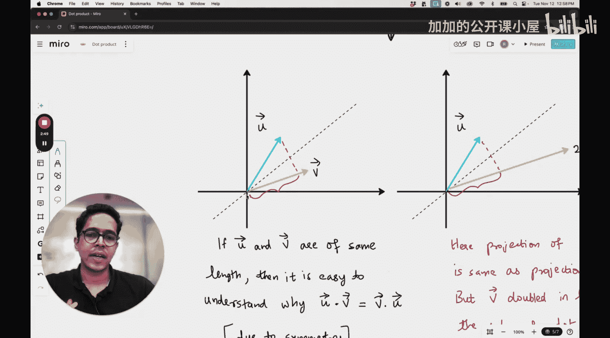

# Vizuara【中英⚡机器学习基础｜Foundations for Machine Learning】 p10 P10 Foundations for ML ｜ Linear Algebra ｜ Relation between dot product and trans [BV1wosSzREF7_p10]

🎼Yeah。

Hi， welcome back to the course Foundations for Maine Learning。

We are continuing to learn mathematical foundations for machine learning and that is linear algebra。

In this lecture， we will look at how dot product relates with linear transformation。

In all the past lectures we have been learning about linear transformations。

 how matrix multiplication is a linear transformation。

 how you can use matrix to matrix multiplication as a composite linear transformation。

 and how we can use matrix to vector multiplication as a linear transformation of a vector， etc。

And today， specifically， we will be looking at dot products。So we know dot products numerically。

If this is one vector。In our notation， whenever we see one column it is a vector。

 if it's one row or if it' is like a matrix it a its a transformation so here you have two vectors one23 and 321 and the dot product you know how to calculate1 times 3 plus2 times 2 plus3 times1。

In this case， it's 3 plus4 plus three，6 plus4，10。So the result of this dot product numerically。

Is a scalar， so dot product takes two vectors and it converts it into a scalar。

We have we also know that dot product is nothing but projection of one vector onto another。

So if in the 2D space， you have a vector U and vector V。

You can think of dot product as first taking a projection of U onto v。

 let's say something I mean v onto U so the projection of v on U is this part and then multiplying that whatever is the length of that with U and converting that into a number。

But we also know that this also works in the other way。

 you can instead of taking the projection of V onto you。You can also take the projection of U onto v。

 so you will get this and then multiply that whatever is that length with v and take the scar value。

 the magnitude of the resulting number。So we know that you can project V onto U or U onto V for this purpose。

But。Why does the order of projection does not matter have you thought about that。

 why do you think if you take U onto V or V onto U？

Why does it not matter geometrically mathematically it iss easy to show。

 but geometrically why does this not matter？We can think of it like this。

 consider two vectors U and V and think that they both have the same length。

But they are pointing in two different directions like this， but they have the same length。

So there is great deal of symmetry here and you can draw a line exactly between those two vectors like this so you can think of we we as something that is true。

😊。

