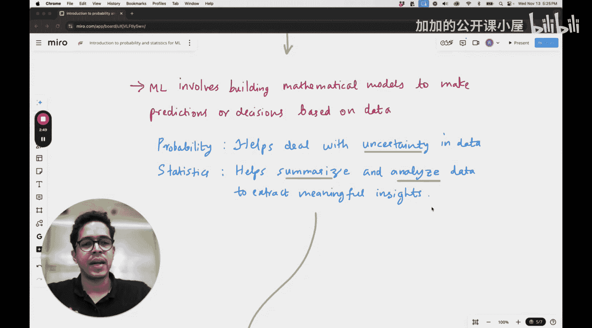

# Vizuara【中英⚡机器学习基础｜Foundations for Machine Learning】 p12 P12 Foundations for Machine Learning ｜ Probability and Statistics ｜ An introduct [BV1wosSzREF7_p12]

Hi， welcome back to the course Foundations for Ma learning。

 we are continuing to learn some mathematical foundations， however。

 today is a fresh start because today we are going to start probability and statistics for machine learning。

So this is an introductory lecture to probability and statistics。

And the ultimate goal is that when it comes to learning machine learning or data science。

 you should be very comfortable with the terms with the mathematics and with the logic behind probability and statistics。

 so let's get into that。So first of all， ML。As you might have probably realized。

 it involves a lot of probability and statistics because you are building mathematical models to make predictions based on the available data。

Sometimes you have to take decisions based on this an example of a decision is let's say you have a AI based spam email classifier。

The AI has to take a decision whether something has to be put as a spam or not spam。

 It's very binary。But to make that prediction or to make that decision it' is using some mathematical model。

 it's collecting some data from the email that is coming into your email and then the spam filter will automatically decide whether something is a spam or not。

So the reason why probability and statistics is very important in machine learning。

 probably the most important concepts in machine learning is because。

It is not enough that you simply make a decision in ML。

Often for people to trust machine learning models， you also have to show some degree of uncertainty that you have in your predictions and probability is basically that branch of mathematics or that area of math that deals with the uncertainty in data。

And what statistics help you is when you have a huge data set。

 statistics help you analyze and summarize this data and extract meaningful insights because as humans。

 we cannot process。Dozens of data even， let alone thousands or 100。

000 data points that you typically see in machine learning。

So you cannot process the data unless it is described in a summarized fashion。

So statistics help you do this。So in this lecture we'll be learning very basic things about probability and statistics it's nothing complicated so you can stay with me throughout the lecture and as we progress in the next four to five lectures we will learn little bit more complicated complex ideas within probability and statistics especially in the context of what is useful for machine learning of course we be we not be learning all the things about probability it's a very very big and difficult topic if you have learned。

