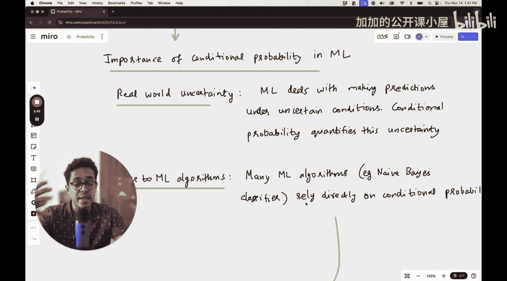

# Vizuara【中英⚡机器学习基础｜Foundations for Machine Learning】 p13 P13 Foundations for Machine Learning ｜ Conditional probability ｜ Probability & S [BV1wosSzREF7_p13]

🎼。

Hi， welcome back to the course Foundations for machinech learning we are continuing to learn some mathematical foundations in this lecture we will look at some fundamentals of probability that you need to be aware of if you want to become a serious machine learning engineer。

😊，This lecture is aimed specifically for beginners。

 so some of the concepts if you are very familiar with probability， you will find very trivial。

 but if you are a beginner or if you are learning for the first time you will definitely enjoy this so let's try to understand some basic concepts without going into the extreme details of probability which we may not need when we are further going ahead and learning machine learning。

So。First I want to emphasize on the fact that two most important things that are needed in machine learning is conditional probability and base theorem so when we say fundamentals of probability will be focusing primarily on conditional probability and well be diving deep into base theorem it's a little bit confusing when I learned base theorem for the first time it was although the equation was very simple the physical intuition behind that。

Mapping that intuition with the equation was always very confusing and whenever some problems were asked。

 it almost always caused confusion。I did not feel very comfortable while learning base theorem for the first time。

 but as the intuition grew deeper， I realized there are easier ways to think about and understand base theorem so I'll try my best to kind of transfer that idea to you。

😊，So let's do a quick recap， a probability of an event E P of E is the number of favorable outcomes divided by total number of outcomes。

 so if the experiment that we are performing is rolling a dice and if the event is described as the occurrence of number four。

😊，Then， the。The space， the entire experimental space is 1，2，3，4。

56 and the event space has only four as the number。

 so it's basically this space length of the space divided by the length of the actual entire space of outcomes so it's one divided by6。

 so these are some formalities but this is a fairly easy thing to even understand probability for any given number when you are rolling a normal dice is one by6。

😊，This is the quick recap， we don't want to go into it any further because these are simple mathematical definitions。

😊，Now， where is probability exactly used in machine learning， especially conditional probability？😊。

This occurs almost always because in real world there is uncertainty。

If you have data set about an email， let's say the words or the text contained within the email and you want to perform a classification based on the text。

