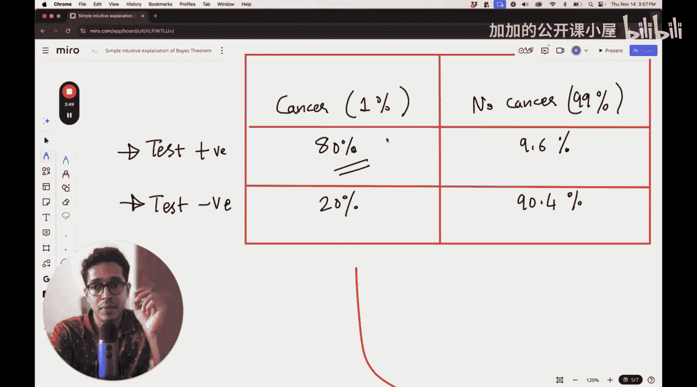

# Vizuara【中英⚡机器学习基础｜Foundations for Machine Learning】 p14 P14 Foundations for Machine Learning ｜ Bayes Theorem - Intuition and basics [Lec [BV1wosSzREF7_p14]

Hi， welcome to this lecture on base theorem here we will try to develop a very simple intuitive understanding of what exactly this theorem is trying to say。

😊，And in this lecture， I'll also try to set up the mathematical description of this theorem。

 but well focus more on what is the logical intuition behind it。😊，So。Let's take an example。😊，Where。

We are looking at cases of breast cancer in women。So let's say the data is something like 1% of women have breast cancer。

 this data may not be accurate， but let's not consider that for a moment。

 let's just focus on the idea being conveyed here so if 1% of the women have breast cancer there is something called mammogram it's like you take X-ray of the breast and you can see the occurrence of brain of breast cancer in the chest Xray in the breast xray so let's say in this mammogram 80% of the times you can detect breast cancer if it is there。

Which means in 20% of the cases when breast cancer is present。

 you cannot detect it right the mammogram will not identify that there is breast cancer in 20% of the cases thats what that is also one of the things that this second statement is saying。

And the third one says 9。6 percentage of mammograms detect breast cancer when it is not there。

 so these are also called false positives， because you are saying that yes， there is breast cancer。

 but it's a false information， so these are this 9。

6 percentage of the cases of mammogram can give you false positives。

So what is actually the remaining cases in？90。Pscent 90 point。Four percentage of the cases。

 you can have a mammogram。Detect breast cancer。And it to be actually there right that's what that's also what this third statement says now let's put all of this into a table format so that you can easily understand right so we have first column corresponding to cancer second column corresponding to no cancer so one% of the chance there is one% chance that women can have cancer breast cancer so that is one person written here and 99% chance that they do not have cancer now the first row what it says is。

😊，If someone is being tested positive for breast cancer。There is 80 percentage chance that。

If someone has cancer， 80% chance that the mammogram will test positive， but if someone has cancer。

 there is 20% chance that someone will not test positive， meaning someone will test negative。

 that's what the mammogram accuracy said right in 80% of the cases when someone has cancer mammogram will detect。

 meaning if in 20% of the case when someone has cancer。

