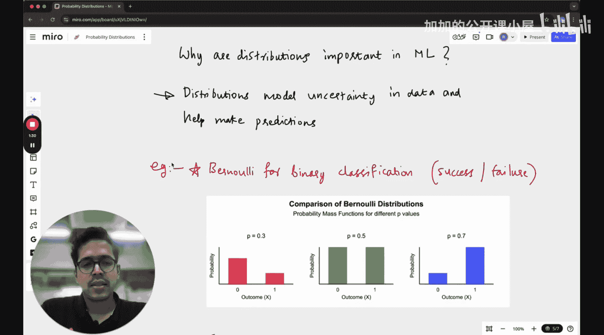

# Vizuara【中英⚡机器学习基础｜Foundations for Machine Learning】 p15 P15 Foundations for Machine Learning ｜ Probability Distributions [Lecture 14] [BV1wosSzREF7_p15]

🎼Yeah。

Hi， welcome back to the course Introduction to Maine Learning in Julia。

In the current module on probability and statistics。

 we earlier learned a little bit about the basics of statistics and a little bit about the basics of probability。

But in this particular lecture， we'll be talking about probability distributions。

This lecture starts pretty much from scratch， so even if you know nothing about anything that is being covered in this lecture。

 don't worry， you will still be able to follow through。

This lecture is part of our foundation building ML for ML activity。

 so with each lecture that you finish you are progressing one step closer to mastering the foundations for machine learning。

 so welcome to the lecture。So probability distribution is nothing but if you have bunch of possible outcomes for a random variable。

The probability distribution describes how the probabilities are distributed over those possible outcomes。

This distribution itself can be discrete or continuous。

A discrete distribution can look something like this。

 so if there are specific countable outcomes as a result of an experiment。

Then the outcome probability distribution will be discrete。For example。

 if you are tossing a coin 10 times。Then you have different possibilities。

 you could get zero tails and all heads， you could get all heads and you could get all tails and zero heads。

You could also get something in between so the possible number of heads or possible number of tails that you can get are discrete。

 it can be any number between 0 and 10 and there is a distribution。

So that will be discrete on the other hand some probability distributions are continuous or at least can be drawn or considered to be continuous for all practical purposes and we'll be seeing some of that also today。

So the idea behind probability distribution is that if。If a particular experiment is conducted。

 there are certain outcomes that are more probable and certain outcomes that are less probable and probability distribution gives you a basic idea about that and these distributions are very important in machine learning especially which is the whole reason why we are learning that because distributions model uncertainty in data and they help us make predictions。

For example， consider this one called Bnoulli distribution for binary classification。

 it determines the success or failure of a particular let's say a particular experiment or it could be true or false for a particular case so one of the papers that we had recently published on。

嗯。Bs in large language models was about the probability for the。

