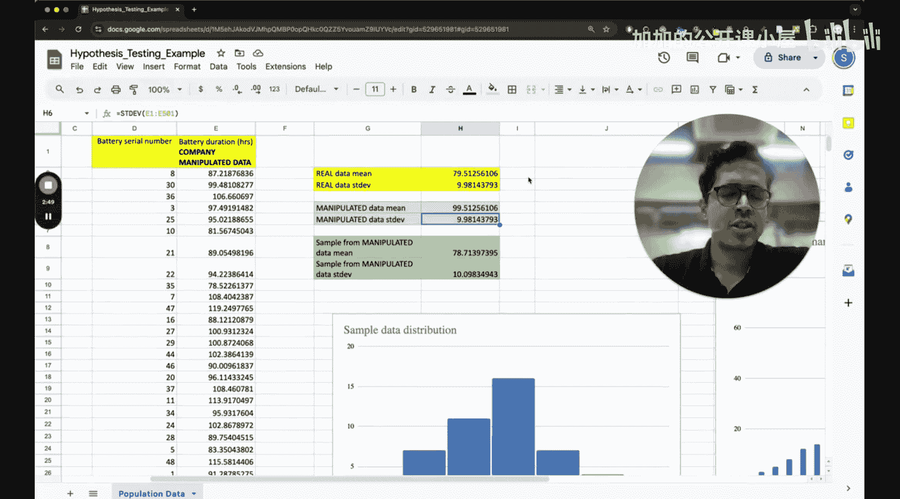

# Vizuara【中英⚡机器学习基础｜Foundations for Machine Learning】 p16 P16 Foundations for Machine Learning ｜ Null & Alternate hypothesis in probabilit [BV1wosSzREF7_p16]

Hi， welcome to this lecture on hypothesis testing and confidence intervals this is a fascinating topic。

 although the title does not seem so。And this is a very important concept。

 not just within machine learning in the entirety of data analysis。So。

I want to make this lecture into kind of like a standalone lecture for because of his nature。

 you don't need too many prerequisites to understand what is being discussed in this lecture。But yet。

 this lecture is again part of the foundations for machine learning course。

 especially where we are currently covering statistics and probability for ML。

So before going into the mathematical details of this lecture， I want to show you a simple case。So。

 let's say。There is a company who is manufacturing batteries。

And say they have manufactured 500 batteries。And they tested the average。嗯。

Battery capacity in terms of number of hours， like how many hours can their battery last？

Now this could be an electric vehicle like a car battery manufacturer right and it's very important for their battery life to be as high as possible。

no。This company， let's say for some reason they did not get you know they did not get to make very good batteries。

 so their actual battery data， battery duration data。

 it may look something like this so here you have battery serial numbers ranging from  one to 500 and1 to 500。

So the serial number is in the first column， the second column is the battery duration in our。

This is the real data that this company， let's say collected from their own experiments and in this real data they have let's say a mean of 79。

5 meaning roughly 80 hours the battery can last only 80 hours and standard deviation the real standard deviation is 10 hours so 80 plus or minus 10 hours roughly right？

Now， the problem with this data is that let's say the company was aiming to produce cars whose average life duration is 10100。

So this this company is conducting some fraud， what is their fraud。

 what they are going to do is they create some manipulated data。

And the manipulation that they have done is to every single number here。😊。

To the every single actual data they added a number of 20 so here in this Excel sheet I have added 20 to 67 to make it 87。

 20 to 79 to make it 99， 20 to 86 to make it 106 such that。😊。

The manipulated mean value for battery duration now is close to 199。

5 standard deviation remains the same so now instead of the battery life being 80 plus or minus 10 now it became 100 plus or minus 10 but this is manipulated。

