# Vizuara【中英⚡机器学习基础｜Foundations for Machine Learning】 p17 P17 Foundations for ML ｜ Naive-Bayes classification, ML model evaluation ｜ confu [BV1wosSzREF7_p17]

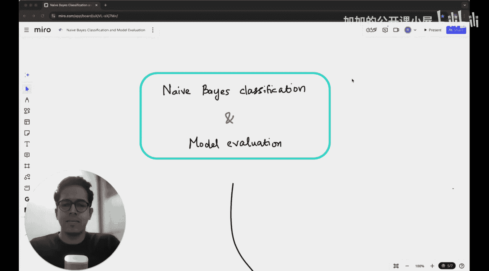

Hi， welcome to a new lecture on NIive basedase classification and model evaluation。

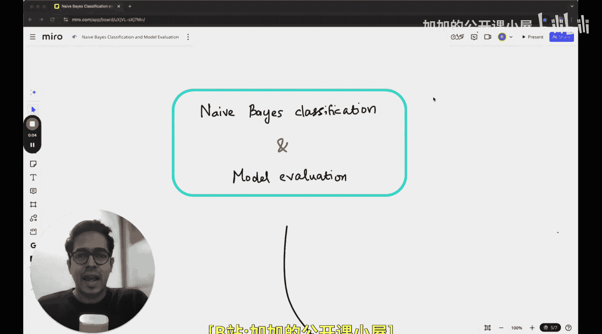

These two topics are very， very common when you work with machine learning or data science related projects。

Although in this course， we have not yet discussed even a single thing about machine learning models or details about。

Moel evaluation this lecture will give you a brief idea about what you can expect once we start learning about machine learning models。

 different classification approaches and approaches for evaluating the efficacy of a model。😊。

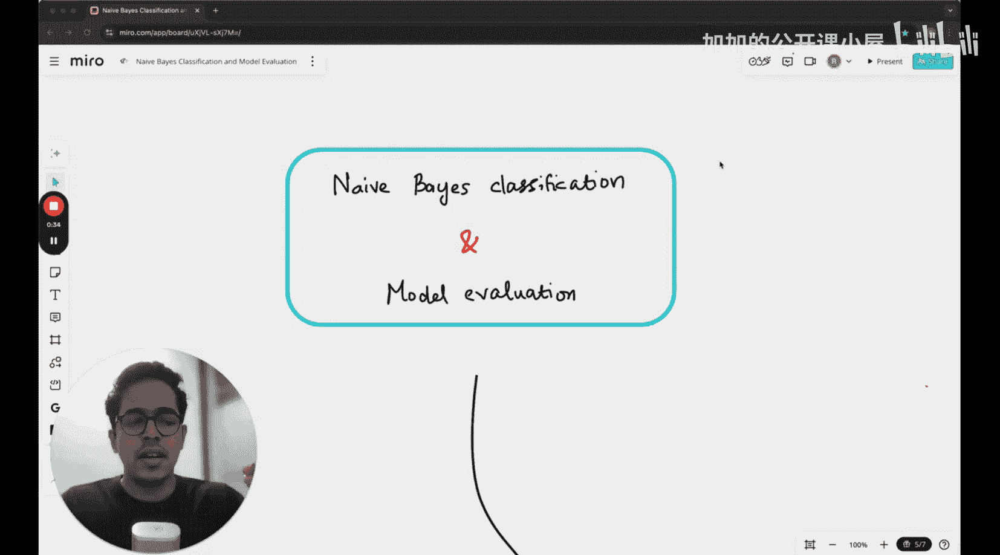

In the past two lectures， we looked ative based we looked at base theorem and we also looked at hypothesis。

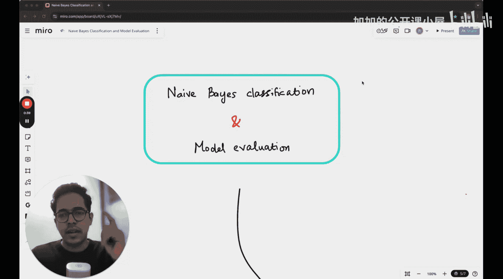

Testing。So in this particular lecture， we will be looking at a particular classifier called Nive based classifier。

😊。

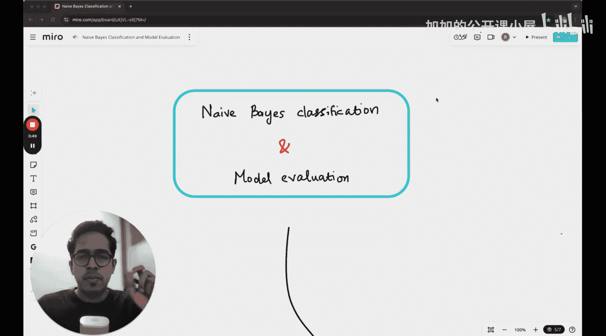

So the lecture is divided into two parts in the first part we'll be looking at some theory and some well perform some hand calculations in the naV based classification so we'll discuss some foundational concepts what are the underlying assumption of naIV based classifier and we'll implement a classifier step by step specifically for the context of email spam classification in one of the earlier lectures we looked at classifying an email based on whether the word called Nigerian prints is present in the email or not but today we'll be looking at it slightly different example instead of looking at one set of word we'll be looking at two separate words。

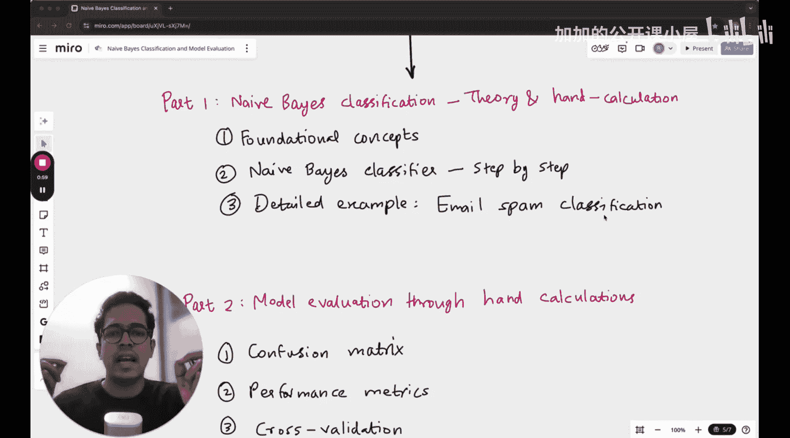

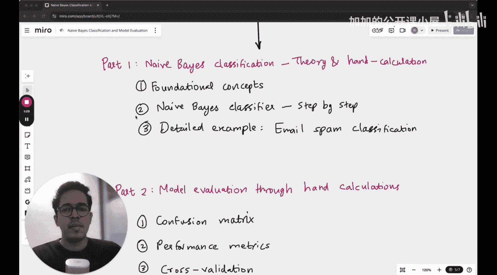

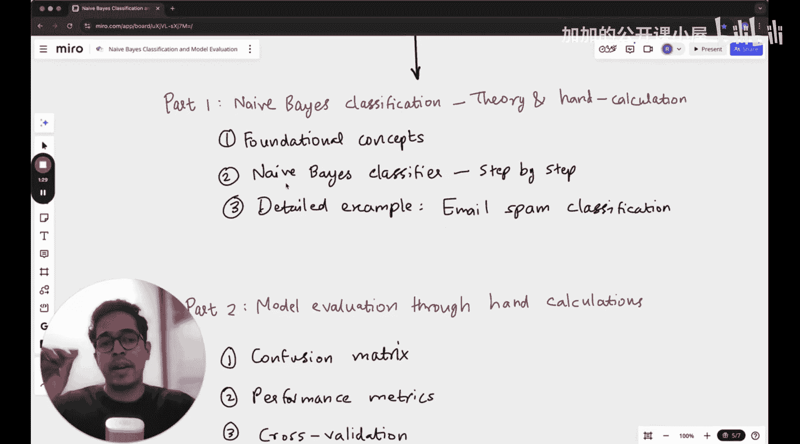

In the second part of model evaluation we'll be discussing about Con matrix we'll be looking at performance metricsrices like F1 score accuracy precision。

 recall， etc， which are bread and butter of data scientists and machine learning engineers we'll be talking a little bit about cross validation and also about statistical significance if you don't know what exactly these terms mean don't worry just go through the lecture if you simply listen to this lecture and if you perform some hand calculations on the side along with me I'm sure you will understand the lecture pretty much1 hundred0 percentage so let's get into it。

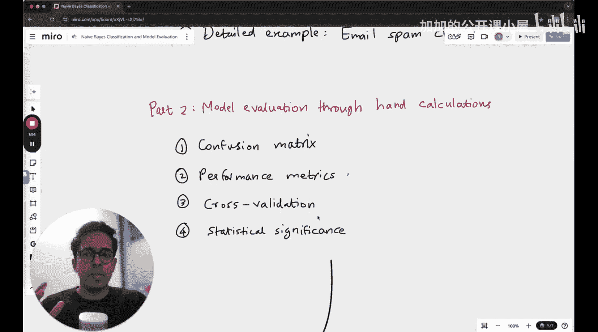

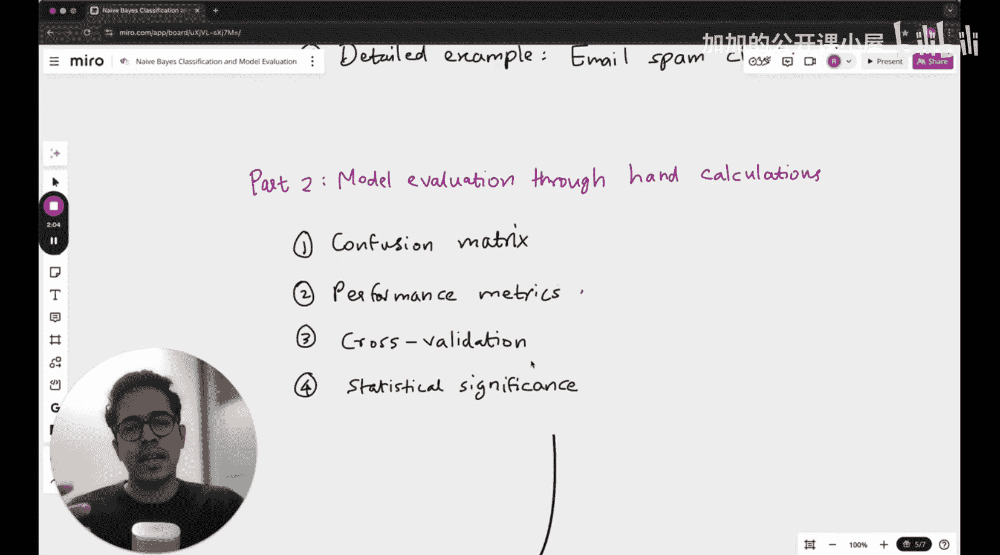

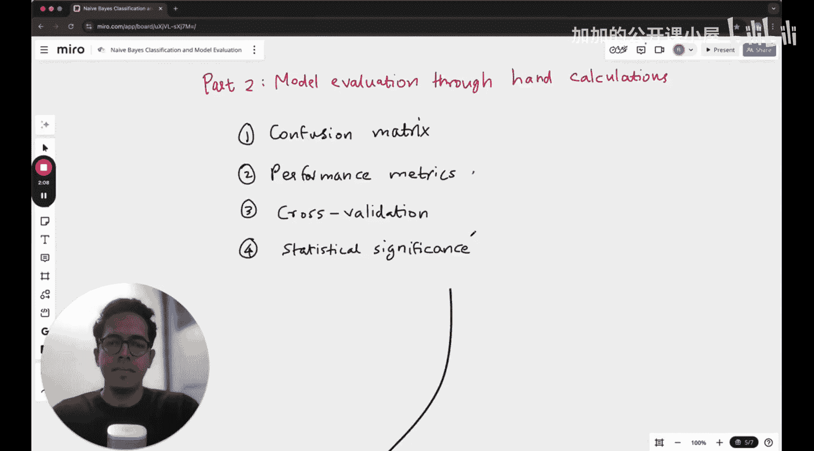

So classification as a concept is simply assigning a given item into one of the two or one of the many categories。

 a binary classifier classifies whatever is given into one of the two classes right let's say you are classifying an image as cat or dog。

 cat or dog classifier is a binary classifier。

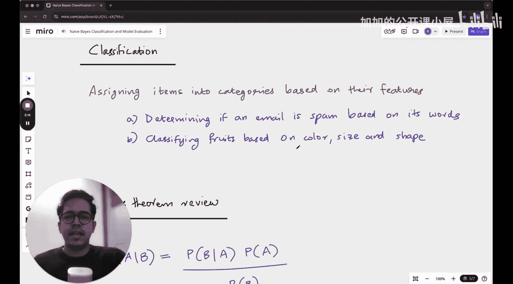

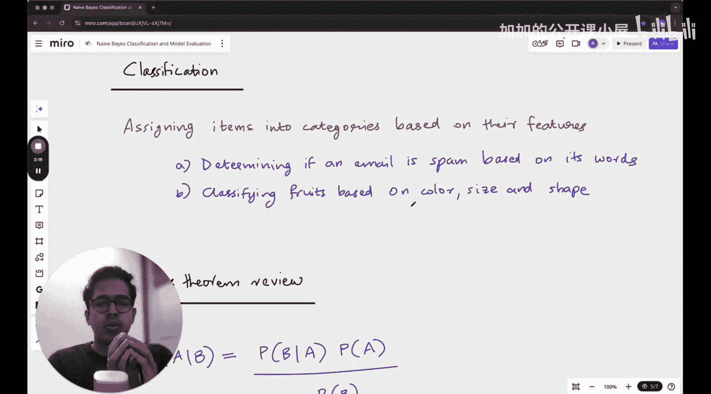

Sam or not spam is a binary classifier。M list data set is there that' is very famous it classifies handwritten digits into one of the 10 classes0 to 9。

 so these are all classification models and in this context the base theorem has so much significance because today we are talking we'll be talking about naive based classifier so well be classifying an email into spam or not spam and for that we'll be using that。

😊。

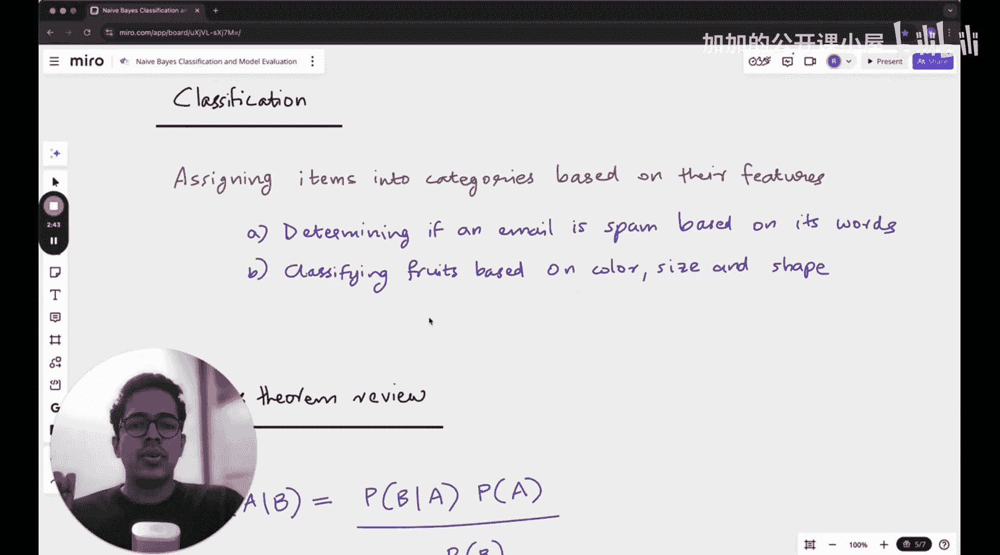

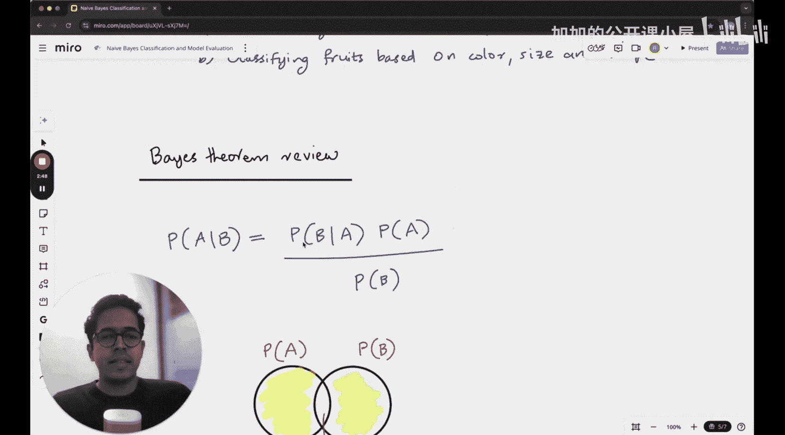

