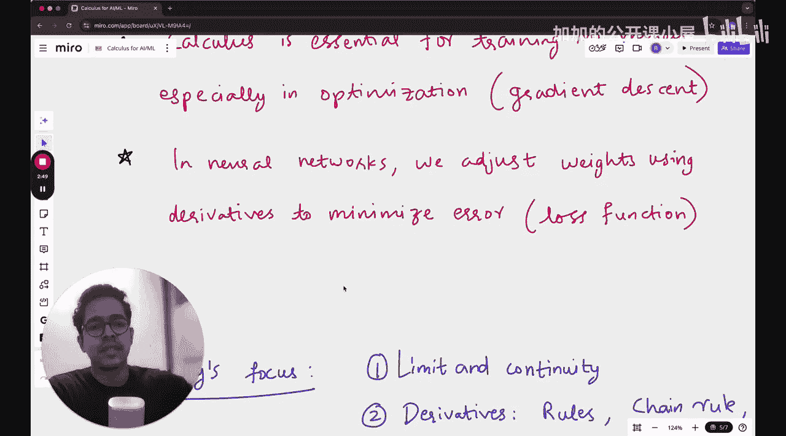

# Vizuara【中英⚡机器学习基础｜Foundations for Machine Learning】 p18 P18 Introduction to Calculus for Machine Learning ｜ Foundations for ML [Lecture [BV1wosSzREF7_p18]

Hi， welcome to a fresh module on calculus for AIML。

We are building the foundations for machine learning and today we are starting with learning calculus。

In the previous module we had looked at linear algebrabra statistics and probability and here comes the most exciting and personally my favorite part calculus。

This lecture is going to be fairly easy if you are familiar with calculus。

 especially derivatives and concepts like continuity。

 so if that is the case feel free to skip the lecture no no worries but if you want to stay with me in the lecture and if you already know the concept consider this as a refresher。

😊，Otherwise， if you are learning about calculus for the first time I'm sure youre going to enjoy。

 you will enjoy regardless so in back propagation in machine learning you know neural network models。

 one of the things that you often use is chain root。😊。

And once I was building a neural network from scratch and I wanted to define the function that。

Dictates the。Change in weights for every back propagation event。

And I was having a very hard time defining the function in terms of the weights itself and in terms of the input to the neural network because I had like a softmax activation function at the end of the neural network。

 so it was a bit tricky to define the partial derivative in that case。So I just want。

 I'm just saying this because the importance of calculus in neural network and in machine learning overall。

😊，You will you will get to appreciate it only once you start doing complex things up until that point you will not feel like。

You need such a strong hold on calculus， but believe me when I say this。

 if you have a strong hold on calculus it will make your life much more easier down the line so let's start today's lecture with very simple terms and this lecture is going to be like a cake for you if you are familiar with calculus。

So calculus is that branch of mathematics which focuses on accumulation or rate of change。

 accumulation is usually calculated using integral calculus。

 the rate of change using differential calculus and this is very important in optimization algorithms。

😊，In back propagation， everything， basically it is one of the mathematical foundation blocks in AIML。

If you have heard of gradient descent， I would say that calculus is probably the most important thing that you have to learn from math to perform gradient descent or even to implement it from scratch。

And there is something called adjustment of weights in neural networks so you start with random weights and you adjust the values of these weights based on how far off your neural network predictions are compared to actual values it is supposed to predict。

