# Vizuara【中英⚡机器学习基础｜Foundations for Machine Learning】 p20 P20 Integral calculus for Machine Learning ｜ Mathematical foundations for ML  [L [BV1wosSzREF7_p20]

Hi， welcome back to another lecture on foundations for machine learning。

This is the start of a new module， we are starting integration for machine learning from this lecture onwards。

Today particularly well be looking at three things， definite integral， indefinite integral。

 and fundamental theorem of calculus。😊。

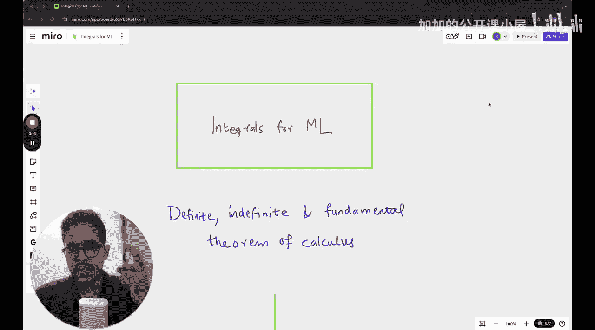

Most of the concepts that are going to be discussed in this lecture will be fairly straightforward if you have learned integral calculus I'm pretty sure you will find the content of this lecture fairly straightforward and easy so if you are very confident that you don't want to kind of have a refresher because your integral fundamentals are very strong then feel free to skip this lecture otherwise this lecture will be relatively short and it will serve as a refresher for you before you proceed with the next lecture。

So。Derivatives， which we have been learning in the course in the past few lectures。

 is nothing but a measure of。

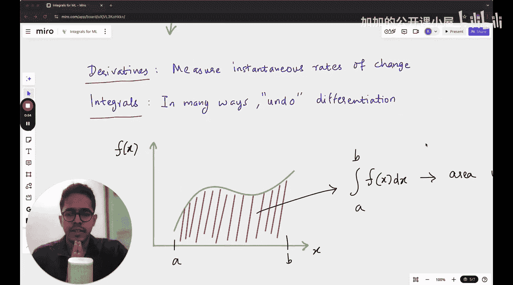

Change， right， the rate of change。We are measuring the change at a particular instant。

 the rate of change at a particular instant when we say that we are taking the derivative of a function。

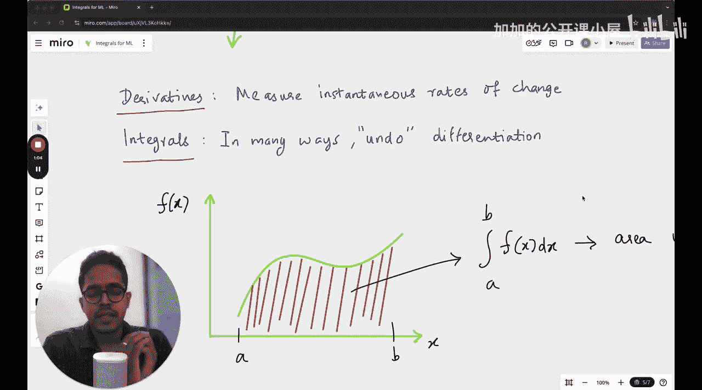

Integration， as you would already know， it is kind of a reverse process of differentiation。

 so whatever differentiation is doing it's kind of undoing。

So integration you might be already familiar with。

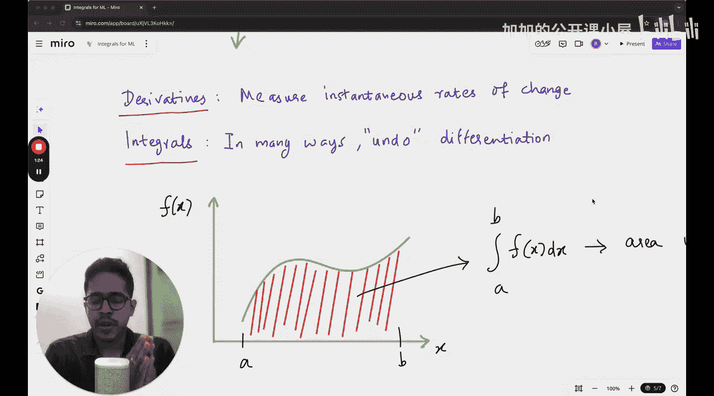

Is synonymous to finding the area under a curve if you are integrating a function from a point A to point B。

 then integral of that function from point A to point B is nothing but area under the curve。

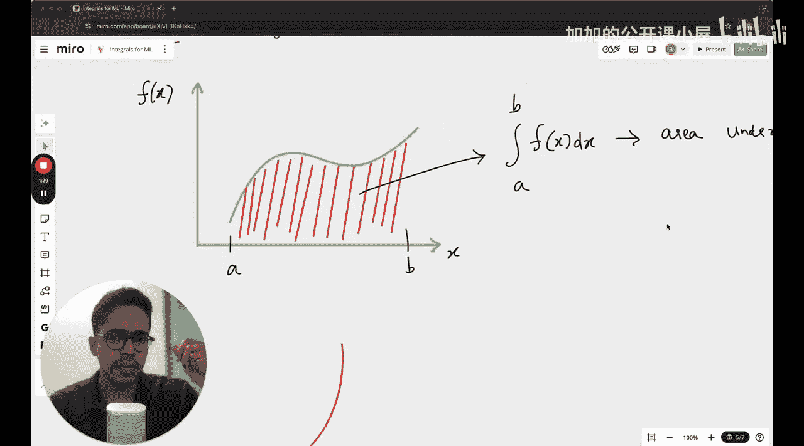

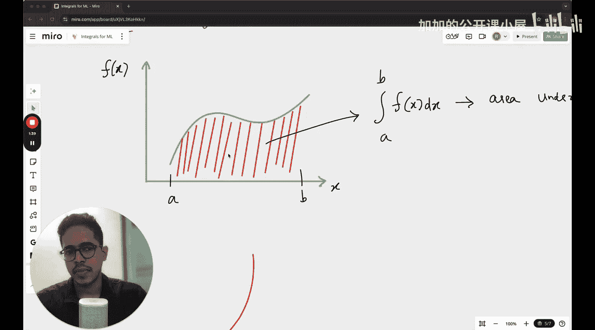

And its denoted by integral， this symbol is integral A to B F of X Bx。

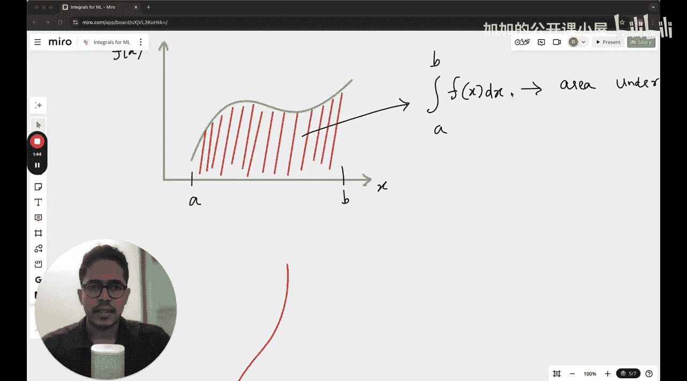

You might have heard of something called Ryman sum。In Raymanam， you can。Represent。

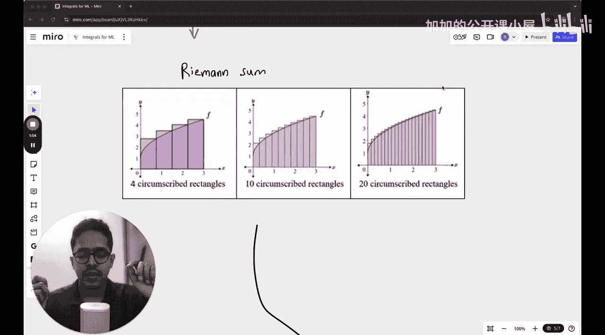

Area under a curve。Using summation of areas of certain rectangles。

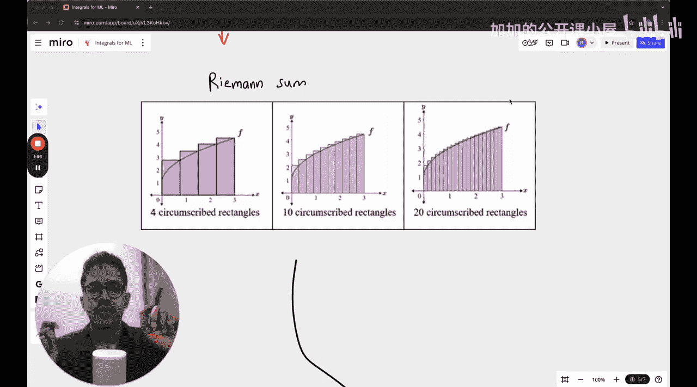

So imagine that in these three cases， the curve is the same， it's the exact same equation。

 but in the first case you have four rectangles。

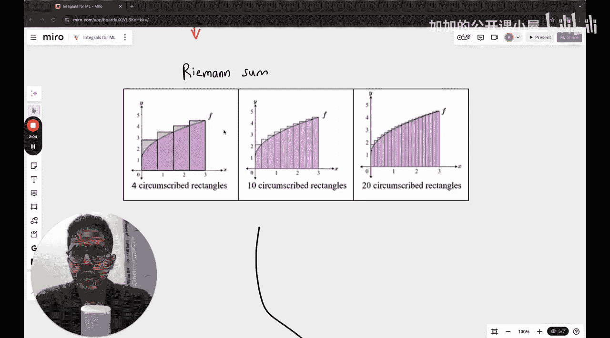

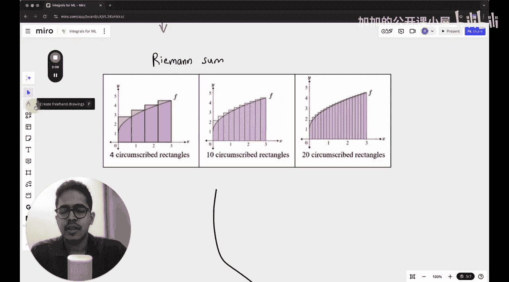

To represent sort of the area under the curve in this case， you have  one，2， three，4，56，7，8， nine。

 10 and I guess in this case maybe you have 20 I don't know exactly， but it looks like so。

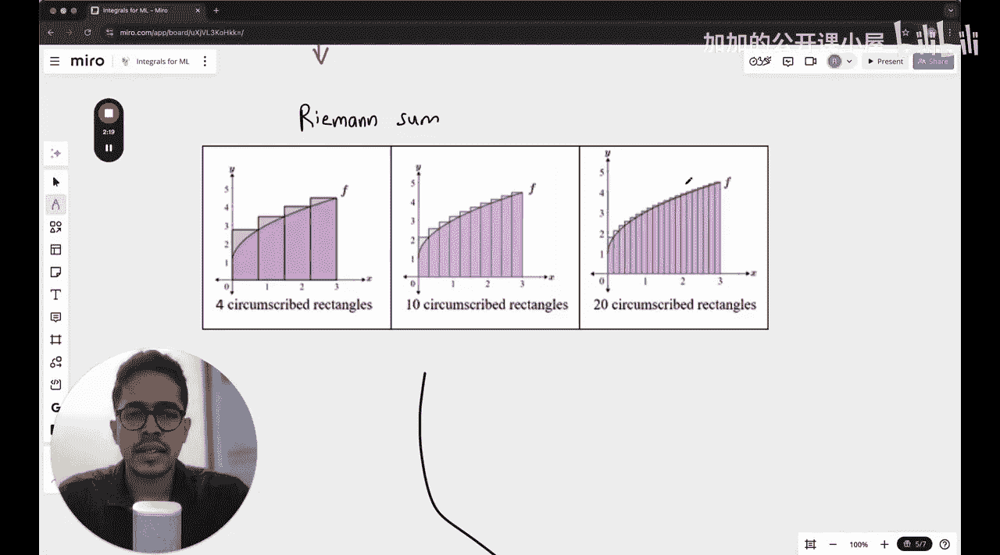

And here you can see that the rectangle， if you add the areas of the rectangle。

 you are always overestimating the area under the curve， it is true in this case。

 it' is also true in this case， but you can see that in this particular case the extent of overestimation is the sum of these gray areas。

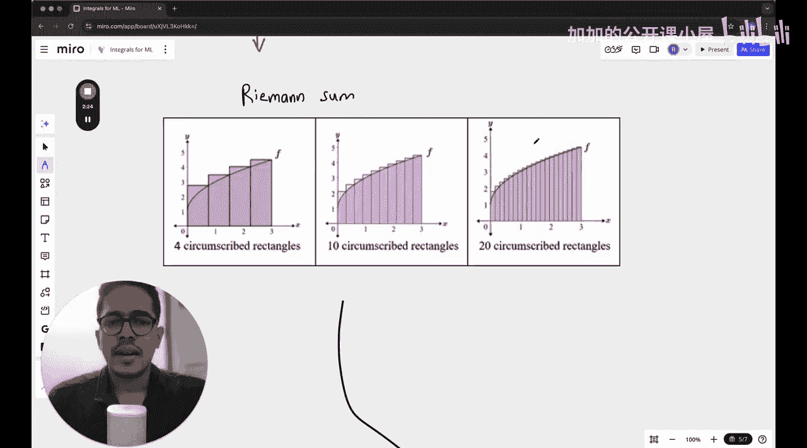

If you add all those。

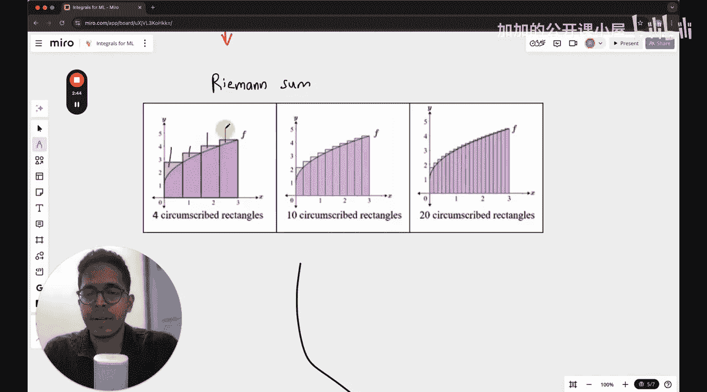

Basically， that much， you are overestimating the area under the curve。

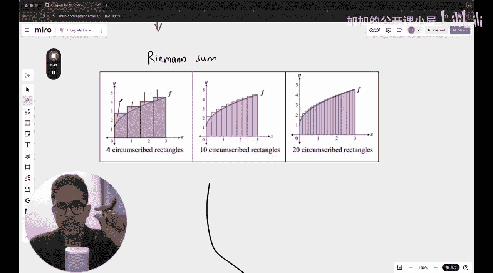

But here you can see that the the extent of overestimation has reduced because the areas of these。

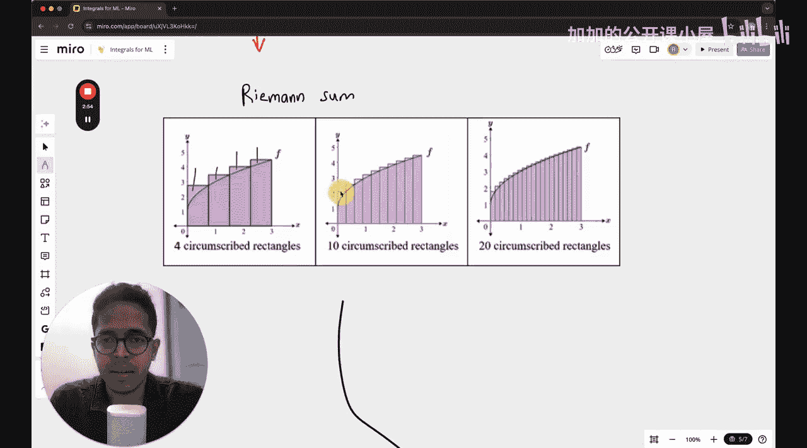