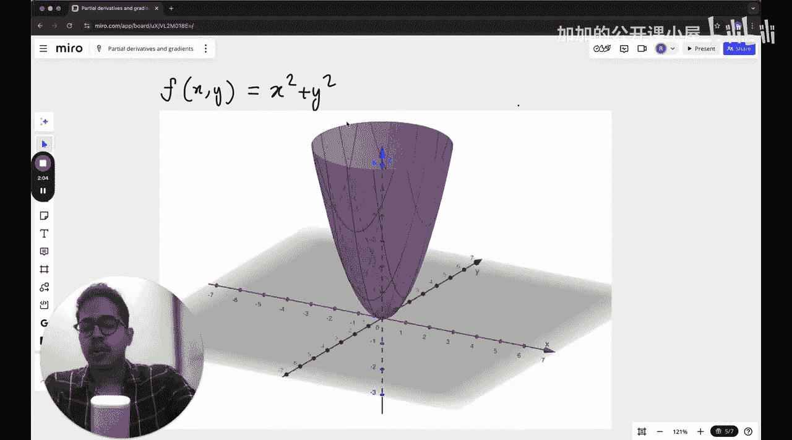
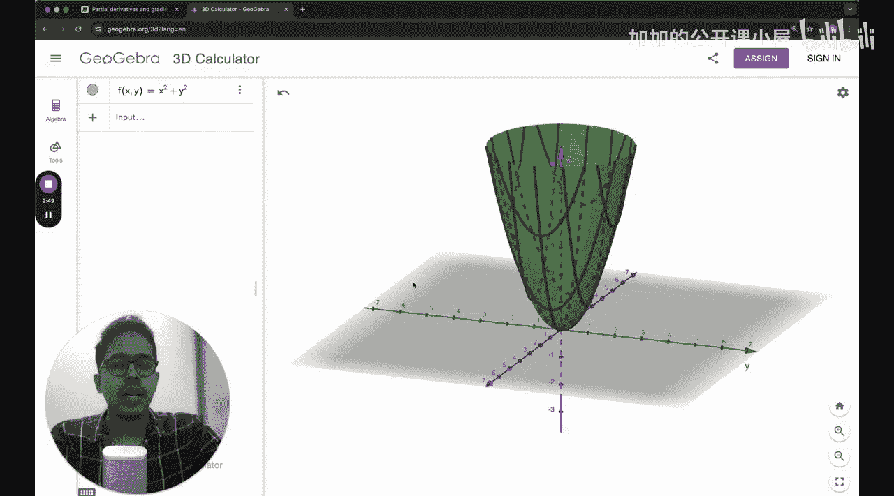

# Vizuara【中英⚡机器学习基础｜Foundations for Machine Learning】 p21 P21 Partial Derivatives and Gradient Descent： The Engine Driving ML ｜ ML foundat [BV1wosSzREF7_p21]

🎼。

Hi welcome back to the Calalculus module for machine learning in this lecture we'll be looking at partial derivatives and gradients which form one of the foundations for machine learning。

😊，So this module is again part of the course foundations for machine learning and specifically in this lecture we'll be looking at multivariable functions。

 partial derivatives， gradients， and then finally how all of this connects to optimization。

 which is one of the corneral stones of machine learning model training。

So most of the real functions that you come across will not be too simplistic it won't be just f of x in real life there will be multiple independent variables which will。

Cast the value of the function to be something so in reality there will be x ys and etctera。

 etc cetera， etc cea， so these are functions with multiple variables so it's called multi variable functions。

 it won't be as simple as fx。So some actual examples are if you are talking about temperature in this room。

 it will vary depending on exact location， temperature won't be evenly distributed throughout there will be minor variation closer to wall the temperature might approach something more closer to the middle of the room it might be something else closer to let's say the vent of the AC it might be something else etc。

 so it depends on the coordinates x Y Z so you can clot the temperature as a function of X Y Z3 parameters in machine learning for example in neural networks which consists of weights and biases。

 the cost function which is also called as the loss function it depends on all the parameters so if there are。

500 weights， the cost or loss is a function of all these 500 parameters。

 If there are another 500 biases， it will also be added to this。

 So this is what is called as the a function which depends on multiple variables and here is a very。

Probably the simplest example， f of x comma y equal to x square plus y squared。

It looks like a parabola。 You can plot this using geo Gbra， so just go to。

嗯。Gogibra 3 d plotting， and there is a 3 d graphing module here， which is really cool。

 so you can literally type in。

Literally type in whatever you want， so it's not this 3 d graphing it is this 3 d calculator and here you can enter f of x equal to x square。

Plus y square。And I think we here we have to add f of x comma y yeah so now this is actually a 3D interactive graph and here the value of the function depends on two variables x and y and because it symmetrically depends on x and y equally the graph look like a very symmetric。

Paarabolic curve。