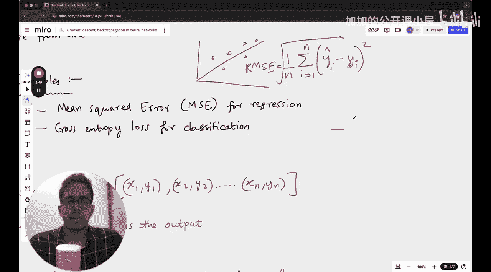

# Vizuara【中英⚡机器学习基础｜Foundations for Machine Learning】 p22 P22 Gradient descent in machine learning  [Lecture 21] [BV1wosSzREF7_p22]

🎼Yeah。

Hi， welcome to one of the most important and my favorite topic within the entirety of A。

 gradient descent and back propagation。In today's lecture。

 we'll be looking at what exactly is the cost or loss function which is often used in ML and literally minimizing this is the entire purpose of machine learning models。

How gradient descent is used to minimize this loss。

 we will also be looking at what exactly is gradient descent。

We'll be trying to understand bad propagation in neural networks and finally some practical considerations like when will you get stuck if you are trying to minimize loss function。

 when will you get stuck in a maximma or when will you get stuck in a minima you will not get stuck in the maxma but you will get stuck in a minima so we'll be looking at all of these in this lecture and this lecture is part of the courses foundations for machine learning so I welcome you to the lecture Leer。

😊，So firstly， the concept of loss function is fairly straightforward in machine learning you have a desired outcome。

 let's say if you are building a classification model or if you are building a regression linear regression model。

You have a target， and you want to。Have the model predict some number which is as close to the target as possible。

 but the problem is you just don't have one single input and one output。

 you have maybe 100 inputs and corresponding 10 outputs so now how do you make sure that your model which is either a line or which is like a hyperplane in in the case of neural network how will this make a prediction which will minimize your let's say minimize your distance from the actual value compared to what you have predicted so this is defined using loss function so loss function measures how far away your model's predictions are from the actual true values。

And I'll come to explaining the loss function in fairly good detail， but let's。

Take a moment to kind of discuss the kind of terminologies which are used for quantifying the loss。

 so mean squared error is nothing but square average of square of all the losses。

 so in linear regression。If these are if this straight line is your model and if these are your data points。

 then mean squared error is nothing but sigma i equal to 1 to n if you have n number of points。

 y predicted minus y actual。The I1，8 predicted y minus8 actual y。Squired divided by n。

 So this is the MSE。And if you put a square root to this， this will become root means square error。

So that is the one use for regression and for classification。

 it is something called as cross entropy loss so that you can define as minus Yi。Minus sigma Y I。

hellen。😊。