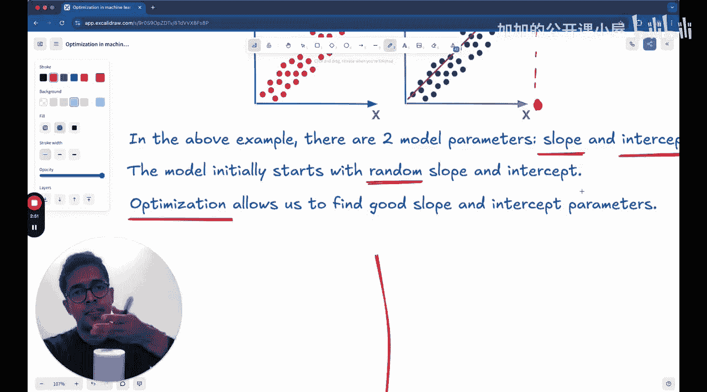

# Vizuara【中英⚡机器学习基础｜Foundations for Machine Learning】 p23 P23 Introduction to Optimization for Machine Learning [Lecture 22] [BV1wosSzREF7_p23]

Hi welcome to the start of a new module optimizationim for Ma learning this lecture is part of the course foundations for machine learning and today we'll be looking at optimization specifically gradient descent so the lecture is divided into two parts in the first part we'll be looking at the theory what exactly does optimizationim mean and what are we optimizing for and in the second part we'll be implementing gradient descent from scratch so welcome to the lecture。

So in the structure of the lecture， as I mentioned。

 we'll be introducing the concept of optimization itself。

What is the mathematical implication for when we say that we are optimizing for a certain parameter？

What exactly is a loss function or cost function？What is gradient descent。

 which is probably the single biggest concept that you have to be familiar with if you want to become a serious machine learning engineer？

And what are some issues with the traditional gradient descent approach we'll be discussing all of that in this lecture。

So。Let's look at a very simple machine learning model。

 which we have discussed before linear regression。😊，In linear regression。

These dots are the data points。And what we are trying to do is we are trying to fit a model which is the best representation of this data so that if you are asked to make a prediction。

For input data， which is not part of the training data， so let's say for x equal to somewhere here。

 if you are asked what is the corresponding y value？

A model which is this straight line fit through the data points as a result of linear regression can make that prediction。

 so you will say that if you want to make a prediction what is the value of the variable y which is the output when the input x is equal to something like this then all you need to do is like follow the straight line and if the straight line is extended something like this let me reduce the thickness。

Then all you need to do is like where is the corresponding y value？呃。Showing。

 so you can say that for this particular x value。The corresponding y value is this and why is that because the model says so and what is the model the straight line？

And there are。Two parameters， if you assume that only you have one dimensional data here。

 there is only two parameters slope and interscept。So， the way。

The optimization in this particular context works is even though you start with a random value of slope and random value of intercept because you have no idea whether the data is passing through origin。

 whether the average value of the line that passes through the data passes through the origin or you don't know whether。

