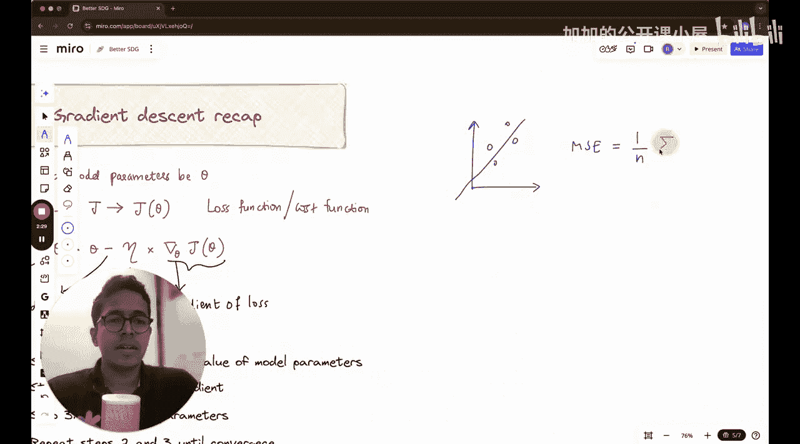

# Vizuara【中英⚡机器学习基础｜Foundations for Machine Learning】 p24 P24 Stochastic Gradient Descent from scratch ｜ Intro to Optimization ｜ Foundatio [BV1wosSzREF7_p24]

🎼。

系い。Welcome back to foundations for machine learning this is the start of a new module consisting of four lectures on ways to make gradient descent much better in machine learning。

 so specifically we'll be looking at something called stochastic gradient descent momentum。

 RMS Pro meaning root mean square propagation and atom optimizer which is probably the most famous optimization algorithm in the entire entirety of machine learning。

I initially thought of recording all these four into one single lecture but later decided that that might make the lecture too long。

 so I decided to split this and go into depth of each of these individual topics which are which gives you a fairly good intuition about why people thought of certain ways in which you can make the gradientcent gradient descent algorithm much better so we'll be looking at stochastic gradient descent in this lecture。

So I have divided the lecture into two parts in the first part I'll be discussing the theory of stochastic gradient descent and in the second part we'll be implementing this and we'll see why exactly stochastic gradient descent is better than the normal vanilla gradient descent the normal gradient descent is also called as batch gradient descent because you are。

Using the entire batch of data to decide by how much you should change the parameters。

Now you might be wondering okay I don't know what is gradient descent or should I follow this lecture or not。

 so don't worry we'll be doing a proper recap of the gradient descent itself in the first part of the lecture before moving into the stochastic gradient descent so let's get into the lecture。

So gradient descent is an algorithm for minimizing your loss function or cost function。

The loss function or cost function is an index of how far your predictions are if you have a machine learning model。

 how far away your predictions are compared to the real data so that is what the loss function is and in the last lecture we had discussed that if we have a linear regression then the loss function can be described as an average of so if these are the data points。

And if this is the straight line that describes the linear fit through these points。

 then loss function can be described using something called mean squared error and then mean square error is 1 by n where n is the number of points sigma i equal to 1 to n。

Times predicted value of y。So， it is written as y i cap minus actual value of y the whole square you can also write it as y minus y i cap y i minus y i cap the whole square。

 so this is called as mean squared error because there is square and is there is square of error and there is mean because you are doing summation and you are dividing by。

