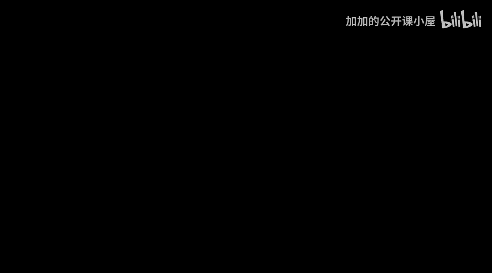

# Vizuara【中英⚡机器学习基础｜Foundations for Machine Learning】 p25 P25 Momentum-based gradient descent from scratch： optimization ｜ Foundations for [BV1wosSzREF7_p25]

🎼。

Hi， welcome to a new lecture in the module optimizationimization for Mach learninging。

 this module is part of the course's Foundations for Ma learning and today we'll be looking at momentum to make better gradient descent。

So in this particular module we have been looking at various ways to implement gradient descent in the previous lecture we looked at stochastic gradient descent and today we'll be covering momentum there are two more methods that I want to cover in in this module the third one would be RMS Pro root mean square propagation and the last one would be atom optimizer which is the most famousous optimizer in usually used in machine learning so don't worry if you don't know what is gradient descent I'll be covering that as a recap in the first part of the lecture so I have structured this lectures in two parts in the first part I'll be covering the theory behind the momentum for gradient descent in the second part of the lecture we'll be implementing this by code so that you can see why momentum is。

Good to have compared to vanilla gradient descent or compared to the normal gradient descent that we usually do。

So let's get into the lecture。So gradient descent。Is nothing but something that you use to minimize loss function in machine learning Los function is an index or it's a measure of how far away your predictions are from the actual data points so if loss function is denoted by J and the ML model parameters by theta so when I say MLl model just imagine you linear regression fitting a straight line through a bunch of data points the parameters is slope and intercept loss function is mean squared error which is how much the points are deviating from the line you square those errors and you take a mean of that so that's mean squared error so in gradient descent what we do is we first start with some random value of parameters in the very very first step and when I say random value of parameters in the context of straight line it's random value of slope and random value of intercept。

Then we keep on iterating to modify this theta such that finally we can reach a value of theta which will minimize the loss function thats the entire goal of gradient descent so the first step is starting with random value of model parameter which I mentioned second step is calculating the gradient so this term is the gradient so this is gradient of J which is a function of theta with respect to theta so you are taking the gradient of the loss function with respect parameters and then you are multiplying this with a learning rate。

And then you update the parameter in step three by saying that the new value of theta。

Equal to old value of theta minus learning rate times， the gradient of loss。

Then you repeat these two steps calculation of gradient and updating the parameters。

 how many of a number of times until you are sat。