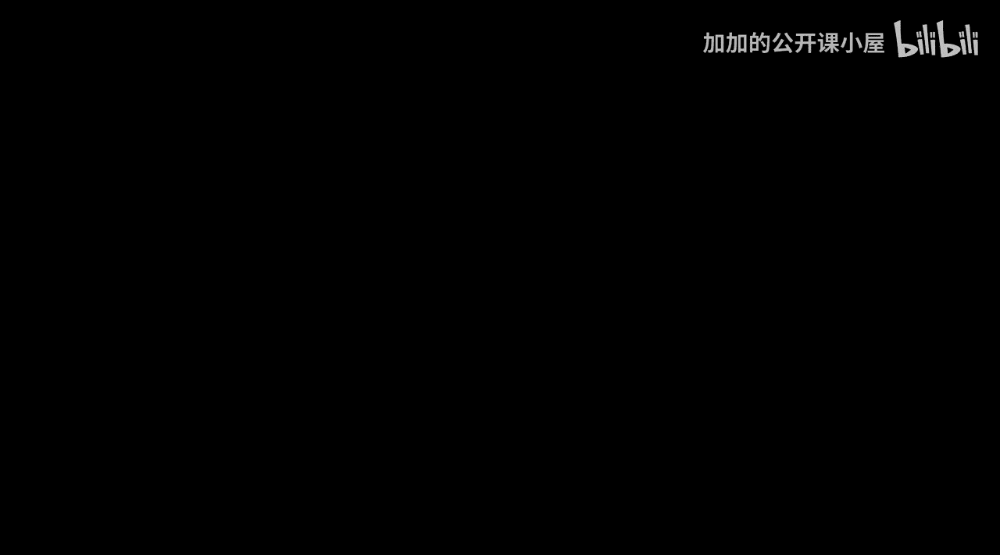

# Vizuara【中英⚡机器学习基础｜Foundations for Machine Learning】 p27 P27 Adam Optimizer from scratch ｜ Gradient descent made better ｜ Foundations for [BV1wosSzREF7_p27]

🎼Yeah。

Hi， welcome back to the series of lectures on optimization for machine learning。

 we are looking at various ways in which we can make better gradient and de。😊。

This series of lectures is part of the course's Foundations for machinech learning。

 and today we'll be specifically looking at Adamom Optimizer。In the last three lectures。

 we looked at stochastic gradient descent， momentum based gradient descent and RMS prop root mean square propagation。

Which were all ways to make gradient descent more efficient or better。Today， Adamom Opr。

 what we are going to discuss is probably the most famous optimizers that you will be even using when you are building production level machine learning models。

If you are not familiar with gradient descent don't worry I'll be covering or I'll be providing you a recap of what exactly is gradient descent at the start of this lecture if you are already familiar with the gradient descent you can skip to the part where we start discussing about Adamom optimizer so let's get into the lecture。

So a brief recap of gradient descent in gradient descent we are trying to minimize the loss function what is the loss function it is a measure of how far off your model's predictions are from the actual values that it is supposed to predict。

It is denoted by J and theta are the model parameters for example。

 if you are using a linear regression the theta will be slope and intercept so you will be modifying the initial values of slope and intercept or initial values of theta which you will randomly assume with the help of gradient so here the theta at a new time step will be equal to theta at the previous time step so I can write this as theta new。

Theta new equal to theta old minus Eta， which is the learning rate times gradient of the loss function with respect to theta。

Here it is called gradient descent because there is a minus sign。

 so you are not moving in the direction of the gradient。

 you are moving in the opposite direction of the gradient。Now the first step。

 if if you were to mention the gradient descent in few steps。

 first step is starting with random values of theta。

 second step is calculating the gradient of the loss function with respect to that particular value of theta。

 then updating the value of theta itself based on what you calculated as the gradient and then repeating steps2 and three until you reach conversions or for a predefined number of steps。

 this is the essence of gradient descent。The problem with this gradient decent is that computationalally it is inefficient for large data sets why is that so because for example in linear regression if these are the points and if this is the model the mean squared error which is the loss function is defined for example as。

1 by n times sigma i equal to 1 to n Y I predicted。

