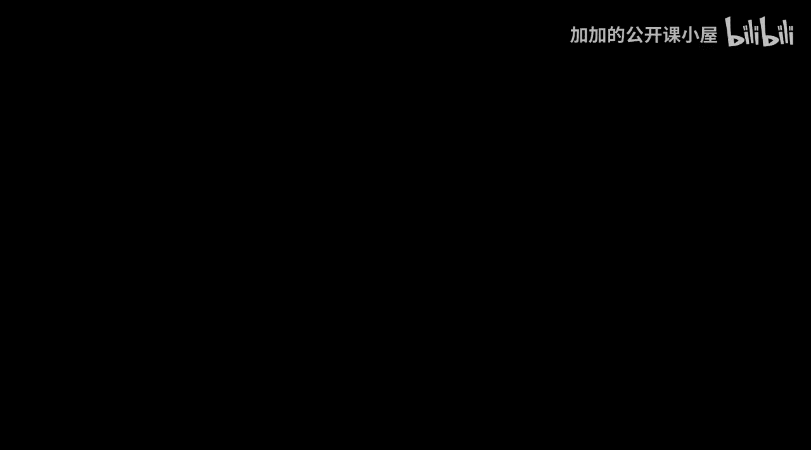
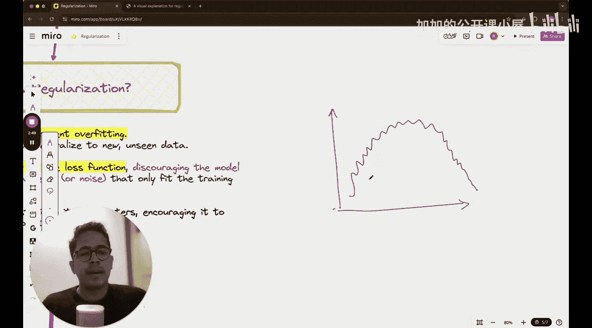

# Vizuara【中英⚡机器学习基础｜Foundations for Machine Learning】 p28 P28 Regularization in ML explained simply ｜ Lasso (L1) and Ridge (L2) ｜ Foundati [BV1wosSzREF7_p28]

Hi， welcome back to the course Foundations for Mach learning today well be learning about regularization first we will learn the theory behind regularization and then we'll implement it from scratch。

You might have probably come across this diagram。If you search on Google regularization visualized or maybe in some other context。

 maybe you might have seen it on LinkedIn and I must say that this diagram which shows the difference between Laso and rich regression is very very confusing it's a beautiful diagram if you understand what's going on but otherwise I would say it's very。

You know it probably makes you feel like you don't know what you're talking about。

And but I have seen people use this diagram again and again。

 so it we will try to spend some good amount of time today to decipher what exactly is going on in this and how is this diagram showing the idea behind laso regression can force some of the parameters to be exactly zero on the other hand a rich regression does not make it to be exactly zero but approximately zero。

 so we will explore this idea and once you are very comfortable understanding what this diagram is trying to say。

I would say you have a fairly grasp on regularization。So first of all。

 what exactly is regularization， it is a method used in machine learning to prevent overfitting what is overfitting overfitting is when a model。

😊，Tryries to learn complex patterns in data， maybe the patterns in data due to outliers。

 maybe it's due to noise。When a model is trying to learn learn patterns in the training data。

 especially which may be outliers or noise， the model is not learning generalizable patterns。

It cannot have very good results when you provide unseen data from your test data set。

What regularization does is it adds a penalty。😊，To the original loss function that the model is using。

 which discourages the model from learning these excessive complex patterns。

And you will see this whole idea being visualized。So the basic premise here is that if you are discouraging the model from learning overly complex patterns。

 it can only learn the general trend in the data and that may lead to a better model which can make better predictions on unseen data set so what do we mean by generalizable pattern here is an example if this y is your prediction and X is your data。

So if your data looks something like this， then clearly and assume this is the training data。

 then clearly this small waviness or small un。

