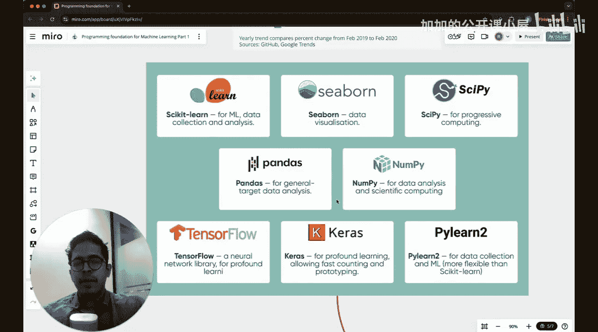

# Vizuara【中英⚡机器学习基础｜Foundations for Machine Learning】 p29 P29 Basics of Python [beginners only] ｜ Foundations for ML [Lecture 28] [BV1wosSzREF7_p29]

Hi， welcome back to the course Foundations for Mach Learn。

 this is the start of a new module where we will be covering programming fundamentals required for machine learning engineers。

So this lecture is a fresh start to Python so if you are already familiar with the basics of Python you can totally skip this lecture I don't think this lecture is necessary for you if you are not a beginner if you are a complete beginner if you don't have that much background using or running programs or writing code in Python then is this lecture is for you so let us get into the lecture we will be starting with very very basics of data types and then we will proceed to write a bit more complex functions towards the end of the lecture。

So firstly， Python， Python is a programming language it is。

Very much interpretpreable in the way it is written， the syntax is very easy to learn。

 it is the by far the most popular programming language for machine learning。

 it is also used extensively in web development。And it's very easy to learn Python relative to many other programming languages personally for me。

 Python was easier to learn than C or C++。And if you want to become a serious machine learning engineer。

 of course you should know Python can end out the other thing is there are a lot of libraries in Python that are extremely popular the community support is very very good and also since lot of internet databases based in Python。

Large language models like chat GT or cloud by Anthropic。

 all of these are very good at giving you solutions when you encounter problems in Python。

So this is a chart which shows the from 2019 February and till 2020 February in the searching of tutorials。

 which languages were the most prominent Python was topmost Java。

 Java etc next because in web development Java is also used extensively right so that's why you see this kind of a trend。

 but it's very clear that Python is the most sought after programming language in the world。

And these are some libraries in Python that are very popular with respect to machine learning。

 data science， deep learning etc， some of these are meant for data visualization like Cborn。

 some of them are meant for data analysis and implementing ML models some of them are for storing data tableular data etc。

 don't worry if you don't know what are these libraries just think of them as already defined。

Code so that you don't have to repeatedly write the code for performing certain functions。

 so these are very， very popular libraries in Python which you will be extensively using as you enter into machine learning。

