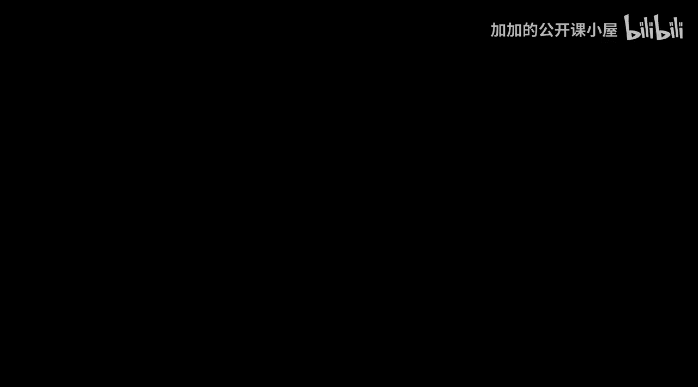
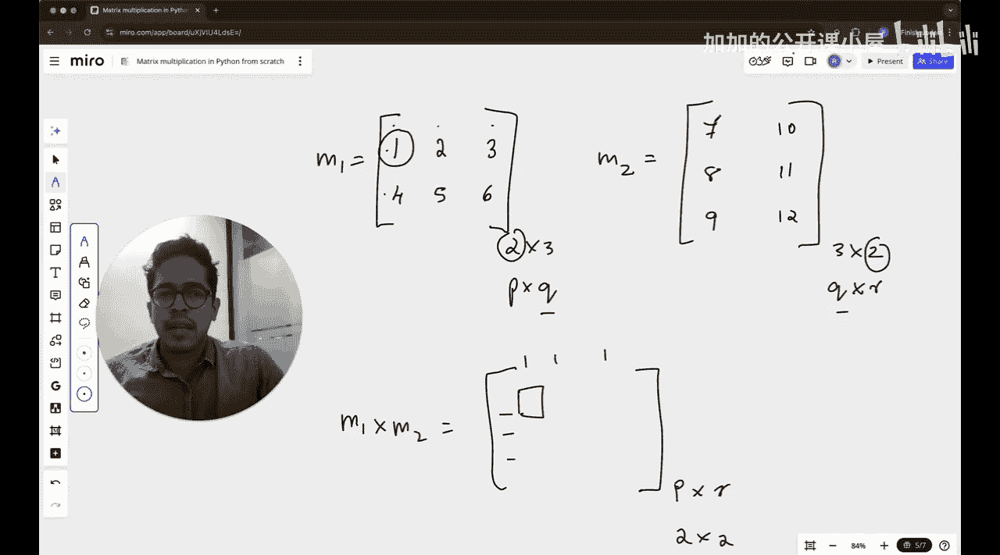

# Vizuara【中英⚡机器学习基础｜Foundations for Machine Learning】 p30 P30 Matrix multiplication from scratch in Python ｜ No NumPy, no libraries ｜ Codi [BV1wosSzREF7_p30]

Hi， welcome to this lecture on introductionuction to Python in this lecture we will be just doing one thing implementation of matrix multiplication from scratch in Python。

 we will not be using any libraries。The good thing why this is a great exercise for beginners is because this exposes you to a few different things in Python firstly you will be looking at and with dealing with lists which is very important in Python second is matrices so matrices are like lists of lists in Python dealing with loops for groups conditional statements then regular syntax of Python and implementation of pure human logic into a code in Python so you will be getting exposure to all of this through just one exercise。

We will not be using NumpI or any other libraries we will be from scratch implementing matrix multiplication。

 so if you are like a beginner， this is a very good exercise for you so just do it with me。

So matrix multiplication is。Something where you need you have one matrix M1 another one M2 and if the number of columns of the first matrix so here this matrix M1 has three columns and the number of rows of the second matrix so this second matrix M2 has three rows if they are the same then you can multiply those two matrixes otherwise you can't multiply there is a dimensionality mismatch so in general if you were to represent the dimensions using PqR the first matrix let's say the dimensions are t by Q and second one let's say it is  Q by R。

The Q should be the same P and R can be different， so that is the idea。

Now how do you perform matrix multiplication how do you get what is m1 by m2 so M1 by M2 is some matrix whose dimension will be p by r right so p byq multiplied by  Q by r this will result in a matrix of dimension p by r in this particular case it will happen to B2 by 2 it can be anything depending on what is the value of p and what is the value of r。

Now P by R means there are p rows and r columns so123 up to r similarly123 up to p this is how p by R will look like so what should be the first element the element number0 comma 0 so in Python the index starts from zero so here if there are two rows the index of the first row will be0 and the index of the second row will be1 if there are three columns index of the first column will be1 second will be sorry first column will be0 second will be one and third will be two like that so here if you are looking at the first element which is zero comma  zero element that is basically this multiplied by this。

Plus。😊，This multiplied by this。