# Vizuara【中英⚡机器学习基础｜Foundations for Machine Learning】 p31 P31 Introduction to classes in Python for beginners [Lecture 30] [BV1wosSzREF7_p31]

Hi， welcome back to the course Foundations for Ma learning and in this current module we are exploring the programming foundations that you have to build so that you can become better at machine learning using Python so this lecture focuses on classes in Python in my opinion classes is probably the most confusing aspect of coding in not just in Python in any programming language。

Mostly for beginners， not for experienced people， so this lecture we will explore what exactly are classes and why are we using them and we will also later explore usage of these classes when you are building ML models in Python。

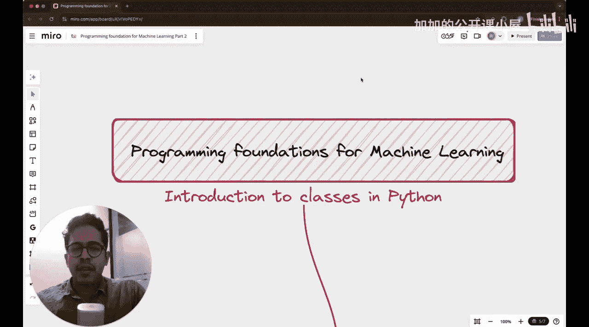

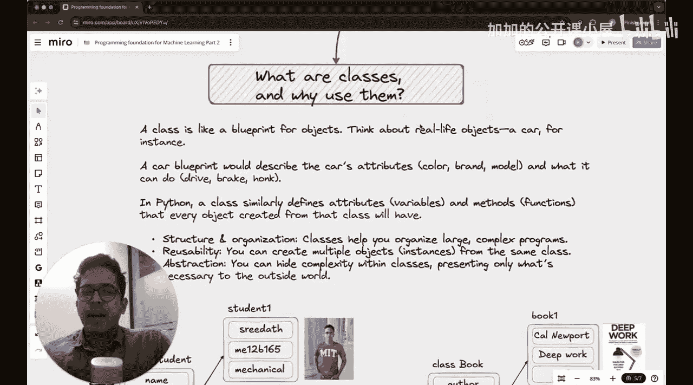

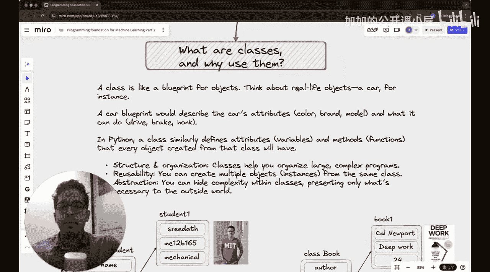

So class is like a blueprint and the reason why I say blueprint for objects is the following so just have a look at this so here you have two objects student one and student2 in student one there are three attributes the name role number and department student2 also has two three attributes name role number and department。

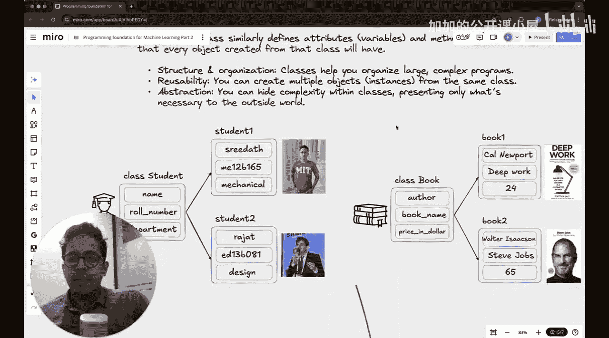

Now， class is the data structure which holds。The blueprint of student one or student2 or any other student which these three attributes where the first attribute is name。

 second attribute is role number and third attribute is department。

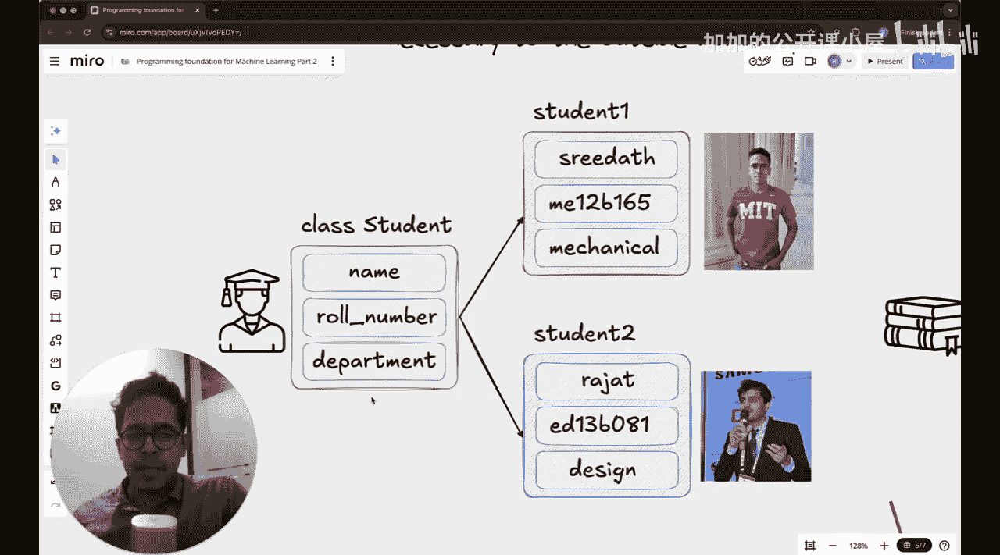

Now think about another one right let's say you are storing information about books and a blueprint of a book meaning a book。

 the metadata of a book might contain information about its author， the name of the book。

 let's say price in dollars， maybe page numbers， there are a bunch of information about a book。

So here， if you have a class named book。With author book name and price in dollar as the attributes。

 then you can have book one as the first object of this class book。

 book two as the second object of this class book， book one has attribute call Newport。

 deep work and 24， so author name book name and price in dollars， book two author name。

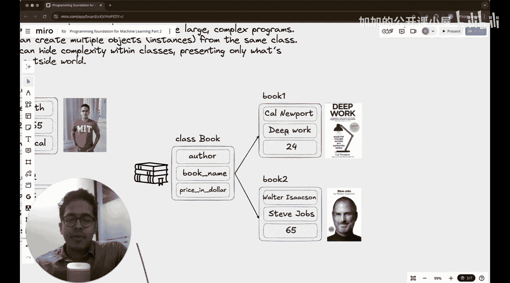

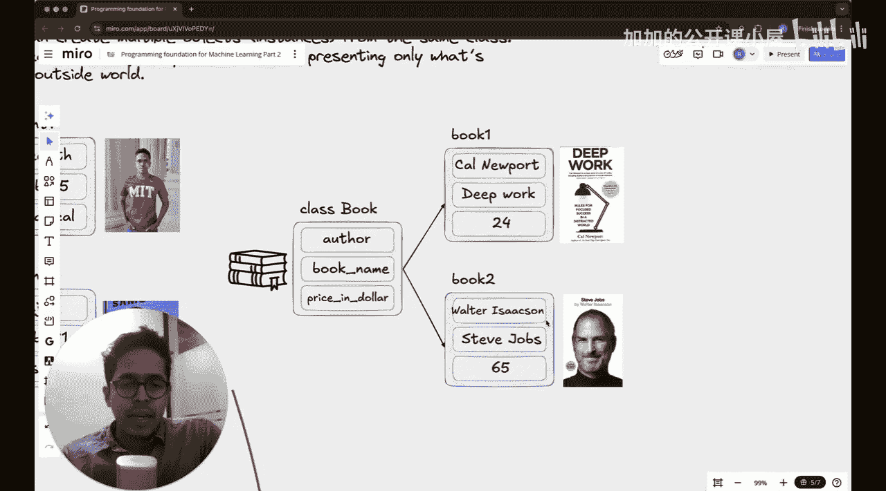

Book name and again price in dollars so this is what a class is so class in class you can define variables of similar attributes it can be you can include integers you can include strings you can include functions anything you can include inside these inside the definition of this class。

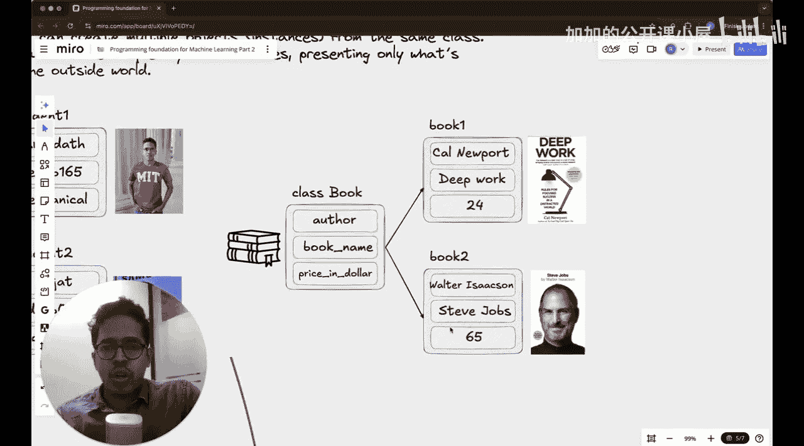

So you can reuse it again and again and again， so even if you are defining 300 students。

 you don't have to create separate separate objects for that all the objects can be the instances of this structure called as class。

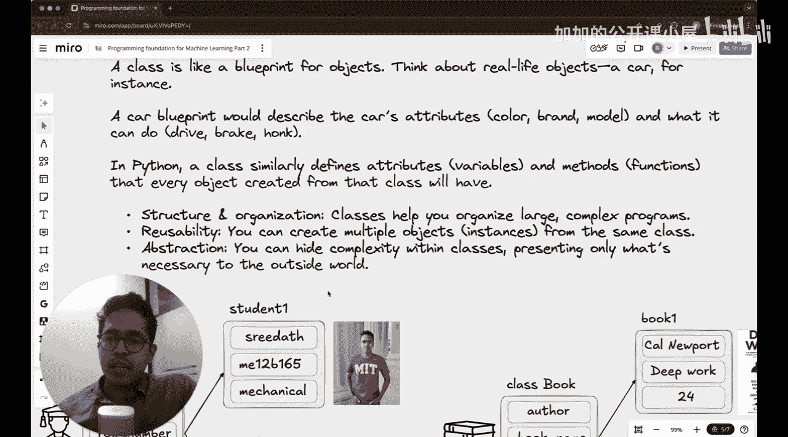

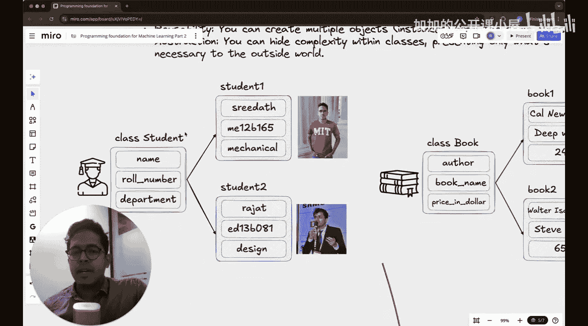

I know that you probably won't still be if you are if you are learning about class for the first time you are still a little bit confused I know and that confusion will be gone when when we are coding this so don't worry about that but basically just try try to understand that class can hold。

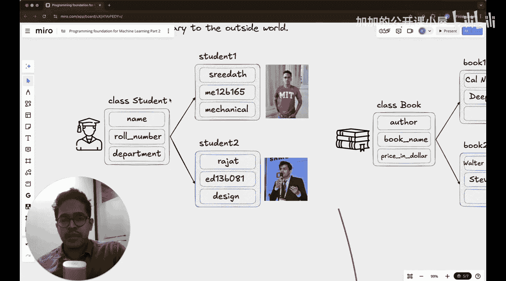