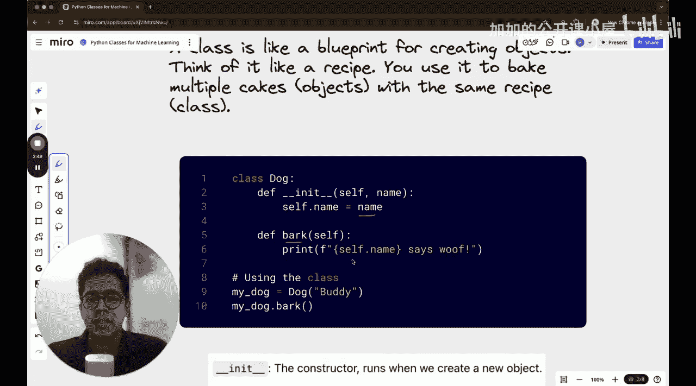

# Vizuara【中英⚡机器学习基础｜Foundations for Machine Learning】 p32 P32 Introduction to Python Classes & Objects in the context of ML [Lecture 31] [BV1wosSzREF7_p32]

Hi， welcome back to programming foundations for machine learning in this lecture we will be learning about classes but specifically in the context of machine learning this is a completely beginner friendly lecture where we will try to understand about classes and how they can be used in machine learning and also we will have a discussion about why to use classes when you have functions so with that let us get into the lecture。

So first of all。These are the four key things which you will take away at the end of this lecture。

 you will understand the basics of Python classes， you will understand how to structure like neural networks or linear regression models or similar ML codes where classes are involved。

You will implement two models in today's lecture first one is a linear regression model completely from scratch and second would be a simple neural network for performing a two class classification。

 so all of this will be done such that we will be defining the models using Python's classes。

So a class is like a blueprint in normal simple language for creating objects you might have heard of object oriented programming so object is like an instance of this class so one way to think about this is think about a classroom where there are。

20 students。 Every student has some attribute， name， height。

 role number subjects that he or she is taking， marks， etc cetera。

 So now a blueprint is is basically this fact that。

To describe a student you need these these these these attributes now an instance is an example of a student where there is one specific name like Srid。

😊，A specific height， specific role number or specific subjects that the student is taking， etc。

So here is an example of a class where we define a class called called dogg。

So I'll explain why you have certain things inside the class such as self in it， etc。

 so this is probably the most confusing part students encounter this init function。

 this self attribute etc。So a class can be empty class also。

 so here the class dog inside that you don't need to have any of this。

 you can simply write path inside the class instead of all of these things。

 then also you will have a class which basically performs nothing。But that is not the case here。

 you have two things inside the class， one is an attribute called name。

 second is a method or a function called as bark。Now the bark function。

 what it does is it prints whatever is the name of this the dog， let's say the name of the dog is。

嗯。