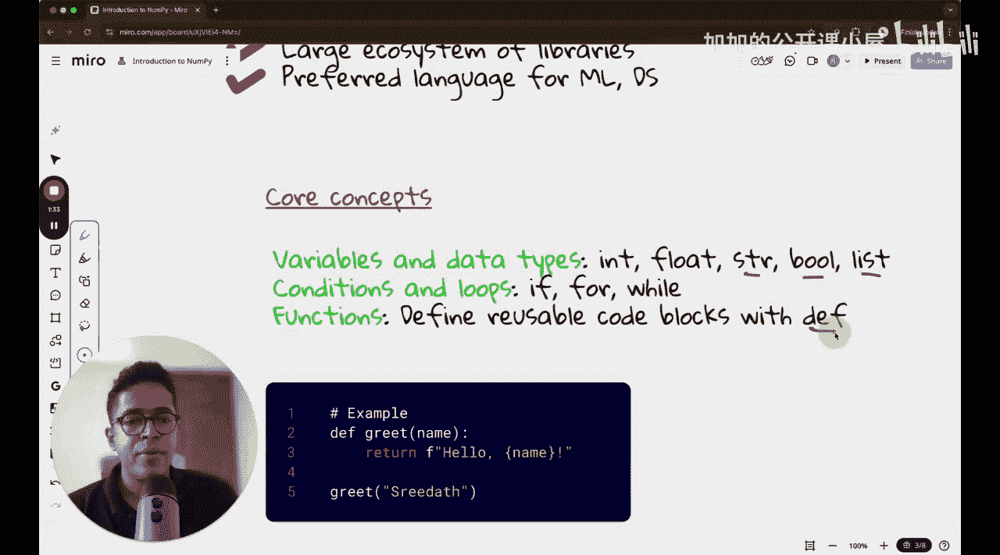

# Vizuara【中英⚡机器学习基础｜Foundations for Machine Learning】 p33 P33 Introduction to NumPy in Python ｜ Programming foundations for Machine Learni [BV1wosSzREF7_p33]

🎼Yeah。

Hi， welcome to Program Foundations for Machine learning in today's lecture we will be looking at NI。

Even if you have spent very little time on machine learning or in data science。

 I am pretty sure you would have heard of Numpy。If you have never heard of it。

 this is the first time you are hearing about Numbai， don't worry。

 will any be treating Numbai in today's lecture as a complete beginner。

So this lecture has four objectives at the end of today's lecture first of all we will do a small recap of Python fundamentals。

 it's syntax data types etc I will not be spending too much time but I'll provide you a couple of links which will help you to cover basic Python syntax but in any case for the sake of completeness。

 I will do initially a small quick Python syntax recap。Then we will be discussing what is NI。

 how do you use it in the context of handling data？

We will also discuss why NumpI was so foundational in data science and machine learning when it was introduced。

And well also do some hands on exercises that will give you。A very good familiarity with using Ny。

 all of this will be coded， we will be using Google Collab for implementing this code in Python。

So let us have a quick recap on Python itself， basics of Python Python is a very easy to learn readable。

Easy to understand syntax programming language， it is by far the most popular programming language for machine learning and data science I'm pretty sure you already know this。

One of the reasons why Python gained so much popularity is because there are so many libraries which have been developed in Python over the course of last maybe 20 plus years which makes machine learning implementation so friendly。

 so the community support in Python is also very very good unlike any other programming language for ML or DSS。

 so these are the reasons why we are talking about Python today specifically in the context of machine learning。

So some of the data types that Python has int intesia float is floating point numbers like 2。

3 numbers with decimal points， string， Boolean， like true or falses and list。

We will be spending a little bit of time in Python lists today because we will be discussing why NumbI was superior for performing array operations compared to the Python lists。

Then there are conditional statements and loops， so if else condition for loops， y loops， etc。

 we can implement a very basic code today before we proceed with NI and of course we can define functions with this code block called DDF and these functions can be called from anywhere so that you don't have to write the code again。

