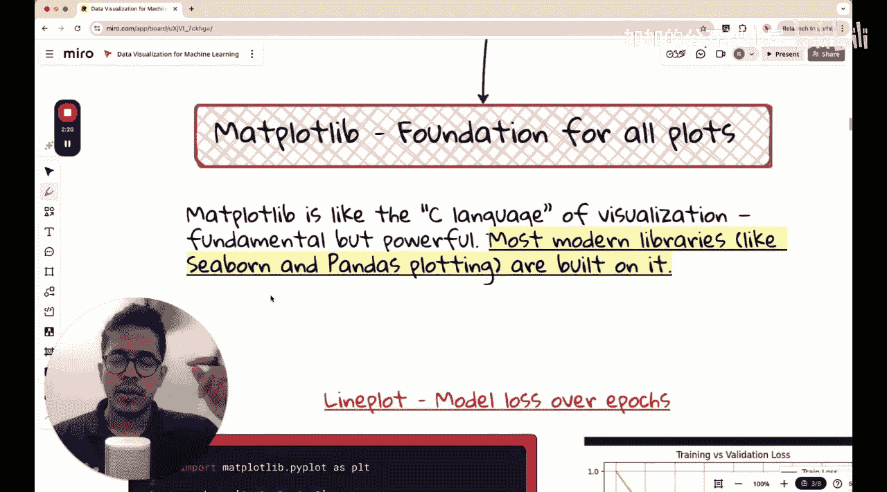

# Vizuara【中英⚡机器学习基础｜Foundations for Machine Learning】 p35 P35 Intro to data visualization libraries for ML in Python - Matplotlib, Seaborn [BV1wosSzREF7_p35]

🎼Yeah。

Hi， welcome back to Python for machine learning in this module we will look at some data visualization libraries that are the most famous in the context of machine learning specifically we will be looking at three。

😊，Python Libaries， Mattlolib， Seaborn and Brotley if you have spent even a little bit of time in machine learning I'm sure you are aware of this。

 even if you are not aware of this don't worry we'll be looking at it from a beginner's point of view so welcome to the lecture。

So by the end of this lecture， you will have a fairly good idea about what type of visualizations are the most useful to be done in ML and its importance。

You will have a fairly good idea about mat plotlibbs， seaborn and plotly。

 these are very famous plotting libraries in Python。

We will also perform some plotting such that we can explore the data and we can try to derive insights from it and at the very end of this lecture we will perform something called as EDA exploratory data analysis it's very famous and this we will be doing on a very famous data set called Titanic data set so with that let us start the lecture。

So data visualization is very important right so if you want to if you are a business and you have another business client and you are building an ML model for that business who's your client。

 how do you communicate the performance of your model how do you communicate to them what have you done are you going to present bunch of tables or are you going to show it visually you have to show it visually to convince someone because humans we have very much inclination towards visuals than numbers right so exploratory data analysis as I mentioned it's a technique where you plot various aspects of data and you see you try to derive insights from it even before you build any ML model so we will do that today。

Or if you want to discover what are the most important features in a data which will allow you to classify that data using an ML model。

 this is called feature engineering so this is also part of visualizing various features which are relevant for your data you can interpret your models in terms of accuracy or in terms of F1 score or other parameters you can plot confusion matrices so this also we will be doing and as I mentioned you have to present。

or communicate with the stakeholders and that's a very important part of building ML models you are building it for someone so whether you are a student or whether you are an industry professional at the end of the day if you are doing something serious in ML you will have to communicate it through beautiful visualization and hopefully this lecture we provide you a good starting point to that。

So the first library that we'll be looking at is mat plot Lib this library forms the form。😊。

