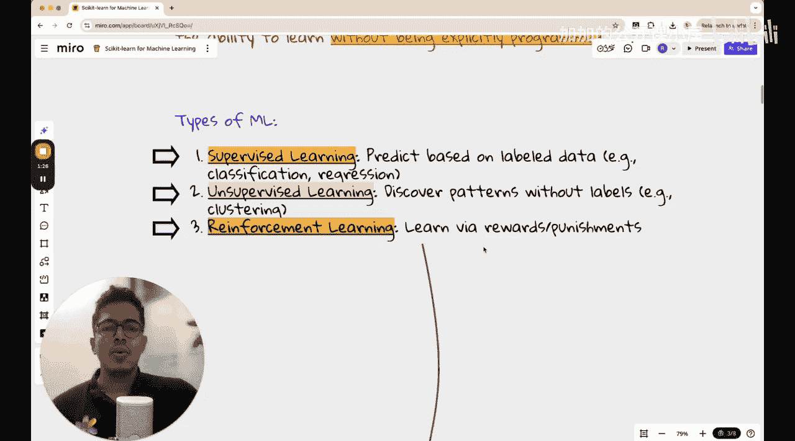

# Vizuara【中英⚡机器学习基础｜Foundations for Machine Learning】 p36 P36 Introduction to Scikit-learn in Python ｜ Foundations for Machine Learning [BV1wosSzREF7_p36]

🎼Yeah。

Hi welcome to this lecture today we are going to be learning about psyit Learn。

 psychitLn is one of the most popular machine learning libraries in Python。

If you are a complete beginner， I'm sure you are going to enjoy this。

 if you have spent a little bit of time in machine learning。

 there is a very high chance that you have already heard of psychic learn。

 but in either case we will go ahead as if we are complete beginners。😊。

So at the end of this lecture I'm hoping to cover fairly good amount of details about the machine learning pipeline。

 specifically how do you explore the data， how can you implement maybe two different types of machine learning models on that same dataset to make predictions and how to do all of this using psychicL library and today we'll be implementing K nearest neighbors and decision entries。

 so as part of the implementation I will also discuss a little bit of the theory behind how it works。

And we will see how to preprocess the data a little bit。

 how to perform evaluation of the model and at the end of the day you will get a feel for implementing the end to end machine learning project pipeline of course the data set will be very simple today so you don't have to worry that the model that we are going to be implementing is is something that is complex that is not the case so with that being said let's get into the lecture。

So before entering into Psychic Learn library let's briefly discuss what exactly is machine learning so in machine learning we don't explicitly program for the output right whereas if we are writing if and else conditions if the condition is this then this is the output else if this is the output else if this is the output else this is the output so in conditional programming we explicitly define the condition for which you need the specific type of output in machine learning we don't do that we let the algorithm figure out what the condition conditions should be and what the output should be for a given input so this is why it's called as machine learning the learning of these conditions happen during the process of something we call as training。

So there are three types of broadly， three types of machine learning learning process。

 supervised learning， unsupervised learning and reinforcement learning there are also other terms like self-supervised learning semisupervised learning etc so in supervised learning for example if you are teaching the machine the model to classify a set of images into dogs versus cats then you will have images as the input data and corresponding labels label meaning whether an image corresponds to a dog or a cat thats called label data and this is fully supervised learning because you have images and a corresponding labels in unsupervised learning you don't have explicit labels so if you want to create clusters out of。

