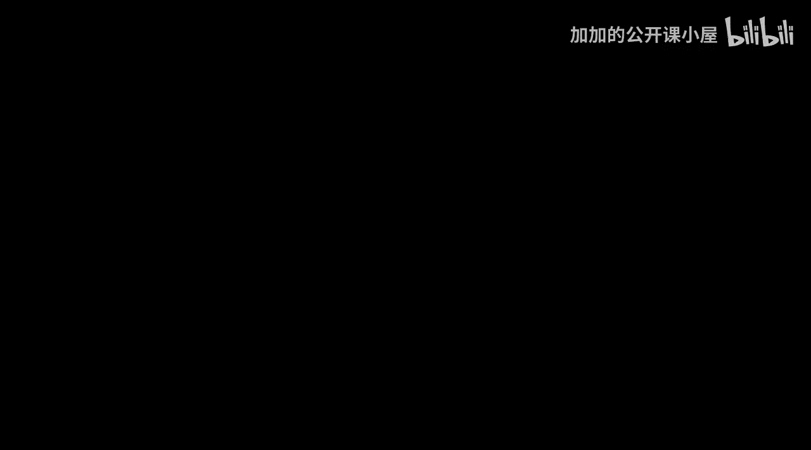
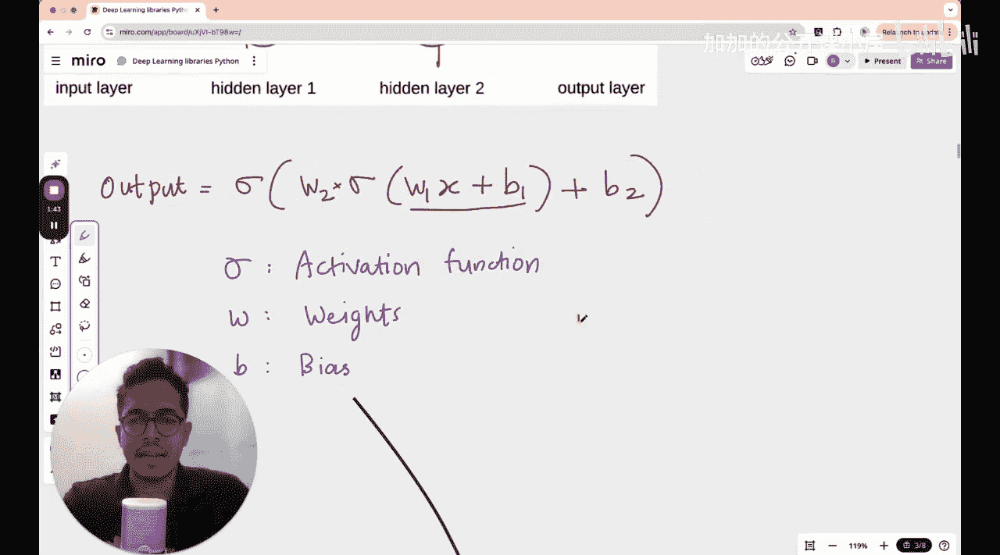

# Vizuara【中英⚡机器学习基础｜Foundations for Machine Learning】 p37 P37 Intro to Python Deep Learning libraries- Tensorflow, Keras, PyTorch ｜ Progra [BV1wosSzREF7_p37]

Hi， welcome back to programming foundations for machine learning today well be discussing about three of the most powerful deep learning frameworks in Python。

 namely TensorFlow， Ks and Pytorch。You may have heard of this already because these are so popular。

 but if you are hearing about it for the first time。

 don't worry we'll be discussing about these three in detail today along with some implementation。

 so welcome to the lecture。At the end of today's lecture。

 you will have a fairly good idea about what is a deep neural network and how is Keerra。

 ssorflow and Pythtorarch so important and so popular。

We will build a very simple neural network using Ks as well as using Ptorrch。

For a binary classification task， and we will also be incorporating psyitL in one of the code modules to import certain data。

We can also have a small discussion on when to use psler versus Tensorflow versus Pytoch。

 so with that let's get into the lecture。So firstly， let us discuss what is a neural network。

Very basically neural networks are called as universal function appromators because a neural network with a single hidden layer with finite number of nodes can approximate any continuous function in a given range of inputs。

So they are called as universal function proximators。

 but an even simpler way to think of neural neural network is as a bunch of layers。

 so you may have seen this kind of a figure which denotes a neural neural network by its input layer。

 hidden layer or multiple hidden layers， plus the final output layer。😊。

So in this neural neural network， the one that you see on the board right now。

There are three nodes in the input layer， meaning you can have three values as the input。

 there are two hidden layers， this is the first hidden layer and this is the second hidden layer and you have one node in the output layer。

 so there is a single number as the output。These neural networks are also sometimes called as large composite functions and here this neural network can be represented by a function like this。

 so output is equal to sigma off so this is not sigma multiplied by this is sigma of where sigma is a function。

W2 multiplied by sigma of w1 x b1 plus B2 so w1 x b1 is the linear transformation of this x as the input。

 so a bias is also added， so w is called as waste b is called bias sigma is called as activation function。

In this neural network， if activation function was not present， then the output would be。

 let's say y equal to w2 times。

W1 x。