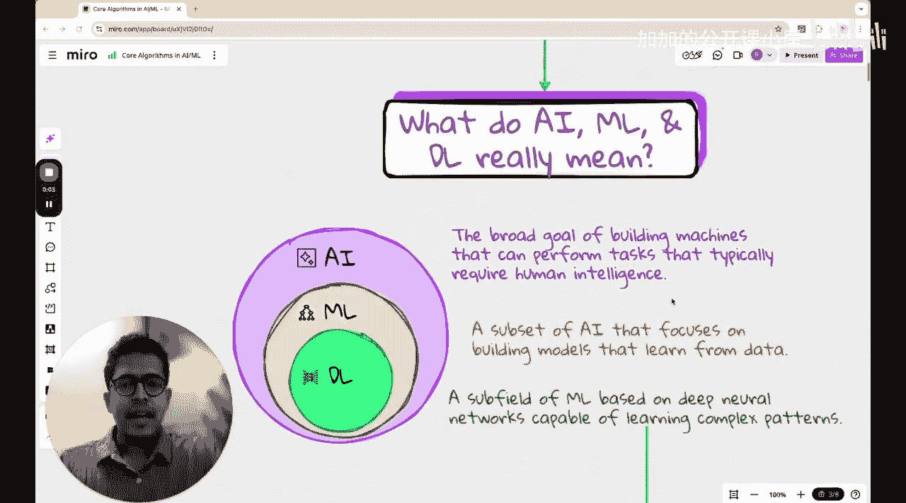

# Vizuara【中英⚡机器学习基础｜Foundations for Machine Learning】 p38 P38 Machine Learning Algorithms Overview - What all exist out there？ [BV1wosSzREF7_p38]

🎼Yeah。

Hi， welcome to this new lecture today we'll be discussing about some of the most common core algorithms in machine learning。

The point of this lecture is to give you an outline of where exactly is the different algorithms in MLl coming into the picture you may have heard of many names support vector machine deep neural network sVm hidden Markov models you may have heard of reinforcement learning long shortter memory and all these terms have become so popular that people have heard of all of these things in different different context and they have no idea where exactly is the boundary of all of this how much do you have to learn and if you plan to lets say learn MLl for the next six to eight months what all things do you be spending your time on so this lecture is to kind of not teach you any algorithms in specific but it's to give you a map of okay these are all the different things that are existing and if you were to learn these are all the things that you should be generally aware of to become really really good at machine learning so that's the purpose of。

Today's lecture， so let's see what is AI， what is ML， what is deep learning。

 and what are some of the most popular algorithms in all of this。

So let's first look at the difference between AI MLl and DL。

 these terms are sometimes used interchangeably， but it's not correct。

 AI ML L DL means specific things。 So AI is the broad。

A range of techniques which allow machines or which allows computers to acquire some sort of human like intelligence。

And AI involves many， many other things like robotics， robots that can perform autonomous tasks。

 any system that can take a decision and perform a task can come under the category of AI and there are many primitive forms of AI people have tried genetic algorithm。

 fuzzy logic， and the umbrella of AI is very broad。

Then machine learning and deep learning have been the most successful techniques using which AI have been implemented in our daily life。

 so machine learning are those category of models models meaning anything that can allow you to train on some data and make predictions on unseen data right so machine learning are those category of models where the features from the data are readily available so when I say features imagine a tabular data。

Of somebody's blood glucose， BMI and maybe cholesterol level。

 etc now if you have00 different people and every single person has these three data points available。

These three data points themselves can be used as the features on top of which your machine learning model can learn。

So now。