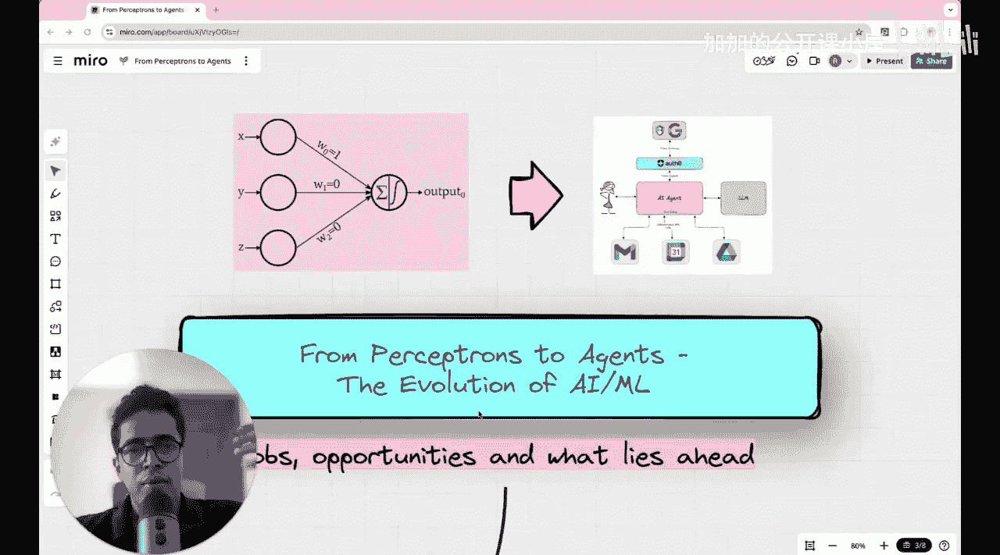
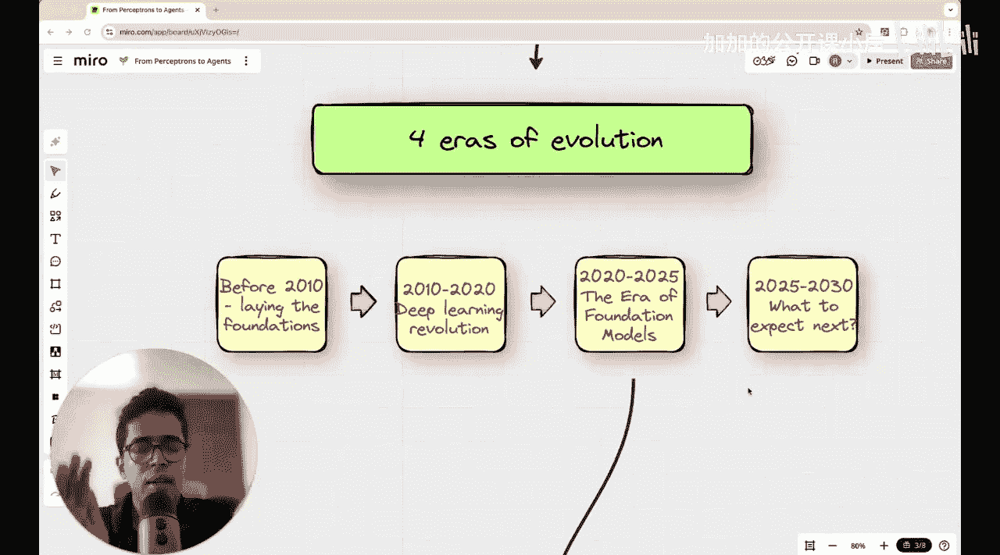

# Vizuara【中英⚡机器学习基础｜Foundations for Machine Learning】 p39 P39 Where is AI headed？ Evolution, current trends and job opportunities [BV1wosSzREF7_p39]

系い。If you are on LinkedIn or if you are on other social media you are definitely hearing about new developments in AIML field and it's almost always overwhelming because the speed with which new happenings are coming out as news it's so fast that you can barely catch up so this lecture is like taking a step backwards and zooming out and seeing how the AI has developed over the past few decades and we will split those developments or evolution into few different stages so that we can see what was the most prominent development at a given period and what is happening right now amidst all the noise and in the next five years or something like that。

 what can you focus on so that you have the best possible career opportunities in AIML。

So something that has started with something as primitive as artificial neurons or multilayer perceptrons。

 which is a feed for neural network， something that started as simple as that now has reached to the stage of autonomous AI agents which can take its own decisions and perform actions so this lecture is an overview of what all things have happened in AI what's happening around us right now and what can we expect to happen in the near future。

So we shall look at the developments happening in AI in four stages or four eras。

The stage before 2010 were machine learning models or feature engineered models were most prominent and that is truly the time when a lot of mathematical foundations were laid for basic probabilistic models for basic machine learning models。

 but then the true change and big career opportunity shift happened in the years from 2010 to 2020 when deep learning really exploded into the scene with deep neural network architecture enabling training vast amount of data for actually performing useful things in production level environments。

Then from 2020 to 2025 you can sort of call it as the era of foundation models， we have seen GPT 3。

0 come out and then later further models of GPT and other large language models on top of which you can pretrain sorry on top of which you can fine tune or perform retrieval augmented generation using a separate database and perform queries。

And now in 2025 a lot of people are talking about AI agents。

 a lot of people are talking about model context protocol MCP and many other terminologies exist。

 so let's take a look at this whole development of AI in stages and try to project what to expect next。

 what kind of job operation。