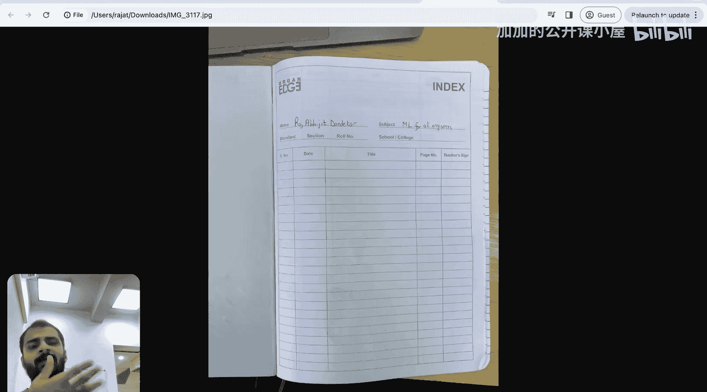
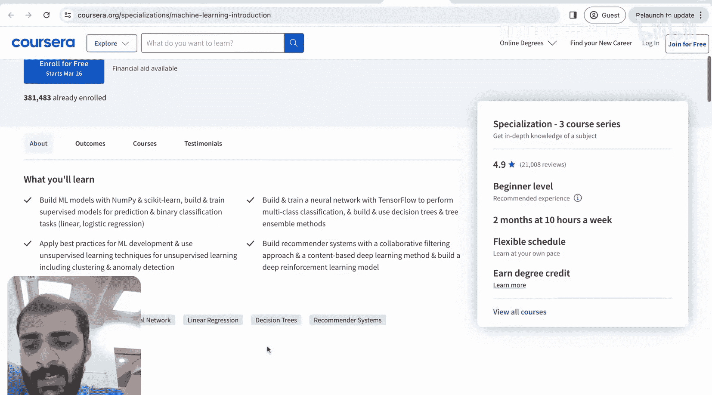

# Vizuara【中英⚡机器学习：实践教学｜Machine Learning： Teach by Doing】 p01 P1 Machine Learning： Teach by Doing Lecture 1 [BV1RusDz1EXd_p1]

Hello everyone， welcome to the Mach learninging for All Engineers teach by Doing Project。

My name is Dr Rajthanecker and in these set of videos。

 which all will be uploaded for free on YouTube。Ill be learning machinech learning from scratch。

And as I learn ML again， I will document my journey and I will share all the resources with you guys so that you can follow me in this journey。

First， let me explain a bit about myself and why I started this project。

And then we can directly dive into the first。lecture。So again， my name is Dr。 Raj Danandeer。

 I graduated from IIT Madras with a BTEC in mechanical engineering in 2017。

And then I completed my PhD。From MIT。Which is the number one university in the world in 2022 I received my PhD in machine learning。

And in 2018， actually， I attended my first ML lecture at MIT。And it transformed my life completely。

The next four years I mastered machine learning concepts， published ML research。

Da machine learning internships。And corporate jobs and finally I attain my PhD at MID in the field of machine learning。

In 2022， I came back to India with a mission to。Educate the millions of engineers who are planning to transition to machine learning and guide them on their journey。

I basically want to help all the students who want to make their transition to machine learning。

And I have been thinking of several ways to help students。What is the best way of doing this。

 how do I make sure that students start their journey and do not get confused or demomotivated or stuck？

So I have started this new project， which is called teach by Doing。

What I'll be doing in these set of videos is that I act as if I do not know anything about machine learning at all and I'm a complete beginner。

And I start from scratch as if your journey would be if you are starting from scratch that way you will relate to what I am showing in these videos。

I'll be showing everything as if you are a complete beginner in ML and if you want to transition to ML。

So every day， every morning， Ill post what I learned the previous day， I'll make a video like this。

I'll make lecture notes。Ill share reference material。

 I will also solve assignments and share what I have solved。

You can see already here that I've brought this book。

In which I'll be documenting everything which I'm learning， which will serve as the resource。

And I have brought pens of different colors。So that I can highlight the different information as I learn the material。

As I learn this material again， I will share thoughts on what is actually useful in industry。

And what has become irrelevant？I will also share a lot of information on which subject contains open areas of research。

So that interested students can also start their research journey。

I will carefully choose the material regarding what I am learning and I will show you how I am choosing this material。

So students who are confused or stuck and they are not able to make this transition to ML。

Maybe courses and offline videos are not inspiring enough。

What might inspire you is if you see someone else。Learning ML from scratch。

 and then you can follow the same journey。So there is no cost to these videos。

 there is no hidden charges， this is pure teaching and learning。

So you can join me in this journey as I transition to ML。

 there might be a huge number of videos as I get started today is day1。And every day I'll be posting。

What I'm learning。Before we get started， you should have a clear objective of why you are learning machine learning in the first place。

In my experience， the biggest motivators are three things first is if you want a job in this field。

And if you do not have the experience on the resume currently。

 that can be a great motivator to start doing machine learning second motivator is if you want to apply to grad school。

But you do not currently have machine learning projects。

 that's why you want to learn machine learning。And the third third motivator is。

You can see that the entire world around you is transitioning to ML and AI and you don't want to get left behind。

You are interested in this topic and you just want to learn about ML so that you can feel like you belong in this world which is transitioning so fast to ML and AI。

I was in a similar boat as all of you who are looking to make this transition because I was in mechanical engineering。

 I had no clue what machine learning is。I learned about it four to five years back and it has completely changed my life professionally and personally。

I hope that these set of videos which I'm making will help you inspire you。

 motiv and guide you in your journey to transition to ML。

I'll be posting every single day on this YouTube channel and in the comments I attach resources。

 Ill attach the notes which I'm making in this book so that you can follow along。

Thank you so much and I'll see you directly in the first lecture。All right。

 so let's get started with the first。Lecture video in this teach by doing ML project。

As you can see on the screen， I started filling this diary or this notebook in which I'll be maintaining all the lecture notes as I start from scratch。

So today will be a start of a long and fruitful journey。

 so let's get started with our journey of understanding and learning machine learning。

First thing which I'm going to do is enter guest mode since I don't own my past browsing history to influence the search results which I'm seeing when I search different things。

So let me start by saying that you have one of the three goals。For transitioning to ML。

 either you want a job or you want to apply to grad school。

 you want to transition to ML or third thing you just want to learn about this field because you are curious about it since the entire world is moving in this direction。

Great， so the first thing which I will search as a beginner is MLl。Or beginners。Okay。

So immediately I can see that a huge number of things have started showing up already。And。

I currently have no way to compare these things， and I can also see that there are a number of sponsored results which have started appearing。

So let me start going through what all searches have been there and let us try to narrow down the initial resource which well begin learning from。

Let's cancel or rule out some things which we definitely don't need let's look at this。

 for example layers or data science online course。嗯。But looks like。

This is more geared towards placements and it also looks like this might be a paid program designed for early career professionals。

 we probably don't want this right now because we want something which builds our foundation in terms of theory and practical knowledge in machine learning。

We kind of want a deep course， which also gives us。

A hands on experience so this looks like it's a PG program。

 so we don't need this much level of specialization right now， so let's cancel this。

There is another course here for data science， which shows。Pay after placement and all these things。

Riser was seat for iron or 5000 so this is also paid。

 so let's not these programs right now it also looks like these programs might be a bit。

Fast so they might teach you quick projects， they might teach you quick coding。

 but they might not really develop a strong foundation in machine learning。

 which is extremely crucial one of the main aims。For me is to teach you this beginner journey。

 but at the same time develop foundations， develop very strong fundamentals and not just do quick projects。

So let me roll out this option as well right now。呃。Okay， then I have heard about Cora。

And I have heard about Udemi， so let me look at the projects。In coursesera， so let me see。

And well for beginner score Sarah。And here you can see top machine learning courses for beginners。

I can see that again， there are a huge number of courses here。And this is again very overwhelming。

 it's very difficult to choose what exactly to learn from here because all of them have good amount of ratings。

But I know that this this course is quite good， it taught by entry of NG， it has a rating of 4。

9 and it has 21 K reviews。So let me click on this and see the contents of this particular course。

I can see that free enrollment is possible， which is good number one。

Secondly， Ill see that in this project， we will learn to build ML models。

