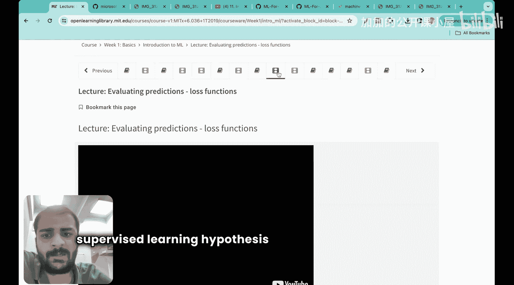
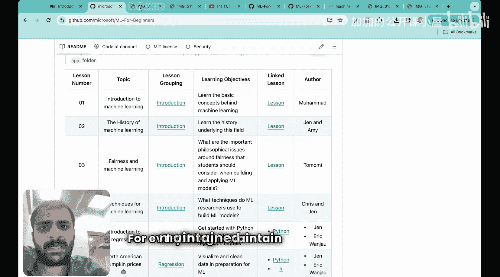
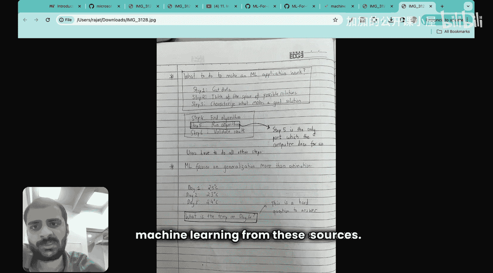
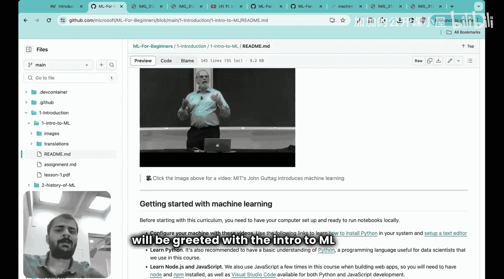
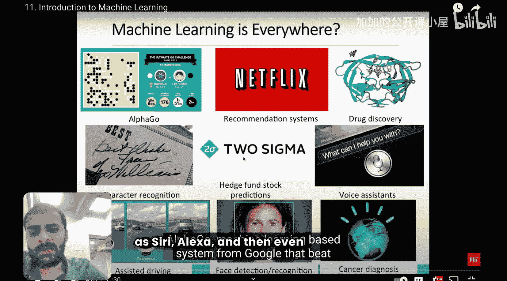
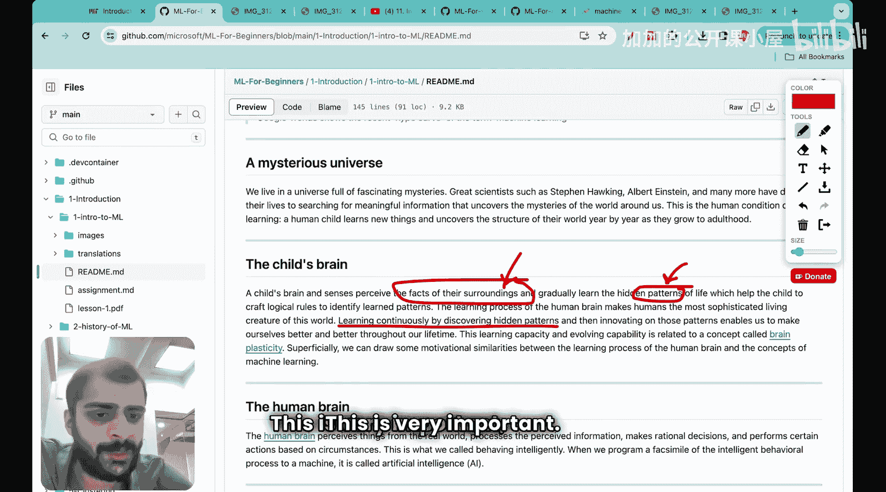

# Vizuara【中英⚡机器学习：实践教学｜Machine Learning： Teach by Doing】 p02 P2 Machine Learning Teach by Doing： Day 2 [BV1RusDz1EXd_p2]

Hello， everyone。Welcome to the day two of the Ma learninging teach by Doing project。My name is Dr。

 Raj Duneer and I have a PhD in machinech learning from MIT。We started this project yesterday。

And the main aim of this is to inspire you to transition to machine learning。As mentioned on day1。

 I'll be learning along with every one of you， I'll be forming agenda for what to learn and every day I'll be posting lecture notes。

诶。Reference material and videos such as this going through what I learned。On day zero。

 which was yesterday。We made a plan for what we are planning to or what we will go through this course。

Essentially， we made a plan to have a good mix of fundamental or theoretical machine learning。

Which we will learn from MIT's 6。036， which is intro to ML course。

And we will supplement it with practical knowledge。Or hands on coding demonstrations。

Which we will learn from the Microsoft course。Titled machine learning for beginners。

So let's get started with today's lecture。In which it will be all about introduction to machine learning。

So yesterday， after making the plan。And today I went through intro to MLl from both the MIT course and this Microsoft course。

 so first tell let me tell you exactly what I went through。When you open this MIT 6。

036 intro to machine learning course for those who have not seen the previous lecture。

 you will need to create an account here it's fully free。But once you create an account。

 you will be greeted with the entire lecture material， which is taught at MIT。

So what I did is I went to this basics module， I went to introduction to ML here。

And then here is what all I went through yesterday and today。

 I watched this video on introduction to ML perspective and history。

I watched this video on introduction to ML estimation and generalization。

I watched this video on supervised learning setting。Supervised learning hypothesis。

Evaluation predictions， loss functions。Evaluating hypothesis training etc。

And I also watch the video on learning algorithms。All of these videos are pretty small I would say four to five minutes each and you can see they're organized here。

 so this symbol is for videos and this symbol is for lecture notes which are interspersed throughout this particular。

Course， so I went through one， two， three， four，5， six， seven videos here。

And I'll soon go through what all I learned from all of these videos。

And in the Microsoft ML4 beginners course。I went through。I went through the first three lessons。

I went through the lesson on introduction to machine learning。

 which is your the history of machine learning and fairness and machine learning。

For everything I maintain detailed notes， so here are the notes which I maintained from the Microsoft course。

And here are the notes which Im intend from the MIT is 6。036， which is introduction to ML course。

In this particular lecture， I will condense everything which I learned about introduction to machine learning from these sources。

So let me first get started from what I learned in this Microsoft。Of course。

So when you click on the lesson here， you will be greeted with the intro to ML。

B。The first thing which I learned is that machine learning is really everywhere all around us。

It is impacting our day to day life in every single sector。I learned about Alphago。

 which is basically a game in which。AI has learned to beat humans， similar to chess。I learned that。

IBM conducted a match with。嗯。The leading chess grandmaster。

 Gary Kasperrov and IBM's AI defeated Gary Esperrov。

Who was the best chess player in the world in 1996。Now。

 AI has repeatedly started beating humans at games such as Alphago， chess， etc。

I also learned that AI is revolutionizing。The content which we consume such as Netflix， Amazon。

Wherever we see recommendation systems such as recommended for you， you must have seen in Netflix。

Or you must have seen in YouTube， what you see on YouTube is very。

 very different from what I see on YouTube。Because YouTube learns。

The way I interact with it and the way you interact with it and so our feed is different even Netflix has a recommended for you section all of these are applications of machine learning。

Machine learning is also completely revolutionizing healthcare such as drug discovery。

Cancer diagnosis。And not just that even consumer applications like phone assistance such as C。Alexa。

And then even it's helping in financial predictions such as stock market prediction or character recognition for doctors or postmen。

 and of course all of you must be familiar with the face detection or recognition。

 such as the facial unlock or the fingerprint unlock which we have on our phone。

All of these are examples of machine learning。Before starting this lecture I did not know what is the difference between ML and AI。

 but this lecture really opened my eyes as to what is the difference between machine learning。

 artificial intelligence and deep learning Ill come to that in some point。

So my first learning was that machine learning is literally all around us。

 even in your day to day life from the moment you wake up， interact with your phones。嗯。

Pone assistant， then Siri， the home assistant， Netflix， YouTube， face unlock， fingerprint， unlock。

 voice assistant， and then even in all the other sectors such as education sector， child GPT。

 drug discovery， healthcare sector， cancer diagnosis using AI。Ml or machine learning is literally。

Impacting every single sector of human experience。The second thing which I learned and which was really good for me to learn was that the hype surrounding machine learning。

What you must be very curious or interested to learn is that the hype around ML was not the same。

At all times in history， in fact， we are living at a time when ML hype is really at its peak。So。

 I went to。Google Tris。And I typed here machine learning。And then， I selected India。

And then I selected 20，0，4 to present。Here you can see that in 2004 the interest the interest was very less whereas see right now the interest has almost increased by 100 to 200 times。

And we are living here at an age where people are extremely interested in machine learning and it's completely revolutionizing everything around us。

This is one more reason why learning machine learning is so important at this stage because so many people care about this field。

I also saw that you can here have a worldwide。Interest over time and not just in India。

Throughout the entire world， the interest in machine learning is just skyrocketing。

Here you can see the countries which have the most interest and of course， India ranks third year。

 South Korea， fifth， etc。So my second big learning was that the ML hype or the AI hype。

Which we see everywhere around us is not the same as it was before。

And the roots for why this is the case lie in the history of machine learning。

When I teach you about the history of ML， you will realize why there is so much hype about it right now and why there was less hype in all these years。

Then， I learned about。What is really the definition of artificial intelligence or how we can start thinking about AI in the first place？

So consider a child's brain， we are constantly receiving inputs from our surroundings。

So here you see let me use this marker and draw here so here you see we are constantly receiving input from our surroundings。

 this is very important input from our surroundings and we are finding patterns in everything which we see around us。

This is how we develop intelligence， this is how we start to discover the things around us。

So we learn continuously by discovering hidden patterns， this is very important。

And those patterns enable us to make decisions。This is。

