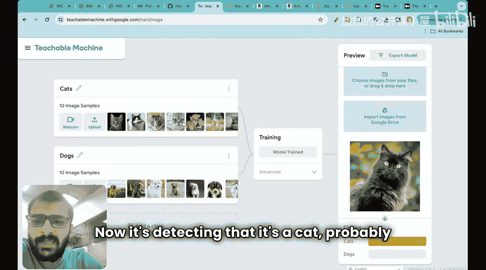

# Vizuara【中英⚡机器学习：实践教学｜Machine Learning： Teach by Doing】 p03 P3 ML Teach by Doing Day 3： Types of ML Models [BV1RusDz1EXd_p3]

Welcome to day three of the machinech learning T by Doing Project。My name is Dr。 Rajthan Deer。

On day1， we looked at。Why we started this machine learning teach by doing project。And on day two。

 we started by looking at the introduction to machine learning。

 introduction to artificial intelligence。We also saw the differences which exists between AI。

 ML and DL that is artificial intelligence machine learning and deep learning we saw that AI is the broader umbrella。

ML is the subset of AI and DL is the further subset of ML。

We also looked at the history of ML and we saw that we live in times right now where the availability of computational power along with access to data and development of innovative algorithms has really accelerated。

The innovations in the AI space。And that's why AI is affecting every single aspect of our lives。

 we are really lucky to be living in this age right now。

In today's lecture or in day three of the machine learning teach by doing project。

We will be looking at the types of ML models。As is the case throughout this machine learning PG by doing course or a project。

I'll be taking references from。Two resources， the first is MIT's 6。

036 introduction to machine learning course。And the second is Microsofts。Ml for a beginner's course。

So if you if you have not seen the previous two lectures。

 I really recommend you to go through them so that you understand why we have chosen these as a reference material。

As I mentioned today we will be looking at the types of ML models and the reference which I have predominantly followed for this is the MIT course。

Especially this video on supervised learning， this lecture notes where。

This instructor goes in a lot of detail about the different types of ML models。

And other videos also associated with the types of ML models which come under the introduction to ML section of this course。

So， if you go to the。Course content you will see that there is week1 basics and there is introduction to ML so Im still in this particular section and Ive covered the videos associated with supervised learning。

The Microsoft course does not have too much detailed information on the types of ML models。

And so I have decided to cover this from the MIT course， which is pretty deep in theory。

Okay， so let's get started with looking at the types of MLl models。

 the first type of machine learning model。Whi is really very important and it has a huge range of applications。

Is called as supervised learning。In supervised learning。

 we are essentially given a data set like below。Where x represent the input and y represent the output。

 So let's say we have M input output pairs。The main idea of supervised learning is to learn the relationship between the input and the output。

 as has been mentioned over here。

So the main idea of supervised learning is to really learn what is the relationship between y and x。

And we have been given these input output pairs。So what can be the possible examples of this so x。

 which is the input can be the blood pressure level of a patient。glucoselu level of a patient etc。

 and y can be whether or not the patient has a probability of having a heart attack。

Or whether or not the patient can have a heart attack in the near future。

Another example could be x could be an image and y could be whose face is it。So essentially。

 it is called a superoed learning because we are given question and answer pair。

We are given a set of data for which we know the question， which is x。And we know the answer。

 which is why。For example， if the question is blood pressure， glucose level， which is the input。

 the answer is which。Patientsient can have a heart attack。

And the real challenge is based on this data， we have to figure out how to answer future questions。

So let's say the data set is like 50 patients and the。Whether they have a heart attack or not。

 so for 25 patients， the answer is yes， for 25 patients， the answer is no。

The real question which we are planning to answer is that let's say a new patient comes to me and I measure their blood pressure。

 glucose levels， etc， can I predict whether this patient will have a heart attack or not？

That is the main task of machine learning in this supervised setting。

While I was exploring different examples of supervised learning。

I saw I understood that I generally got an idea of this， but I needed a practical demonstration。

And that's when I encountered a website which is called as teachable machine。

 Ill attach the link of this website in the information of this video。

It is a brilliant website to explore several different projects and upon experimenting with this I designed or developed a project which is a great example of supervised learning so let me click on this image project the goal of this project will be very simple Ill give the machine or the computer1 images of cats。

And 10 images of dogs。Wwhichch are my input output pairs so again look at this particular case the input will be the image and the output will be the whether it's a cat or whether it's a dog this is the data set which is given to the computer so let me actually upload this data so here let me upload 10 images of cats which are sourced from the internet。

Here you can see that I've uploaded 10 cat image samples。And you let me upload 10 images of dogs。

So here you can see that Ive uploaded images of dogs in these are my input output pairs I have already told the computer that for these excess which is the input the output is a cat。

And for these excess， which is the input image， the output is a dog by excess， I mean x。

 which is the input。So if you look at the input output pair。

 the x here is the image and the y is whether it' is a cat or whether it is a dog。

 that's what I'm doing here right now。And the task is that the task of this machine learning model is to figure out from whatever I have given。

That whenever I upload any new image。This AI model has to figure out whether it's a cat or whether it's a dog。

Okay， so let me first train the model here。Currently。

 I'm not too concerned about whether what's happening behind this training， etc ce。

 I just want to showcase supervised learning。So I have told the computer these are cats。

 these are dogs now let's check on a new data， so the inputile attaches file。

And now the machine learning model is traineded。And now let me check whether the computer or the machine is able to correctly classify any new image as a cat or a dog currently when nothing is uploaded you can see that with almost 50。

50 probability it says cat and dog。Now let me upload a test image。Of。

GAT initially and here you can see that with 100% accuracy the AI model or the trained ML model is being able to recognize it as a CAD。

Isn't this amazing， I did not give this this image before in the input data。

 this is a completely new image。Somehow the model has become intelligent to predict any new image as a cat or a dog。

Now let me try to upload an image of a dog actually。Okay。

 now I' have uploaded the image of a dog here you can see that with 100% accuracy。The ML。

 the trained ML model has classified this image as that of a dog。Somehow。

 some magic is happening here。And the AI model or the ML model is detecting patterns and now it is traineded。

Now it is trained to identify any image as a cat or a dog let me upload a difficult image actually。

 let me upload side of view here。Here you can see that even if I upload a side view。

 it still detects that it's a dog。Okay， let me try to upload another image still with 100 percent accuracy now it's detecting that it's a cat。

Probably detected features， probably it saw that cats have pointed ears longer whisker。

