# Vizuara【中英⚡机器学习：实践教学｜Machine Learning： Teach by Doing】 p04 P4 ML Teach by Doing Day 4： The 6 Steps of any ML Project [BV1RusDz1EXd_p4]

Hello everyone， welcomee to the day4 or lecture4 of the machine learninging Tea by Doing project。

In the previous lecture， we took a look at the three types of machine learning models。

Supervised learning， unsupervised learning and reinforcement learning。

We also looked at day to day examples and practical examples of these three types of ML models。

After the lecture we received a number of great YouTube comments。

 one of the comment was can we use the teachable machine interface which we demonstrated yesterday to classify between different types of monkeys and yes it's indeed possible to do that。

Another comment which we received was regarding the comparisons between a kid learning to ride a bicycle and unsupervised learning。

We also answered that on YouTube。Similarly， keep on commenting on the video so that we will also discuss the interesting comments。

In the next day's video。So let us get started with today's lecture。

The main topic of today's lecture is the six steps。

Which are involved in any machine learning project。

Ive looked at around 50 to 60 real world ML projects right now and。For all these projects。

 for doing any machine learning project， you essentially have to keep these six steps in mind。

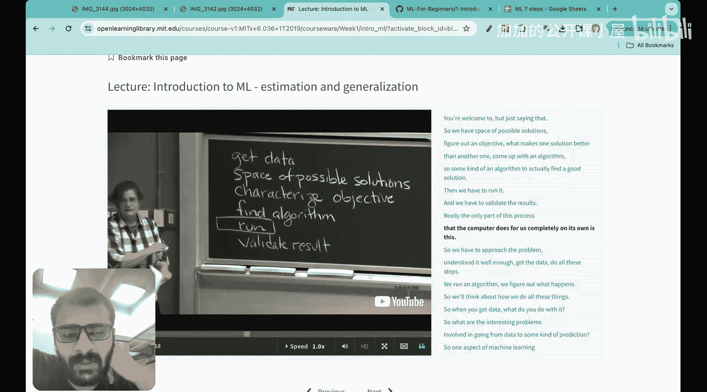

For this particular lecture， we will be referring to the MIT 6。

036 course which introduce this framework。

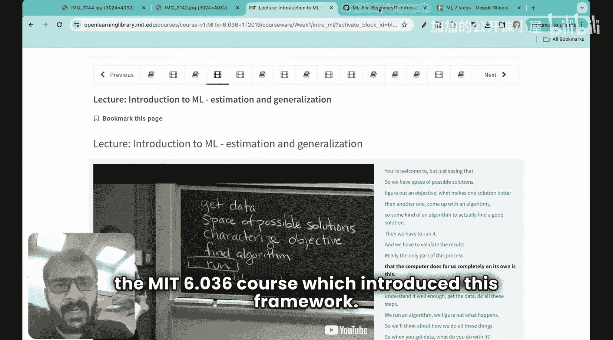

The Microsoft lecture or the Microsoft course does not have too much information regarding this。

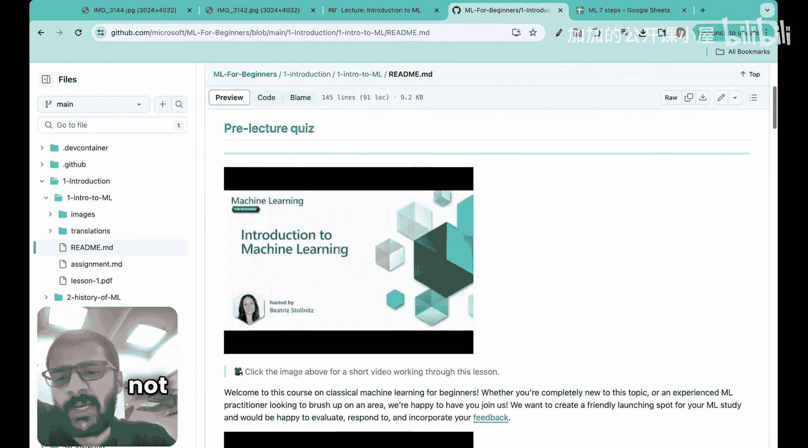

If you have not seen the previous lectures， kindly see the lecture one where we discuss why these are the two courses which we are referring to throughout this series。

So in today's video， I'll mostly go through the learnings。Which I understood based on the MIT scores。

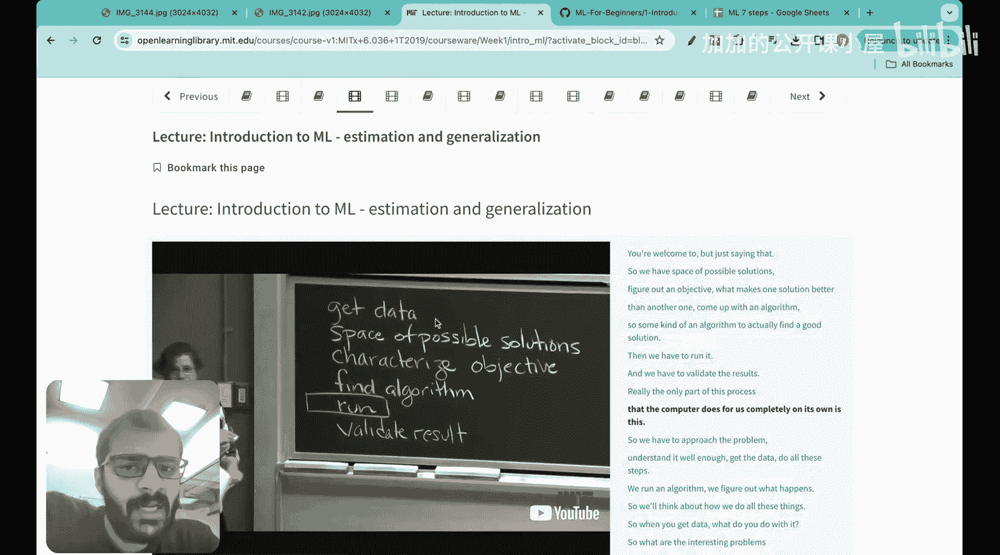

So let's get started， the first biggest learning for me was the six major steps in doing any machine learning projects。

And these six steps are as follows， the first step is getting or gathering data。

The second step is finding a space of possible solutions。

The third step is characterizing the objective。Or characterizing what makes a good solution compared to others。

The fourth step is finding the algorithm。The fifth step is running the algorithm。And the last step。

 which is the sixth step， is validating the result。Out of these six steps。

 except for running the algorithm， all the other things have to be done by humans。

So the fifth step which is running the algorithm， that is the only step which is done by the machine。

So the reason you are following this journey along with me is that hopefully towards the end of it。

You will be able to do all these steps， you will be able to gather data。

 you will be able to find the space of possible solutions you will be able to characterize the objective。

 you will be able to find an MLL algorithm， you will be able to run the algorithm and you will also be able to validate the result。

So that is the main aim for doing any ML project。When I looked at these different points。Intitly。

 they made sense to me， but again， they were not connected to any real life example。

So I did not really understand what they meant。

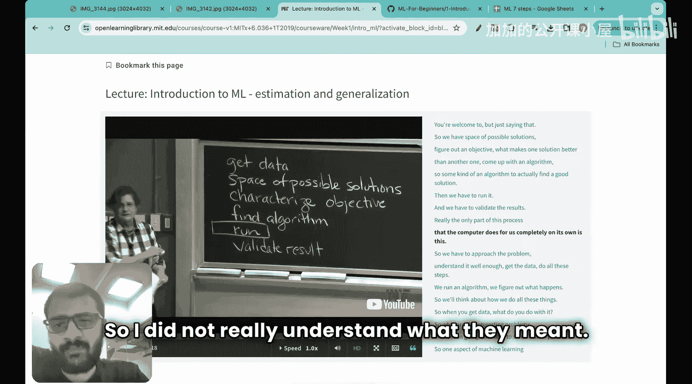

So as is the usual practice with me， I started making notes。

And this is what I emphasize throughout this series that whenever you watch a video。

 don't just watch it。But simultaneously make a notes， along with it。And as you write。

 you will also see that your concepts are slowly becoming clearer。

 so let us visit these six steps again as we saw the first step was getting the data。

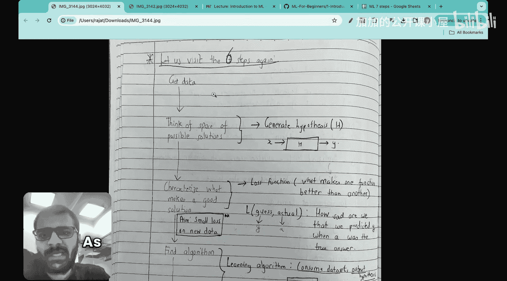

Second step was thinking of a space of possible solutions。

I figured out that this also means generating a hypothesis。Let's say that the input is x。

And let's say that the output is wire。And we want to generate a hypothesis。Between x。

 between the relationship between x and y。The third step is characterizing what makes a good solution。

So here we have to essentially determine what makes one。Hypo is better than the other。

In the finding the algorithm， we have to narrow down on the learning algorithm or finalize our hypothesis。

Then we have to run the algorithm and then finally we have to validate the result。Again。

 when I thought about the hypothesis it made things a bit clearer to me。

 but still I needed a practical example so what I did is I have constructed a hands on practical example for all of you guys who are watching。

And I have made it in simple LinkedIn， simple Excel sheet。

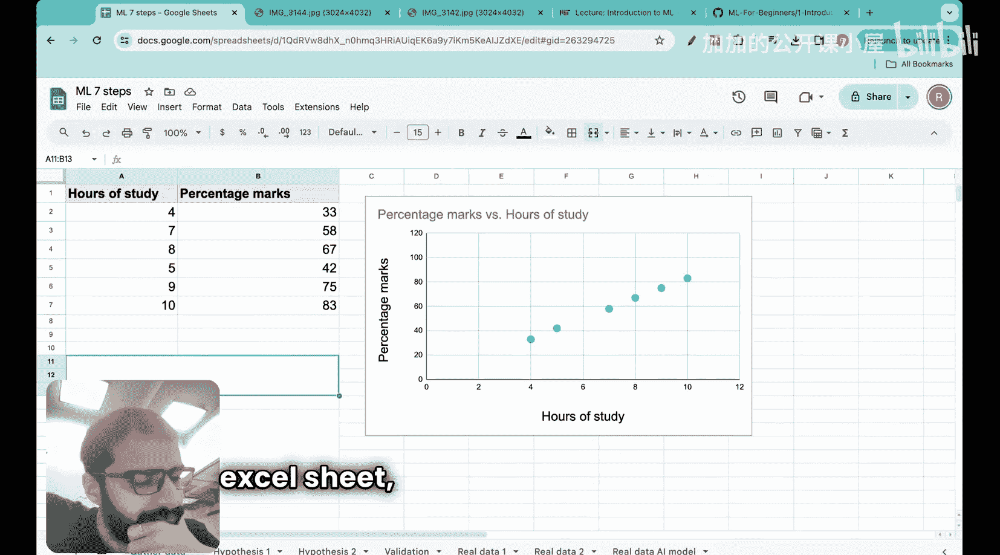

So that it will be very easy for you to follow all these。

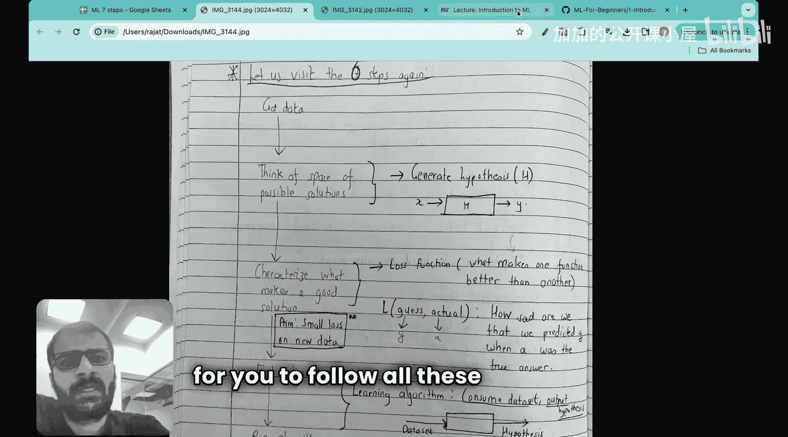

These six steps。So let us look at a simple problem。

 let's say you are a person who is tasked with this problem。You are a visit。

 You have visited a school， and the school has asked you that。

Based on the number of hours that a student is studying。

 can you predict the percentage marks of the student。

Remember in the last lecture we saw that ML deals with forecasting more and ML deals with generalization。

And this is a problem like that， where you have been given some data， let's say。

 of previous students who have studied for a particular duration and the percentage marks which they have obtained。

 your task is let's say now you take a new student who have studied for some number of hours。

Your task is to take that new student and predict the percentage marks of that particular student。

You have been tasked with employing machine learning for this。

Since you are a beginner let us resort to these seven steps the first step is collecting the data so you go to the school and you ask them that okay for me to develop this machine learning model。

 Ill need data from you。

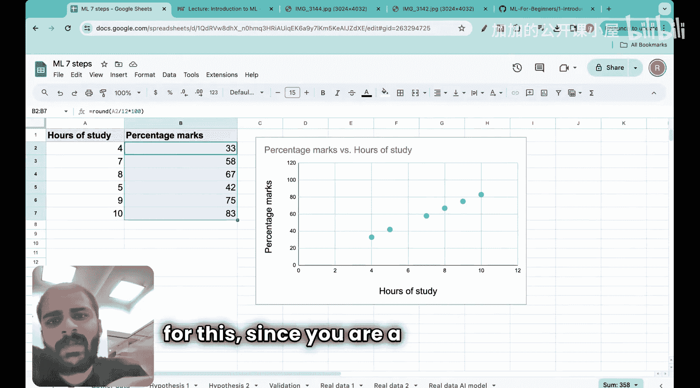

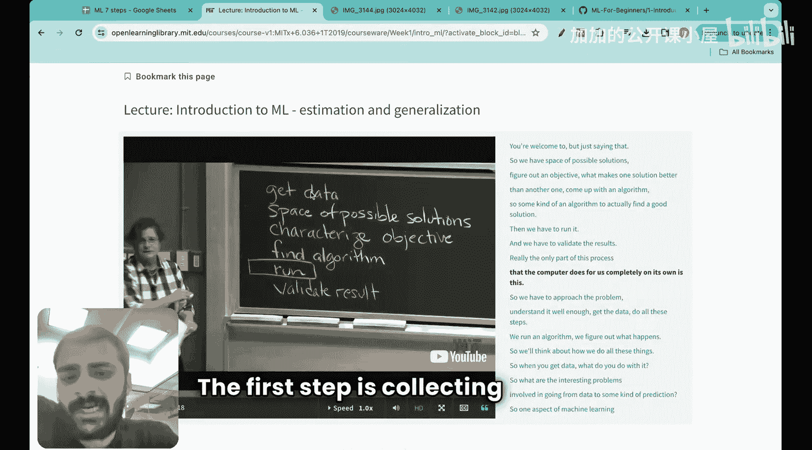

Can you give me some data of number of our students have studied and the percentage marks which they have worked in？

Because remember， without data， ML is nothing， just like we need food to survive。

 ML and AI require data。The school says that， yes， we have data for six students。

We have data for the hours which they have studied and the percentage mark which they have obtained。

And the school gives you that data， right？When you plot this data。

 it looks something like this on the x axis is our of study and on the y axis is percentage marks。

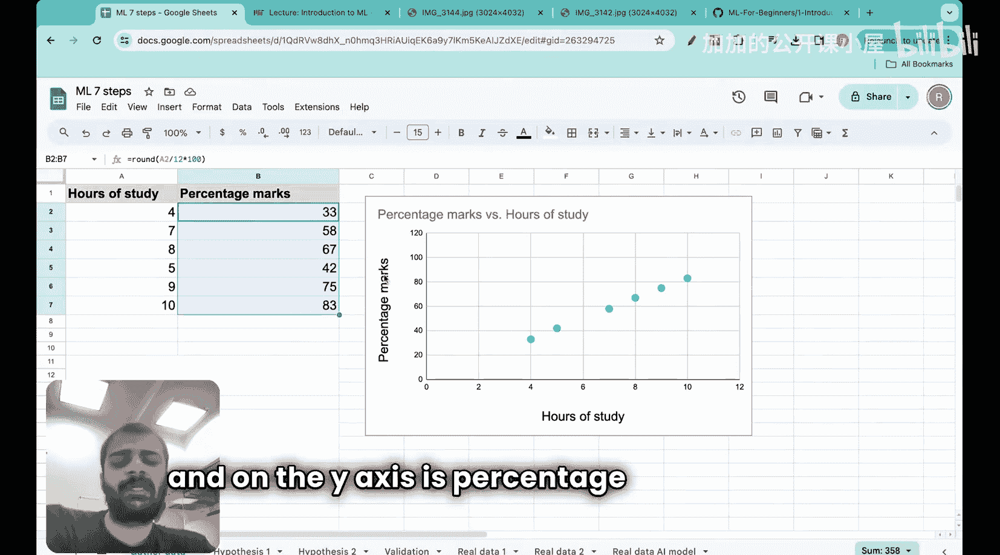

Great， now let's go to the next step。The next step is think of a space of possible solutions。

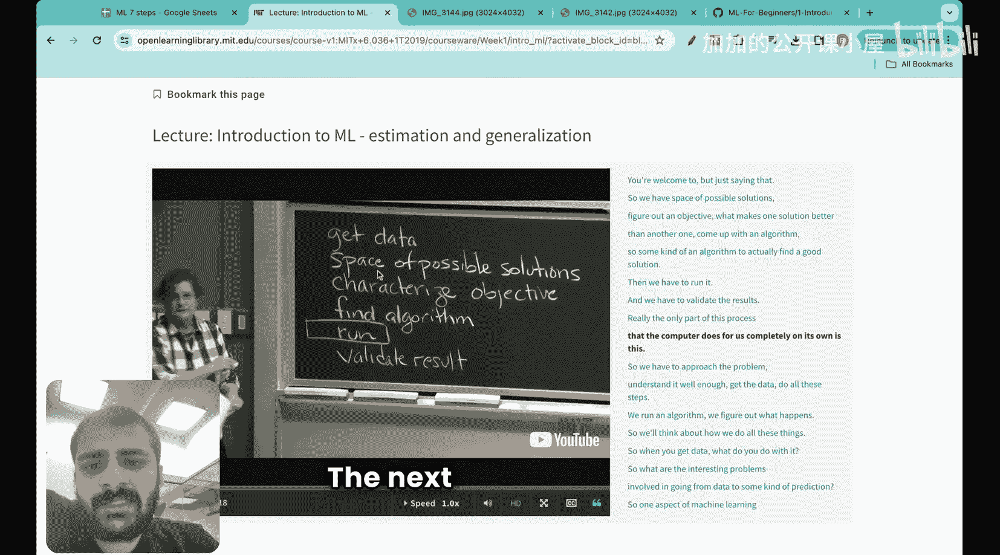

What you want to do as an ML engineer now is to find the relationship between the input。

 which is the hours of study and the output， which is the percentage marks。

So this is when you will think of the space of possible solutions。

 which means that you will generate a hypothesis。

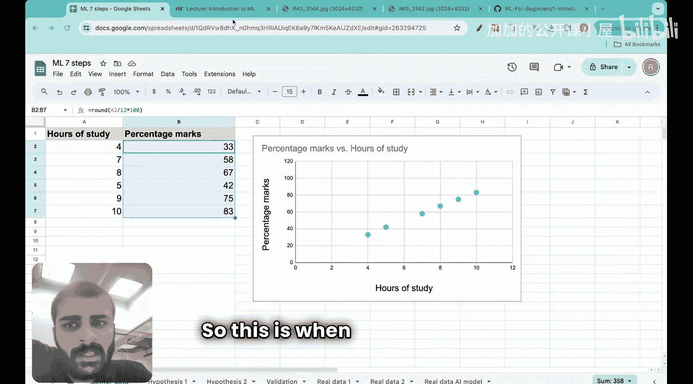

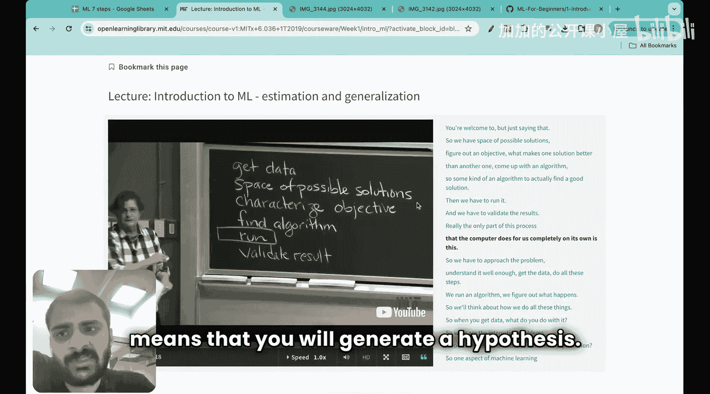

So， let us generate a hypothesis， we will generate two hypothesisses the first hypothesis is that of a straight line。

So my first hypothesis is that。There is a straight line relationship between the output and the input。

And my second hypothesis。My second hypothesis is that there is a curve will line relationship between the input and the output。

Let me mark it with a different color， So this is my second hypothesis and remember what my first hypothesis was my first hypothesis was a straight line between the input and the output。

So as an ML engineer， you have come up with this two hypothesis。

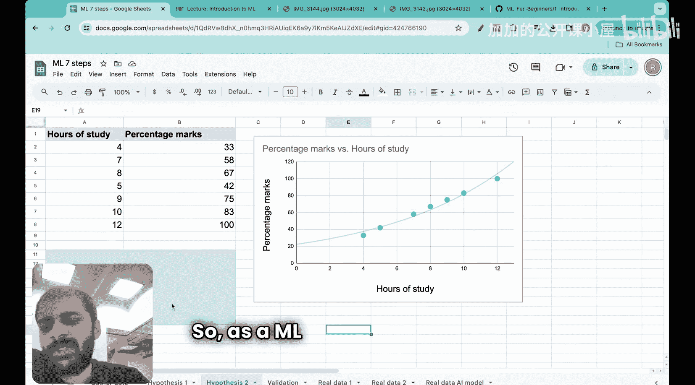

So， this is what this second step means， think of a space of possible solutions。

 so think of possible hypothesis or the possible relationships between x which is the input and y which is the output so we have thought of two hypothesistheses right now great。

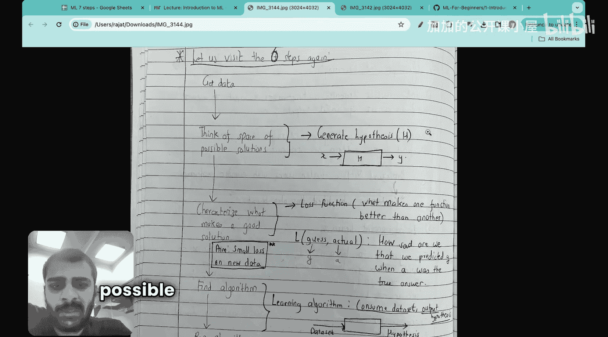

Now， let us actually move to the third step， which is characterize what makes a good solution。

 and this is extremely important。How do we decide which hypothesis is good。

 Is the first hypothesis good， Is the second hypothesis good。We need some metric right to compare。

From the graph its fine， we can see it， but we need a quantitative metric to compare between these two hyposes。

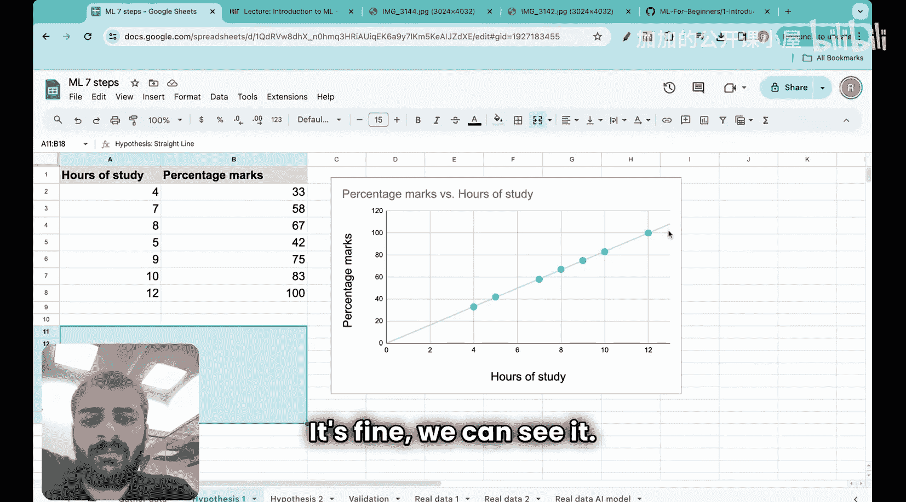

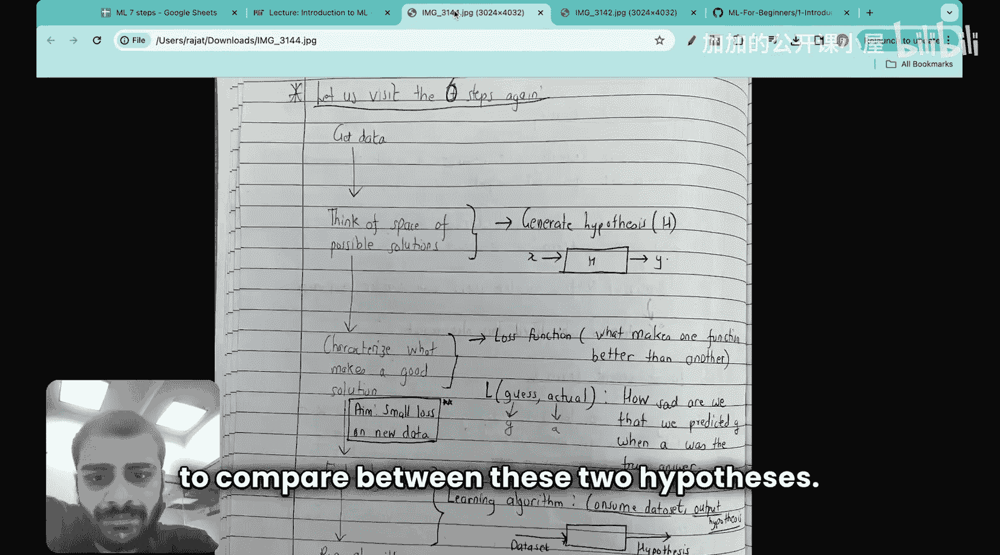

This is where the loss function comes into the picture。

The loss function is essentially the difference between our guess and the actual data。

So in layman's term， it basically means how sad are we that we predicted some guess value G when the actual value was a。

That's it。So the loss function is the difference between your guess and the actual value。

