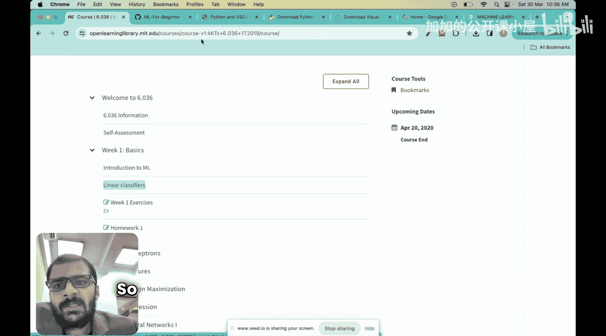
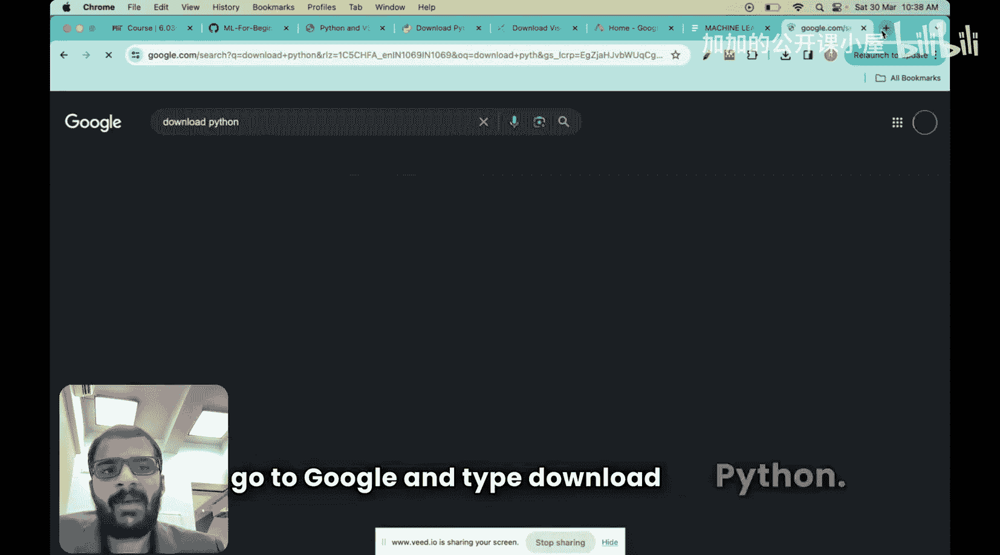
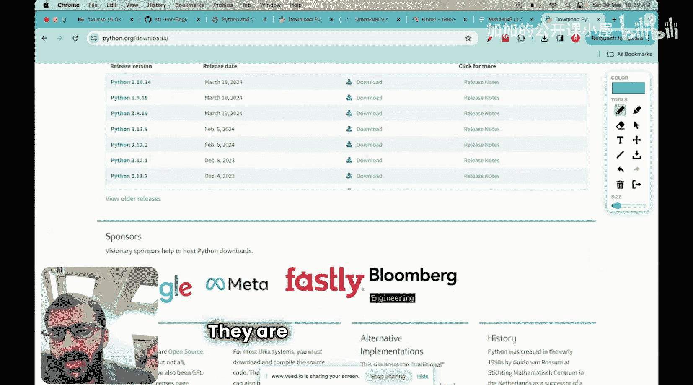

# Vizuara【中英⚡机器学习：实践教学｜Machine Learning： Teach by Doing】 p05 P5 ML Teach by Doing Day 5： Install Python and run your first code! [BV1RusDz1EXd_p5]

Hello， everyone。Welcome to the machine learning T by doing day five。My name is Dr。 Raj Daneer。

And in this lecture， we will be looking at Python and VS code。

We will be understanding all about the Python language and not just that we will do a hands on installation of Python。

And I'll show you how to execute your first ever Python code。

Students who already are familiar with Python can feel free to skip this particular lecture。

 or they can follow along to clarify some concepts。Whereas students who have always been afraid of。

 let's say， coding or installing Python， or they have heard about Python， but。

They really don't know what's the hype around it， or they have not never installed it in person。

I'll show you how easy and how quick it is really to install Python。

 you'll be able to do it in just 15 to 20 minutes。And I'll also go a bit more into text editors such as VS code and how to install VS code we will also discuss the differences between why is a editor really important。

And it difference with the interpreter， let's see。So you must have heard about all these terms。

 but if you have never gotten around to installing Python or if you have been always afraid of coding right？

Follow along with me in this lecture。And I'll show you how simple it is really to install Python and to run your first Python code。

So my philosophy with coding is pretty simple。Instead of first trying to understand every single thing。

You just run a code which works initially， You can maybe copy it from somewhere and just run it on your machine When that code runs for the first time and you see the output。

 you get a lot of motivation to continue learning further。

 and then you can go back to understand how the code was written。

 But if you spend months and months trying to understand the code itself without ever running it on your laptop。

Or your computer， then you never get the motivation。

I believe the best way to learn is to get your hands dirty initially。

 directly jump into it run your first code。And then go back and see what was written in the code that's how I've learned coding my entire life so don't be scared of this beast。

嗯。It has become so important now to learn Python that。

All of us should understand Python and should execute Python code and what I want to show in this particular lecture is that it's really very。

 very easy。To run your first Python script。So let's get started in the previous four lectures we looked at the general overview of MLTG by doing。

In the second lecture we looked at intro to ML in the third lecture。

 we looked at types of ML models and in the fourth lecture we looked at the six steps of ML project。

In this last lecture I had asked a question about training data and test data in particular I had asked how can we be so sure that optimizing training data will lead to less amount of。

Test error or optimizing for training error would lead to less amount of test error。

Out of all the responses which we received in the comments， the best response was the one which。

Said that the distribution of data in the training set should be similar to the distribution of data in the test set。

So if it's a Gaussian distribution， let's say we can be confident that or if it's any other distribution。

 we can be confident that if。We have minimized the training error。

 the test error will also be minimized because the data follows a similar distribution。

We will come to this point in later lectures also， but please be active on the comments。

Because well be discussing it in subsequent videos， the best comments。

And as Im going to show in this lecture how to install Python and run Python code。

 if you face any doubts in the installation or if you are stuck somewhere。

 please put it in the comments and we will resolve the doubt as soon as possible。

So let's get started with the day five。First I want to quickly go through what exactly is Python。

 so for viewers or for students who have no clue about this。

 but they have just heard of it and they don't know the basics。

Python is a popular programming language which is known for its simplicity and readability。

And it is also widely used in various domains such as machine learning and artificial intelligence the way I like to think about Python is it's like a tool which all ML engineers should have if Python did not exist the pace of ML research would really slow down Python has really made it easy for engineers and students like us to run ML algorithms or run ML techniques on our own laptops。

So the six steps which we saw in the previous lecture， the six ML steps。

 Python is the place where we run and execute those steps。

And that' is why courses give so much preference through it so if you look at the MITs course we have reached we have finished this intro to ML portion and from next week onwards we will be looking at linear classifiers。

Even in the M L4 beginners， Microsoft course。We have finished the introduction section。

As has been senior， and next， we will move towards regression。Now。

 as for both the MIT course and this course， it is essential that you install Python。

And that is why we are going through this particular lecture where we are understanding what Python is and how to install it because it will really be useful for all our tasks later when we go to regression。

 when we go to classification and when we look at other ML algorithms。

It is important to install Python from right now so that when it comes to that stage and when we do hands on projects。

 you can directly follow along。So this series is even meant for students who have no clue about Python because as you can see。

 I'm going right from the very basics。

So this is a popular programming language and the way I think of it is a tool。

Which ML engineers and students should definitely have in their toolbox。Now。

 the reason why Python has become so popular for machine learning is because of four things。

 I believe the first thing is it's pretty simple。To understand and its pretty simple to read and write the code in Python as we go through the lectures you will also see that writing code in Python is much easier than writing it in C or C++。

At least for engineers who don't have coding background before。

That's why so many engineers have transitioned to Python in the first place。Secondly。

 a number of researchers， number of students and engineers have built libraries now for Ml and AI。

 So that makes it very easy for me to run different tasks。 For example， if I want to train a。

languageguage model， I don't have to write the entire thing from scratch。

 I can just use a pre written library in Python。Thirdly， it's open source。

 which means as we will see in today's lecture， it's completely free to download Python to install it and to run your first code。

There is no barrier to entry。And finally， there is a large community support。

 If you ask any doubt on the Internet on stack overflow， I am sure there will be a response to it。

 There are millions of people who are using Python on a daily basis。

 so the community support for this language is really incredible。

These are the four reasons why Python has really become so popular in the first place。

So let's dive into the lecture and let's get started with installing Python， okay。

So I'll also be sharing this download link in the description but。

You can just go to Google and type download Python。

 the first link which will open up will look something like this and this is exactly where you have to go to download Python。

Now here you will see that there are options for Windows， Mac， etc。

 so you can just select whichever platform is convenient to you and you can download so I am using a Mac so it has automatically shown download the latest version for Mac OS so then I click on this download button。

If you are using Windows， please。Go to this particular link and then click on the download button。

 remember to download the latest version of Python because that will be the most reliable do not download Python 2 so Python2 versions are very old they are not even here I think so download the latest version。

Click on this button and the download will start over here you will see the download progressing I think it's around 400 m or something but it will it took around two minutes for me to download it on my PC when I did it yesterday depending on the internet speed you can wait for some time for the downloading to finish。

Now， when the download finishes， it will appear in your downloads。

It will essentially appear in your downloads folder and then you just have to follow the installation instruction sequentially。

So just click on I agree and whichever folder has space you can install Python there so for the Mac you can see that the Python application has been installed over here。

