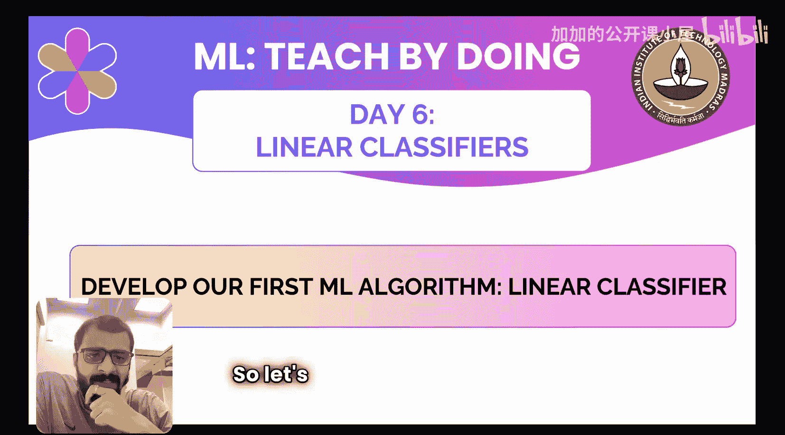
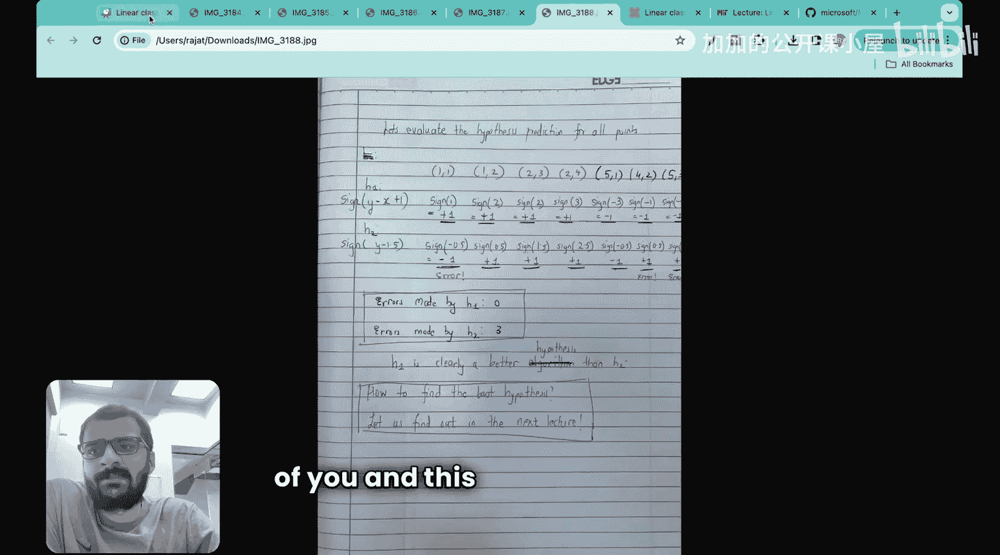
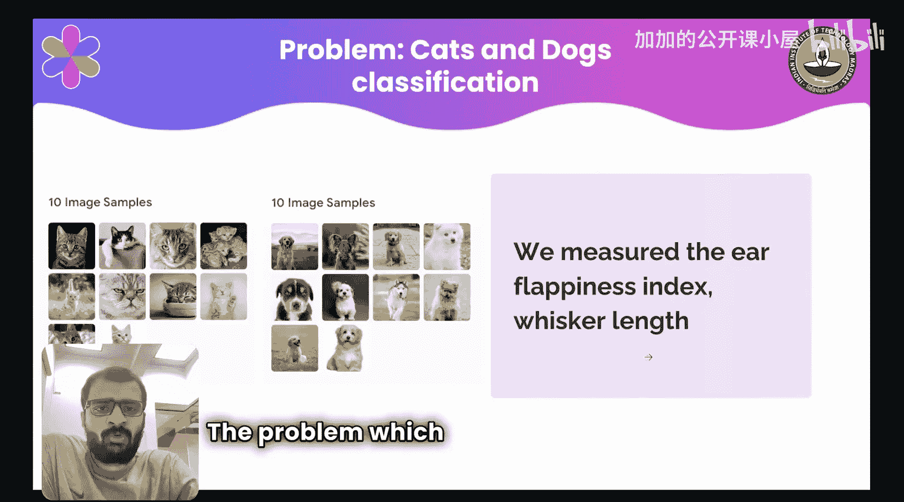
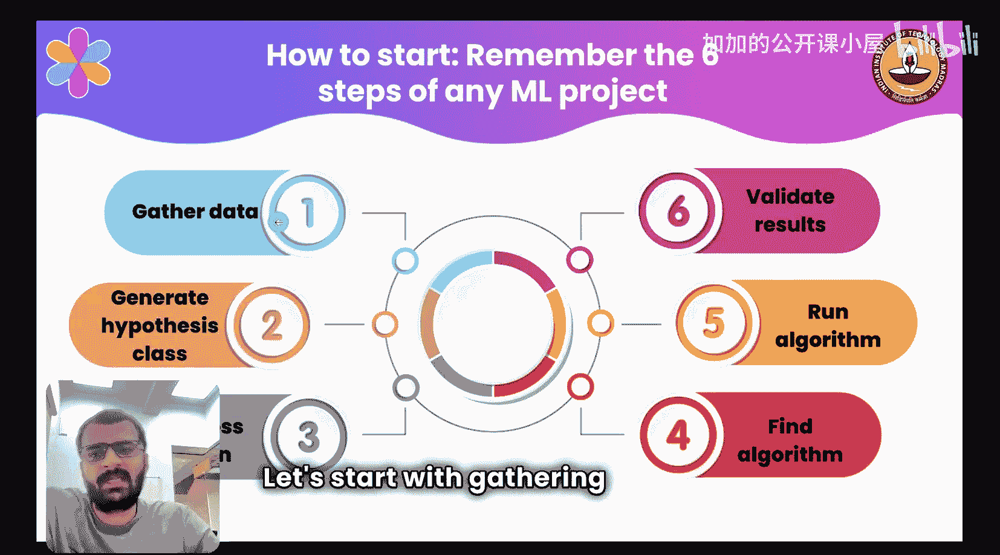
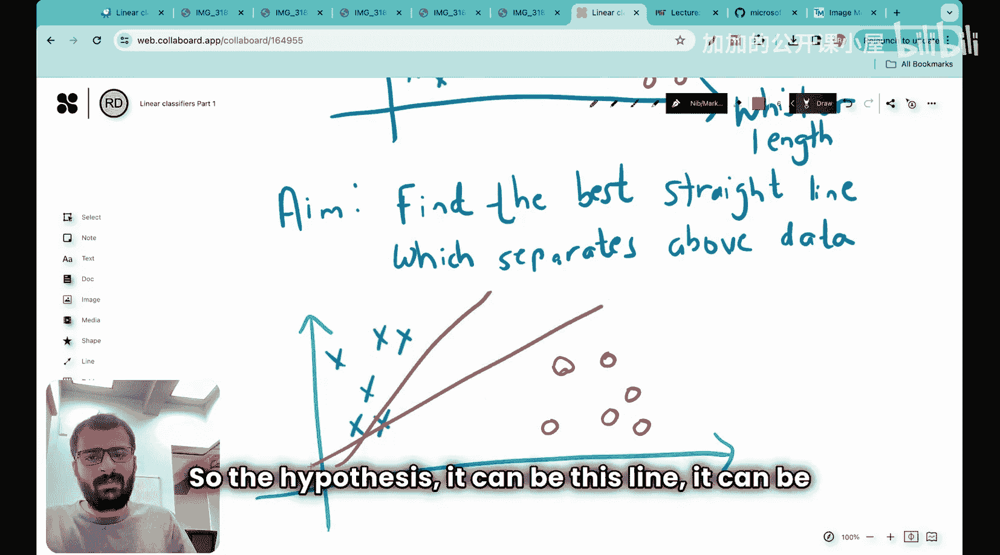

# Vizuara【中英⚡机器学习：实践教学｜Machine Learning： Teach by Doing】 p06 P6 ML Teach by Doing Day 6： Linear Classifiers Part 1 [BV1RusDz1EXd_p6]

Hello， everyone。Welcome to the Ma Learning T by Doing Project day six。In the previous five days。

 we have covered a number of things， including the types of ML models。

Installing Python and running your first ML code the six steps of doing any ML project etcter so if you have not seen those previous lectures。

 please go through them。And then you can come back to this lecture。Today is a very。

 very interesting topic。Today， we are going to develop our first machine learning algorithm。

It will be a lecture on linear classifiers。I have planned two lectures on this。

 one will be today and one will be tomorrow， so today will be the part one of this lecture。

I'll also be writing many things in front of all of you today。

 so please make sure to have a pen or a paper ready。

That will tremendously improve your understanding。So let's get started， everyone。

Before we get started， I would like to share that for today's lecture。

 I have made four pages of handwritten notes。Which I'll be sharing with all of you and this presentation PDF also I'll be sharing。

 which will be found in the information section of the video。

So all that material will be available to you。So let's get started with today's interesting lecture where we will develop our first machine learning algorithm。

 which is linear classifier。The problem which we will be taking for this is the caps and dogs classification remember in a previous lecture we looked at the teachable machine interface。

Where we performed an image classification between two types of categories。

 we gave the category one as cats， we gave the category two as dogs。

And then we uploaded several pictures， we uploaded 10 images of cats， we uploaded 10 images of dogs。

 and then we ultimately run the AI model。Today we will be developing our own AI model。

 which will be able to classify between cats and dogs。

So we will dive a bit into theory as well as practical one more thing I would like to share with all of you is that if you go to the Microsoft course。

And if you look at classification， the way they do classification is directly using Python and directly from projects。

 but there is no mention of the theory of classification or the mathematics behind classification。

Whereas in today's lecture we will be following MIT course where they dive a lot into the theory and the mathematical understanding behind linear classification。

One of the goals of this series is not just to do practical projects but also to introduce you to the foundations of machine learning we will of course do practical classification problems as well。

 but initially all of you guys really need to understand the theory so this initial first lecture and also maybe tomorrow's lecture will be geared towards theory of classification and then we will take handson examples where we will demonstrate projects in Python。

So the problem which we are facing is that we have to identify between cats and dogs。

And there is one more thing we have measured two properties based on all of these images。

 We have measured the vi length。And we have measured the ear Fliness index。So。

 we know that dogs have flappy ears， so we have constructed a metric called ear flapappiness index and we know that cats have longer whiskers so we have measured another thing called whisker length。

Now， your task is that based on these two measurements。

You have to build a linear classifier so that if I give you any other new animal。

You take these two measurements again， you take the ear happinessiness index and if you measure the whisker length。

 your model should be able to predict whether it' is a cat or whether it' is a dog。

I hope everyone has understood this problem imagine you have 10 cats and 10 dogs and you have measured the ear flapiness index and whisker length of all these animals that' is your training data the problem is to construct a linear classifier model which can classify any new animal so lets say now I give you another new animal and you measure its flapiness index and the whisker length based on the training data your job is to classify the new animal。

And take into input the measurements， the two measurements。

And then classify whether it's a cat or whether it's a dog。Great。

 I hope everyone has understood this problem。Now， whenever anyone gives you any machine learning project like this。

 your first instinct should be should be to go back to the six steps of any machine learning project。

I think it was day three of the series where we looked at the six steps of any ML project。

And we saw that the six steps are gathering the data， generating hypothesis class。

 defining the loss function。Fourth is finding the algorithm， fifth is running the algorithm。

 and sixth is validating the result。In today's lecture。

 we'll be looking at especially the steps number one and steps number two。

And a bit about step number three in tomorrow's lecture， we will look at step four。

 step5 and step six。So okay， you have been given this project and you have the six steps of any ML project。

 So lets start with the first step， let's start with gathering the data。

 So now I am going to this whiteboard well where I'll be writing in front of you。

So。Our task right now。Is to。Generate。Linear classifier。Or to find the best possible algorithm。

And as I mentioned， we looked at the step one。Step 1。Is gather the data。Gather the data。

Now let's look at the data I am going to plot the data here。The data looks something like this。

This is the y axis and this is the x axis。The X axis label is whiskser length。Whisker length。

And the y axis label is here。Eear of happiness。Index。Okay。

 and so the first data point will be for dogs。So dogs generally have flappy ears and shorter whisker length。

 so all of the data lies here。This is the data which we have collected， this is for dogs。

And for cats， all of the data lies here。So cats generally have a shorter ear fliness index and their whisker length is usually larger。

So this is the data for cats which lies here。Now， our aim。Let me switch back to the blue。Our aim。

Is to find。When I say find the best linear classifier， our aim is to find the best。😊，Spread line。

Which separates the above data。Which separates。Above data。So that's our aim。

 and the further aim is that。Whenever someone gives us。A new data point。

 Let's say someone has given us a new data point。Of。Which is somewhere here。

Let's say this is our new data point。Based on that straight line。

 we should be able to classify whether it's a cat or whether it's a dog。So this is the aim。

So if we go to step number two， we have to generate a hypothesis class。

And since we are building a linear classifier， the hypothesis class will be all the space of straight lines which are possible。

 so let me draw the above graph again。So。呃。L to me。Drrowaw the dog data。 So this is the dog data。

And this is the CAD data。Okay， now the hypothesis class is all possible straight lines which can exist。

 so let's see so the hypothesis class can visually look something like this。😊。

Let me use orange color for this。 So the hypothesis can be this line， it can be this line。

 it can be this line， it can be this line， it can be this it can。

