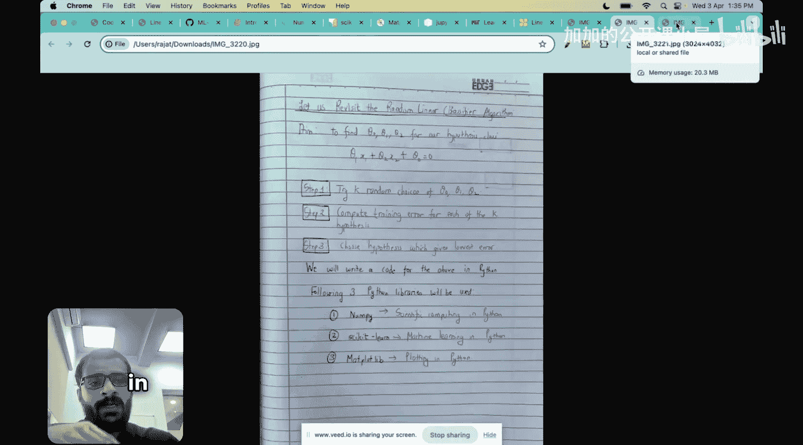
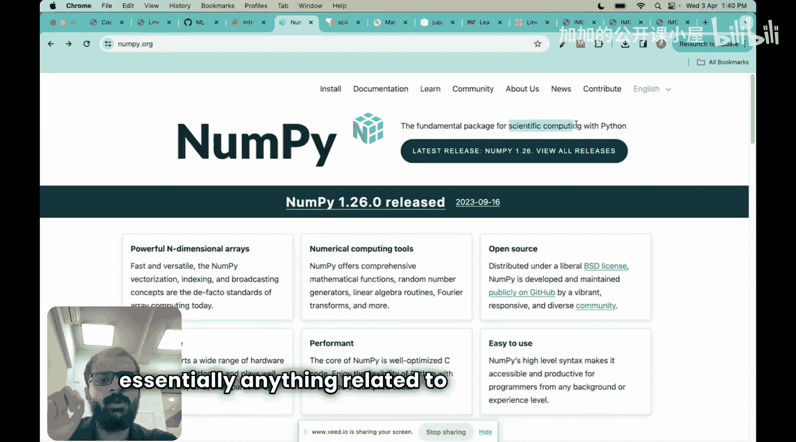
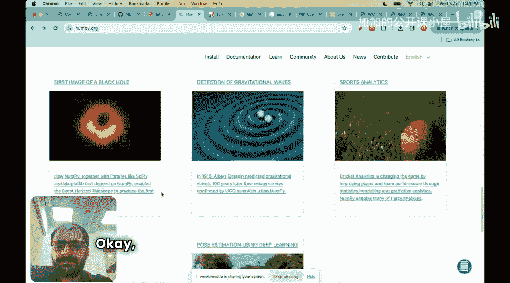
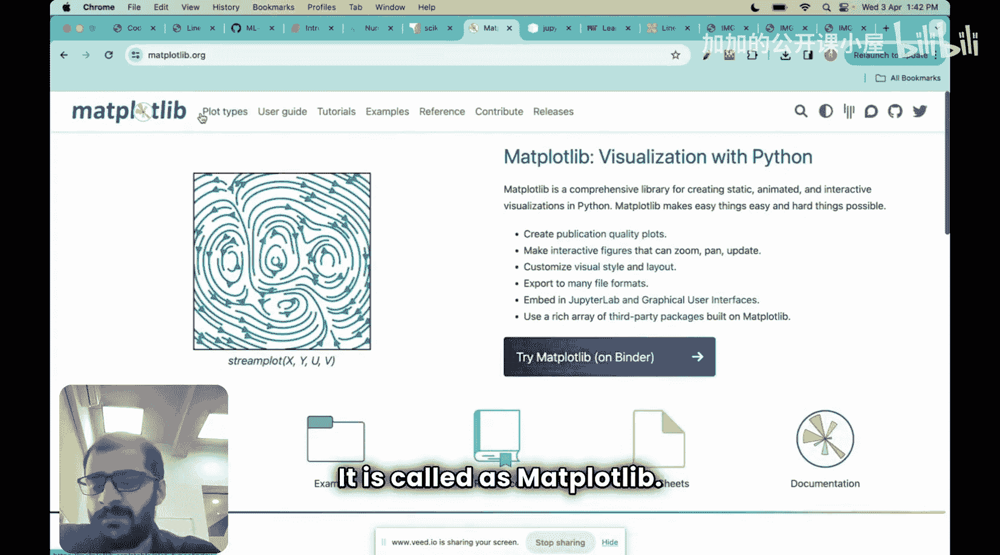

# Vizuara【中英⚡机器学习：实践教学｜Machine Learning： Teach by Doing】 p08 P8 ML Teach by Doing Lecture 8： Jupyter Notebooks, Numpy, Scikit-Learn, Matplotl [BV1RusDz1EXd_p8]

Hello everyone， welcome to the day8 of the Mach Learning T by Doing project。

In the previous two lectures， we have taken a look at linear classifiers。

And we have actually developed our first machine learning algorithm。

 which is the random linear classification algorithm。For executing that algorithm。

 we went through all of these six steps in the part one of the lecture we went through the steps on gathering our data。

 generating the linear hypothesis class， defining the loss function and in the part two of the lecture we went through the remaining three parts which is finding the algorithm。

 running the algorithm and validating the results。In today's lecture。

 what we will be doing is we will be coding。The linear classifier in Python。

Essentially what we will be doing is these six steps which you observed over here。

 we will be running the code in Python completely from scratch so that you will see a practical and handson implementation of the theory which you learned in the previous lectures。

As I mentioned， I want this course to be a mixture of theory plus practical last two lectures were devoted to theory and this particular lecture will be diving into the practical aspects。

So other courses might just teach you just doing it in Python。

 but then you will miss out on the theoretical base which we have built up。

So today we will understand about coding linear classifiers in Python。

The only background knowledge which I expect about Python is just installing Python in the first place。

 and I've already made a lecture for it it's in day number five。

I show how to install Python and integrate it with VS code in just 20 minutes。

So if you have not seen that lecture or if you have not installed Python。

 then please watch it it's barely 25 to 30 minutes lecture。

 if you have installed Python on your system that's great then you don't need any prerequisite for following with me in this lecture。

After making the content and after writing the notes。

 which as always I'll be sharing with you on in the YouTube information。

 I realize that I'll break this into two parts。

Just because。I don't want to make one video very long。So in the first part。

 what we will be learning is。Jupiter notebooks and three powerful Python libraries。

Overall for the two part coding session which I have glad we will be learning these four things。

 but in this video we will look at number one， what is Jupiter notebook。What what。

 why is it become so popular， what are the advantages of Jupiter notebooks？

How to integrate Jupyter notebook with VS code。And then we will also learn about libraries in Python。

 After installing Python， we will learn why Python has become so famous。

 and we will learn three of the most powerful libraries in Python。 First is called as Numpy。

 Second is called as psychit learnn， and third is called as mat plotlib。😊。

After introducing these libraries and Jupiter Roadbook。

We will install these in the VS code environment。So that our Python installation is configured with these libraries and with the Jupiter notebook environment。

So let's get started first， let me introduce Jupiter notebooks。

Jupyter notebook if you go to the documentation itself。

Jupiter notebooks are a community standard for communicating and performing interactive computing。

 basically the way I think about Jupiter notebook is very much in the communication space。

If you just write the code in VS code， it is very difficult for you to communicate it with others because it is quite difficult to integrate the code with。

The title， description， etc cea。What Jupiter notebook does is that。In the Jupiter notebook document。

 you can have a mixture of text， you can even add mathematics， images， videos， etc。

 along with the code， so basically it makes it much much easier to explain and go through the code。

Overall， it's an amazing tool for communication。And that' is the reason why I'll be showing the code through Jupyter notebook because it will be much easier for me to exactly show you guys how different lines of codes are working。

An example of this is。Let us go below in this documentation。An example of this is this particular。

Example， so the first way is to just write this in V code。

 but that' is not good right in Jupyter notebook you can even write a title like this you can write a description then you can show the code cell then you can show the plotting then you can even write next steps etc I believe that this thing itself is written in Jupyter notebook style this document which I am showing to you right now。

So in a sense， this is much， much better for communicating codes。

And that's why so many engineers and so many students use Jupyter notebook for writing initial Python scripts and many teachers around the world such as myself who are teaching machine learning。

They really like Jupiter notebook because it makes the teaching and the explanations much。

 much easier。So thats the first thing which we learned today， Jupyter notebooks。

 I'll show you briefly how we can integrate it with V code。But before that。

 let me introduce the other three powerful Python libraries。The first library is Numpai。

So if you go to Nai。org， that is the website and the one sentence description of NumbI is that it is the fundamental package for scientific computing with Python。

So Numpier allows us to define arrays， manipulate arrays， mets。

It gives several computing tools for linear algebra。

And for several other machine learning frameworks as well。And this library is fully open source。

 which means that it's available publicly on GitHub。嗯。

And so here you can see Numbai allows you to do different things。First。

 you have to tell the Python editor that。You are loading this particular package and once you do that。

 then later you can do several things。 So here you can see that。

We we are creating a 2D array and we are setting every second element in some rows and finding the maximum per row basically an array operation is being performed here Nai makes it very very easy to define arrays and perform mathematical operations。

As you can see。There are several possible applications in even data science。

 machine learning and visualizations。That's where Numbai has become extremely popular， in fact。

 if you go to the documentation section of Numbai。You will see several things about getting started user guide。

 etc cetera。 But every single developer I know uses Ny in some or the other code， which they write。

 It is the default package， which people go through for。

Manipulating Me array is essentially anything related to scientific computing。

呃。ok。

So let me again go to the documentation and let me show you the Github repository so it's fully open source here you can see that it has 26000 stars 9。

2000 fork which means 9。9000 people have forked this repository and try to edit it on their own so if someone is interested to check out NI code please you can check it out at this GiHub repository if not it's perfectly fine you just need to know that NI is used for scientific computing I show you how it can be used in practice。

Second package which is extremely powerful is psyit Learn。

 and this is a package which is very specific to machine learning in Python。Essentially。

 PsyitL is a library which provides so many out of the box functions which you can directly use。

For several tasks such as classification， regression， clustering， etc cetera。

 the purpose of these libraries is that someone has already written down the library so that when you want to execute a famous ML L algorithm。

 you don't have to write the entire code。 You can just write the function。

 which is provided by this particular library。In this case， psychic learn。

And psyitler is built on top of Numbai itself。So later we will learn about all these things classification。

 regression clustering， etcter， but for all of these machine learning tasks。

 psychic learn essentially is the best。Li to do or to perform all of these ML tasks and it's widely used in practice the reason I'm demonstrating this library to you and the reason we are going to follow this is even if you are doing a simple project or a complex project psychit learn is the library which you will use。

The third package which I want to show is a plotting library， it is called as matte plot Lib。

Let's say you're running a Python script and if you want to have plots for visual。

