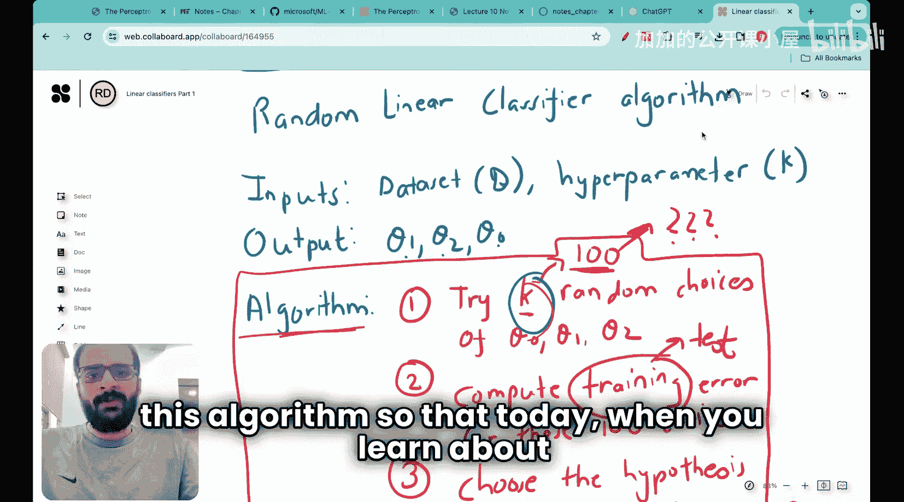
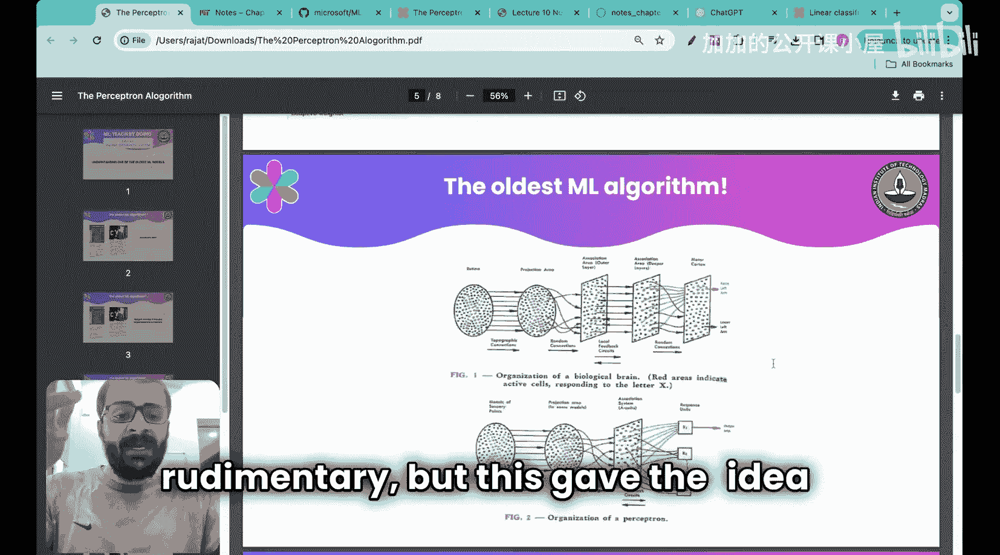
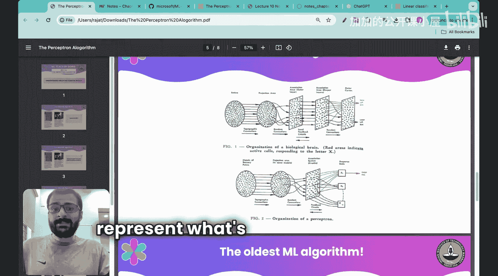
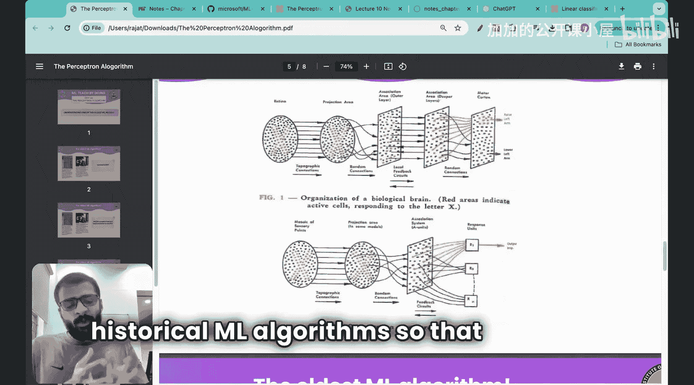
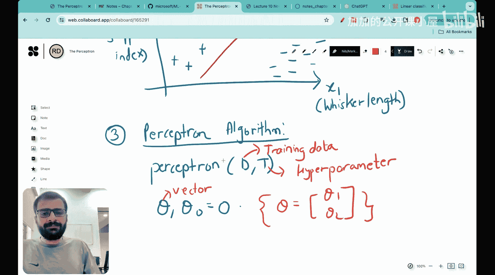

# Vizuara【中英⚡机器学习：实践教学｜Machine Learning： Teach by Doing】 p10 P10 ML Teach by Doing Lecture 10： The Perceptron Explained [BV1RusDz1EXd_p10]

Hello， everyone。Welcome to the machine learning teach by doing lecture 10 or the day 10。Today。

 I am incredibly excited because today we are going to learn about one of the oldest machine learning models。

Which was actually developed in 1957。The name of this model or algorithm is the perceptron algorithm。

The name sounds pretty cool and today we are going to learn all about the perceptron algorithm right from scratch as always Ill be presenting with a whiteboard approach where I'll be writing everything in front of you so that you completely and clearly understand this algorithm。

Let's get started。Before that， in the previous lectures， we looked at linear classifiers。

And we looked at another algorithm called as the random linear classifier algorithm。

Today we are going to look at the perceptron algorithm。

 which is a bit more smarter than this random linear classifier algorithm which we looked at before。

So if you have not seen the previous lectures， please go through this to get a feel of this algorithm so that today when you learn about the perceptron。

 you will appreciate it much， much more。

So as I mentioned， the perceptron algorithm is one of the oldest machine learning algorithms it was invented in 1957。

Which is almost。Around 60 to 70 years back and today we are going to learn about that。In fact。

 this was not just a model， it was also implemented as a machine by engineers and here is how that machine actually looked like so this is the machine on which the perceptron algorithm was implemented it is also called as the mark1 perceptron machine which was the first implementation of the perceptron algorithm。

Here is the person also who is working with the machine。

And the main purpose of this machine was to mimic the way the human brain processes visual information and learns from it。

Remember at that time neural networks and artificial intelligence was not developed at all。

 in fact there was no research or no this terminology itself was not known that AI can represent the human brain。

So the researchers who developed the perceptron algorithm。

 they had this insight that what if we can mimic the way the human brain processes visual information？

The perceptron is very fundamental and very rudimentary。

 but this gave the idea to the fact that ML algorithms can essentially represent what is happening in the human brain。

😊。

So when the perceptron paper was released here you can see the authors mentioned this in the figure that in figure 1。

 they showed the organization of a biological brain and in figure2 they showed an organization of a perceptron and they visualized a world in which we can have ML algorithms like the perceptron which can model the human brain。

This is the algorithm from where the idea or the concept of artificial intelligence was really boring。

And today you are going to learn about it， so imagine that you have a time machine which takes you back 60 years and you are learning about the first ML algorithm。

 the reason I am teaching this to you right now is because to appreciate all the current algorithms。

 you will see that the roots of the current developments lie in the past as is the case with so many things so it's very important to appreciate the historical ML algorithms so that you don't feel intimidated by the new ML algorithms。

This was actually one of the first models which could learn from its mistake remember at that time the idea of machine learning was not really invented but now if you think of it a model which could learn from its mistake is essentially the key idea behind machine learning itself。

In machine learning also， the machine is learning as it interacts more and more with the user。

So the perceptron algorithm was one of the first model which could learn from its mistake。

 so in essence it was one of the oldest machine learning models。

When the algorithm itself was developed， the primary aim of the perceptron was to be able to recognize shapes。

 patterns， letters and numbers。Now we can do so many more things。

 but at that time it was revolutionary because it could learn from its mistakes on its own without human intervention。

So let's get started。As I mentioned this will be an interesting hands on lecture in which we will completely understand the perceptron right from the very basics I won't ever use a terminology or just。

Show you something on the screen， which I myself have not written down。嗯。

That way you can easily understand what I'm doing and what I'm writing， so let's get started。

One more thing before we get started is that this particular lecture is inspired from the MITs perceptron lecture。

The Microsoft lectures as I mentioned they are heavily geared towards spec aspects so they don't have anything about the perceptron this is again one of the reasons if you take courses which are fully just practical you will miss out on these brilliant historical ML algorithms and you will miss out learning about them。

So， let's get started with understanding the percept and learning all about the perceptron。So。Okay。

 first of all the first thing to note is that the perceptron is essentially smarter。Then， the。

Random linear classifier。Which we， we looked at before。So do keep this in mind。Secondly。

Perceptron is also an MLl algorithm。Which gives us the best linear classifier。

So the problem which we will be looking at is the same one which we looked at when we constructed the random linear classifier。

And I will introduce the problem to you， don't worry。So let's introduce the problem。We have。X soon。

Annex 2。X1， which is the x axis variable， is whisk length。

So we are collecting a bunch of dogs and cats we are measuring the whisker length and we are measuring a metric which is called as the year of Flappiness index。

ok。So the dogs will be called as a plus category。And the dog data looks something like this。

So as you can see， docs generally have higher ear flapiness index， but lower whisker length。

So this is the data for the dogss。And the CAD data looks something like this。Cats generally have a。

Essentially a higher whisker length but a lower ear happinessiness index。

 so this is how the CAD data actually looks like。So the goal of the perceptron algorithm。

Is actually to find the straight line which best separates these two data。

That is the goal and in two dimension the equation for this straight line will be theta1 x1。

Plus theta 2 x2 plus theta not equal to 0。So first。

 let us look at the perceptron algorithm itself and then I will explain to you every single thing in the algorithm step by step。

So let us look at the perceptron algorithm。Okay， so I'm going to call this algorithm as perceptron。

And the input switchdget takes are D and T。D is the。Praining data。And T is the hyperparameter。

We will explain what T is in the subsequent lectures。

 but today the main goal is to not focus on T but to really understand the algorithmith itself。

So initially what I'll do is I'll initialize theta and theta not to be equal to 0。

Who want more representation， which I'll follow continuously throughout this particular。

Lecture is a vector notation。 So remember that when I write theti， this is a vector。

And not just so theta is equal to theta 1 and theta 2。

So remember ultimately we have to find the parameters theta 1 theta 2 and theta node right what I am going to do is that I am going to represent theta as a vector which is two values theta 1 and theta 2 theta node will remain to be a scalar。

So if I find theta and theta not， I just have to take the first。

