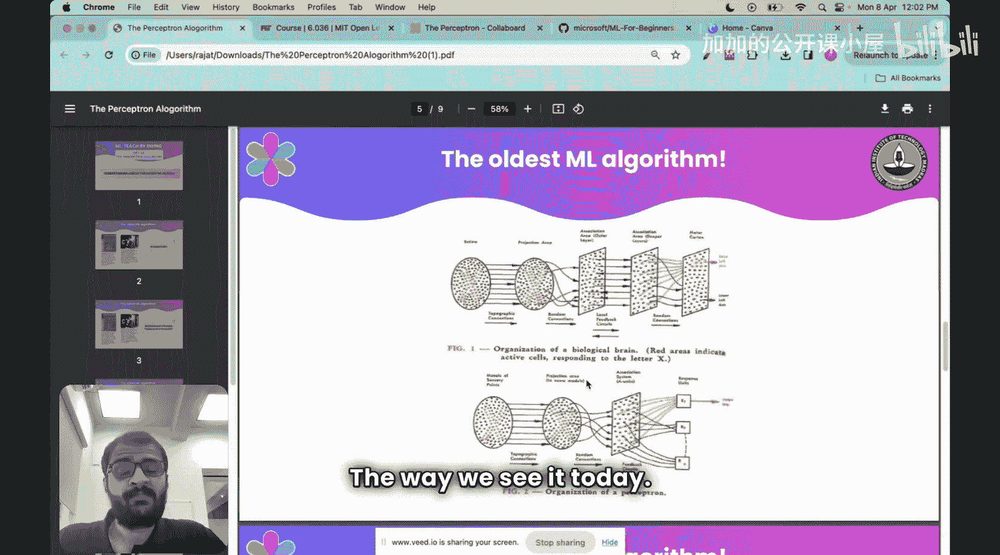
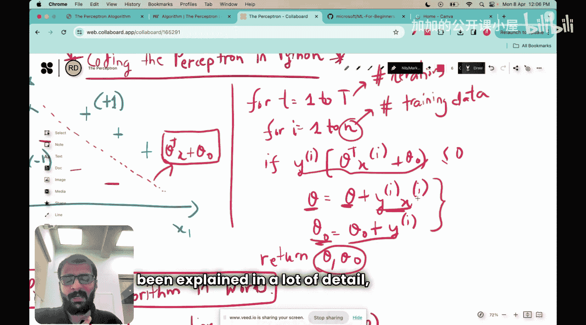
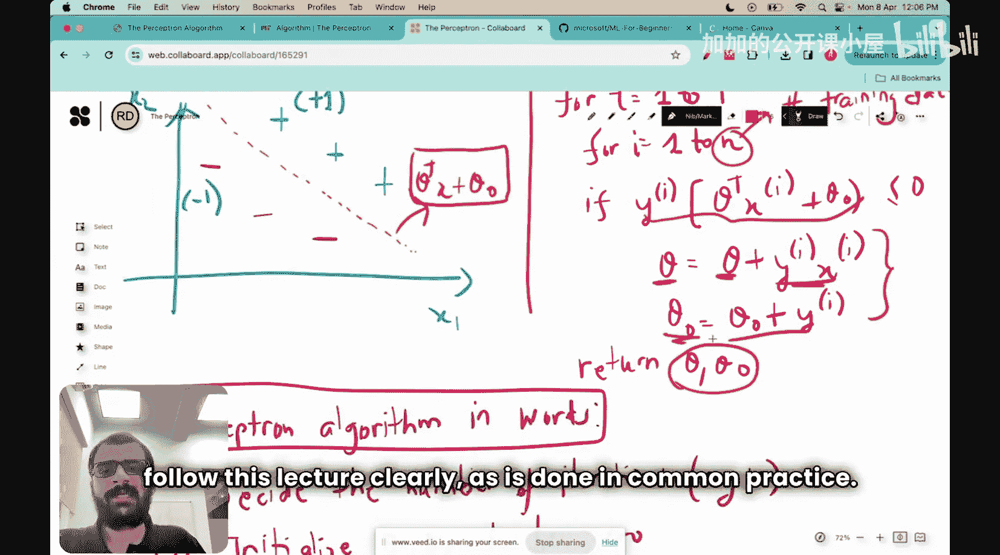
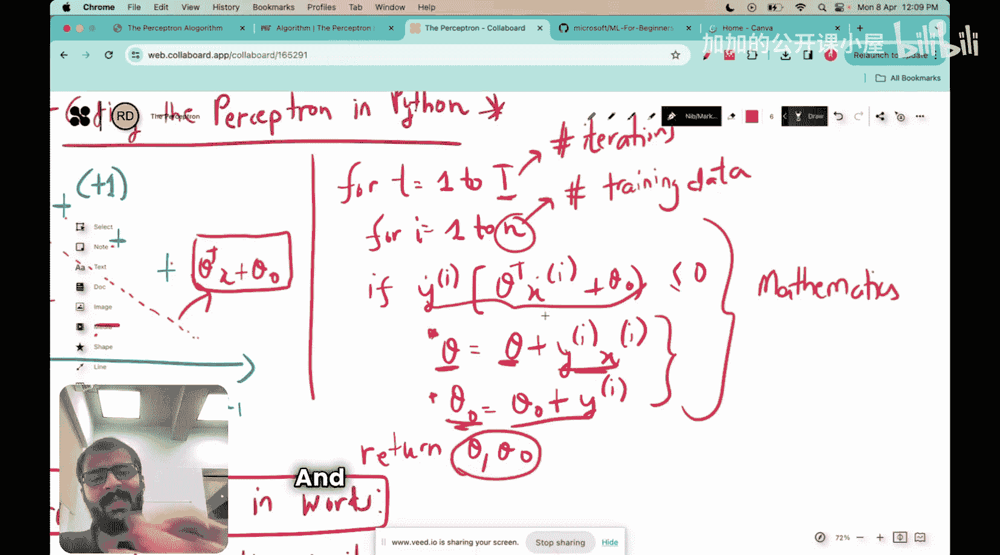
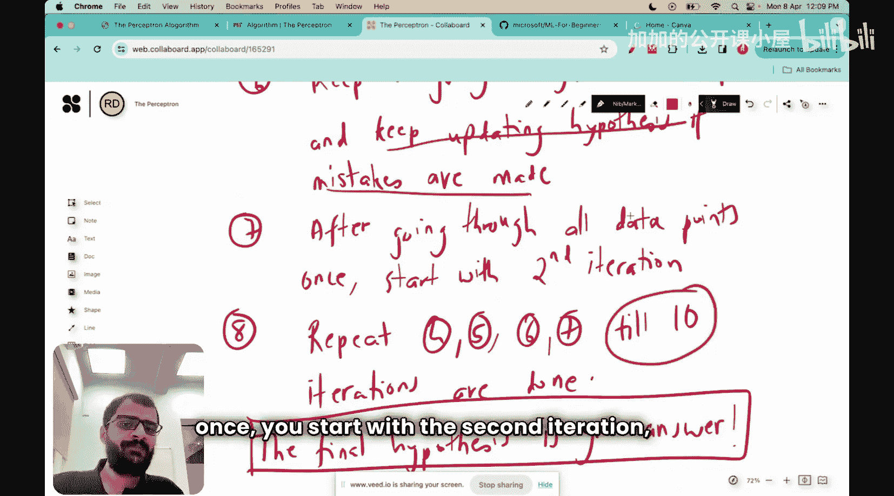
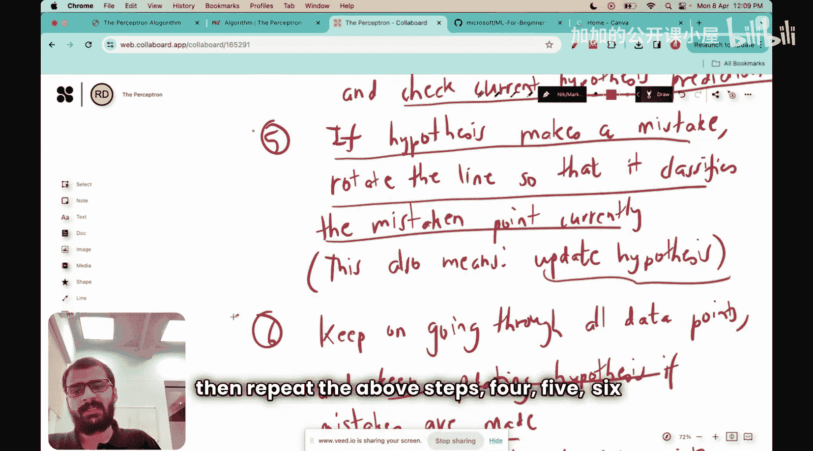
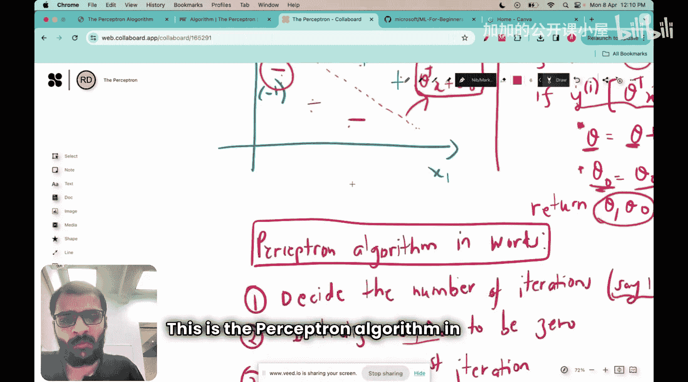
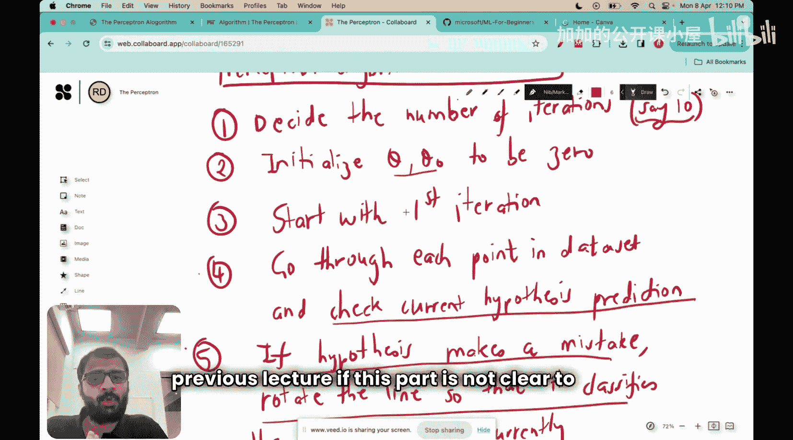
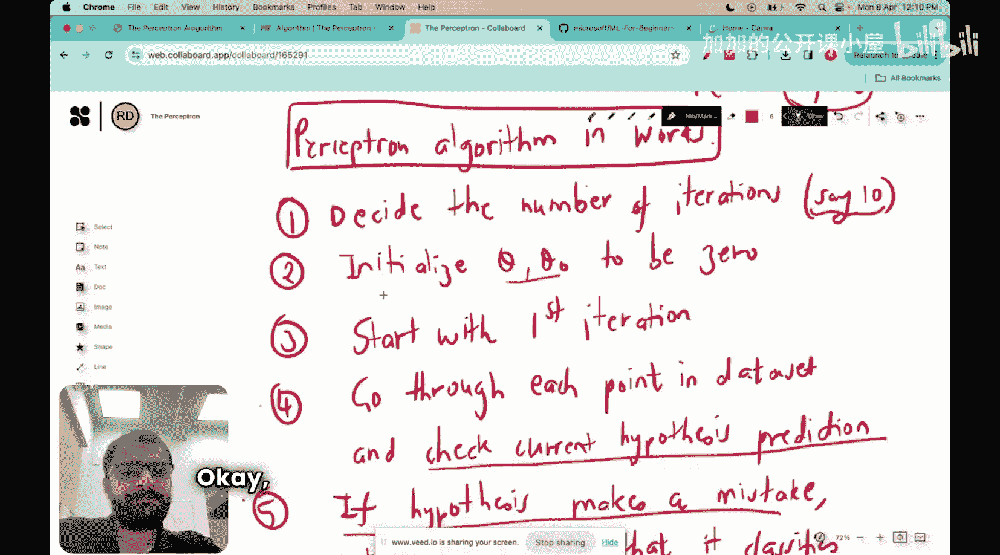
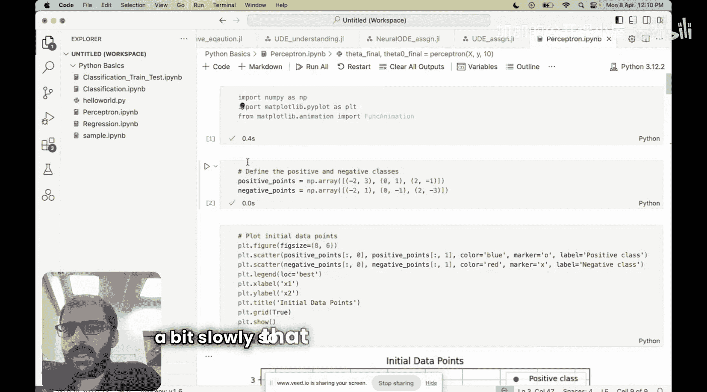

# Vizuara【中英⚡机器学习：实践教学｜Machine Learning： Teach by Doing】 p11 P11 ML Teach by Doing Lecture 11： Coding the Perceptron [BV1RusDz1EXd_p11]

Hello， everyone。Welcome to lecturec 11 or day 11 of the machine learning Tea by doinging project。

In this particular lecture。We will be looking at coding the perceptron algorithm in Python。

So in the previous lecture， we took a very， very detailed look at the perceptron algorithm and saw that it is one of the oldest machine learning models。

We saw that this model was invented in 1957 and it was one of the first models which really learned from data。

And that's why although it was not classified as a machine learning model at that type。

 it really was one。We also saw that this particular model was not just an ML algorithm。

 but it was also implemented as a machine by engineers of that time。

And the first paper which was released on the perceptron。

 the authors really intended for the perceptron to be a representation of the human brain。

 although it was extremely simplified origin， but still the vision was really moving towards artificial intelligence the way we see it today。

I really like the perceptron algorithm because it is one of the oldest ML models and the roots of all ML models which we see around us right now can be found in the perceptron we can learn several things from the perceptron such as training a machine how a machine learns from data。

Et cetera。The primary aim of the perceptor when it was developed was to recognize shapes， patterns。

 letters and numbers， of course ML algorithms now can do much， much more complex and powerful things。

 but it is always good to have foundational knowledge。So。

 in today's lecture we will be looking at coding the perceptron algorithmithm in Python essentially you will write the entire code for the perceptron in Python let me tell you why we are learning about this right now。

So as I mentioned， the reference for the perceptron algorithm is this MIT 6。

036 which is introduction to the machine learning course if you go to the perceptron lecture and if you go through their video lectures and if you go through their assignments。

 you will see that they explain perceptron。Whi we covered in the previous lecture of perceptron as well。

 but there is no demonstration of writing the code about this in Python。

And I believe that unless you actually write the code in Python。

 you will not really understand the algorithm itself， you will not really have fun。

Even in this Microsoft lecture which we have been following。

 there is no mention first of all of the perceptproron even。

And there is no coding lesson for the perceptron， so I decided to create a coding lesson all on my own and Ill also be sharing the code files with you as I do throughout this particular lecture series。

So this particular lecture will be about start to end coding of the perceptpro algorithm in Python。

If you have directly seen this lecture without seeing the previous one。

 I highly recommend that you go through the previous lecture because in this lecture I am not going to explain the algorithm I have already done that in a lot of detail in the previous lecture the previous lecture was around one hour 15 minutes long so it was quite detailed in which I go through the algorithm step by step at what it really means。

But if you have been through the previous lecture and want to know how to code the perceptor in Python yourself。

 this is the best place to start。So let's get started。

As is the case with all the classification problems， this is how our data looks like。

 as I have mentioned on the left hand side of the screen， the red negative are the negative data。

 which means the correct answer is minus1 in this case。

And my positive class data has been shown by plus sites。

Which means the correct answer in this case case is plus1。So。

 this is my data and the aim is to construct a linear classifier。

 the aim is to find this straight line which is given by theta transpose xus theta node which is the best classifier for the negative and the positive points。

There can be so many of such classifiers， so many such straight lines we can draw our aim is to find the best one。

So mathematically， the perceptron algorithm looks something like this for t is equal to 1 to capital t。

 which is the number of iterations。For I equal to 12 small n。

 n is the number of training data points。This algorithm says that。

For each training data point you check this particular value y into theta transpose x plus theta node。

 if it is less than 0， then you update the hypothesis。

 you update theta by adding the product of Yi and X to it， you update theta node by adding Yi to it。

 and then you return theta and theta node。If you are not understanding why are we checking this particular quantity or why are we updating theta and theta not like this。

 again go to the previous lecture in which everything has been explained in a lot of detail so you can follow this lecture clearly。

As is done in common practice in all of my lectures which I'm doing。

 I don't just write the mathematical representation。

 but I really try to explain this algorithm in the world。

So， let us try to understand how the percept algorithm works in worlds。

 so this is the mathematical representation right so this is mathematics。Yeah。

Let's see what this means in words first you decide the number of iterations。

 lets say I want to do 10 iterations， which is this capital T。

Then you initialize theta and theta not to0。 that's your first hypothesis iteration。

 let's say theta and theta not to0。 then you start with the first iteration。

When you start with the iteration， then you go through each point in the data set。

So this is given by for i equal to small1 to i equal to 1 to small n。

 which means you go through each point in the data and for each point you check the current hypothesis prediction。

If the hypothesis makes a mistake。So this if condition is given by y I multiplied by theta transpose X plus theta0 less than or equal to 0。

 so if this particular value is less than 0， which means the hypothesis is made a mistake for the Y I and X which we have selected。

Then， you essentially。Roate the current hypothesis so that it classifies the mistake and point correctly so lets say the current hypothesis like this and it has made a mistake you rotate the hypothesis and mathematically that rotation is also given by this update values。

So mathematically， rotating the current hypothesis means updating theta and theta node。Basically。

 it says that if your current hypothesis makes a mistake for the point。

Then rotate that hypothesis until it gives a correct prediction for that point and that rotation is given by this update。

So that rotation means that theta values need to be increased by Y I into Xi and theta not so value need to be increased by Y。

Then we have to keep on going through all the data points right now we just looked at one data point right maybe this。

And we updated the hypothesis if the hypothesis made a mistake。

 then you go through all the data points， you go through this， you go through this。

 you go through this， you go through this and you go through this as you go through all the data points。

 you keep on updating the hypothesis mistakes are made so basically as you go through all the data points you check this condition。

If mistakes are made， you update the hypothesis by rotating it， if mistakes are not bad。

 you jump to the next data point。And the final thing is you repeat this entire procedure till 10 iterations are done。

So after going through all the data point once， you start with the second iteration and then repeat the above steps for。

5， six and seven until an iteration are， so these are the number of iterations which you start with in the first place。

And the final hypothesis which you get is your answer。

Just to repeat what you do is start with theta and theta not equal to 0， then check。

 then go through each training point， start with the first iteration， go through each 01 by1。

 check if the current hypothesis is making a mistake if mistakes are made rotate the hypothesis and update it。

After going through all the points once， then go through the second iteration。

 again go through all the points once and keep on updating the hypothesis till no mistakes are made do this process till you finish any iterations。

The final hypothesis。Which remains， that is your answer。This is the percept algorithm in words。

Now if you did not understand this part， which means that you have not understood the previous lecture or if you or you have not been through the previous lecture。

 so I highly recommend you again to go through the previous lecture if this part is not clear to you。

Now all of these six or seven or eight steps which I've mentioned in words here。

 I'm going to code this in Python， okay。

So let's get started with the Python coding。As has been mentioned in the comments。

 I am going to try to go through this part a bit slowly so that all of you can understand。

Okay， so as always， we will be。