# Vizuara【中英⚡机器学习：实践教学｜Machine Learning： Teach by Doing】 p12 P12 ML Teach by Doing Lecture 12： Perceptron Convergence Theorem [BV1RusDz1EXd_p12]

Hello， everyone。Welcome to the day to end of the Machine learning Teaeach by Doing project。

This will be the last lecture on the perceptron algorithm。

Up till now have we had two lectures on the perceptron on day 10 we looked at the perceptron algorithm itself and why it works。

And on day 11， we quoted the perceptor algorithm。From scratch in Bion。Today。

 we will learn about some terminologies which are associated with the perceptron algorithm。

 such as linear separability of a data， data margin， etc。

These terminologies are very important because when we look at ML models such as support vector machines and even some neural network loss functions such as the heat loss。

 etc。Many advanced concepts have。Or require you to understand linear separability and more importantly。

 margin of a data set。And not many people know this。

 but perceptron is actually one of the first algorithms which interpret this concept in the first place。

The concepts of。Margin and the concept of linear separability So today we will be looking at four terminologies associated with the perceptron。

 the first is perceptron through the origin second is linear separability of a data set and what does it mean。

Thirdly， we will look at margin of a data set。And what is meant by a margin of a data set？

And finally we will look at a theorem which is an amazing theorem。

 we will not look at the proof of it， but it is called as the perceptron convergence theorem。

This will be a theoretical lecture where I will try to explain all the concepts in a nice manner。

So let's get started if you have not seen the previous two lectures on。

The introduction to the perceptron and secondly coding the perceptron algorithm。

 I highly recommend you to go through these lectures to clarify your conceptual understanding regarding the perceptron algorithm itself。

So let's get started with today's lecture。I learned about everything which I' am going to show you today from MIT course MIT course is one of the only course I found on the internet which actually goes into the theory of perceptron in a lot of detail。

And the concepts which I'm going to introduce to you today such as linear separability， margin， etc。

 I have learned all of them from this MIT course。I will provide the courses material in the reference so that you can also go through it。

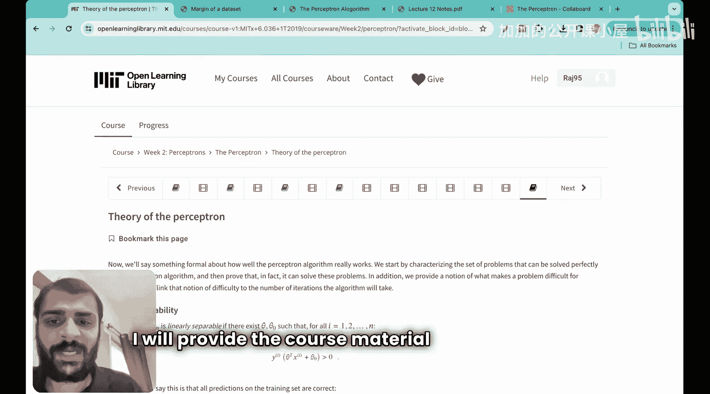

Okay so I have made all detailed notes for this particular lecture which Ill be sharing in the information as I always do。

 so you will be having all this material which I will be presenting in today's lecture。

So lets get started， we already have seen about the perceptron algorithm which is essentially a linear classifier。

 which means that lets say we have a negative data set like this and the positive data set like this。

 the perceptron finds the best linear classifier which separates these two sets of data。

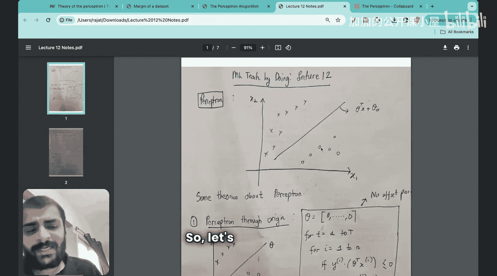

And then we looked at the algorithm itself。Essentially the algorithm loops through the data about 10 times or how muchever we decide and for each data point we check whether a mistake has been made by the hypothesis。

 if a mistake has been made the hypothesis is updated and then you cycle through the rest of the data。

We do this once for one iteration。And if we are going through 10 iterations。

 we do this entire process 10 times。One thing which will come up at multiple points in this lecture is this quantity why I am multiplied by theta transpose X plus theta mode。

So recall from our previous lectures that the meaning of this quantity is that it illustrates whether a mistake has been made or not。

So if this quantity is less than 0， it means that the hypothesis makes a mistake while classifying the point Y I and Xile。

Whereas if the point is great whereas if this quantity is greater than0 the hypothesis is correct if it is equal to 0 it means that the point lies on the hypothesis。

😊，If if you don't know why the meaning of this particular quantity means the number of mistakes or meets if a mistake has been made。

 kindly look at lecture number 10 where we go through the basics of the percept。

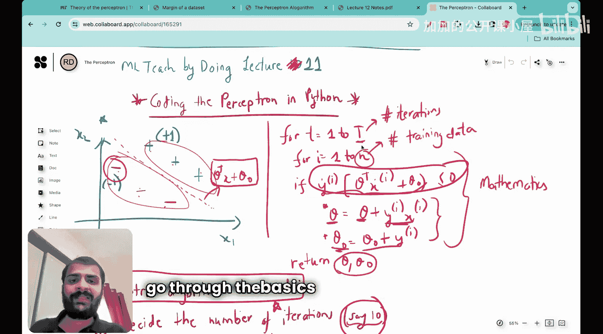

Okay， so this is the best line which is written by the perceptron and is usually denoted by theta transpose x plus theta node。

Where theta is a vector and theta not is the scr。

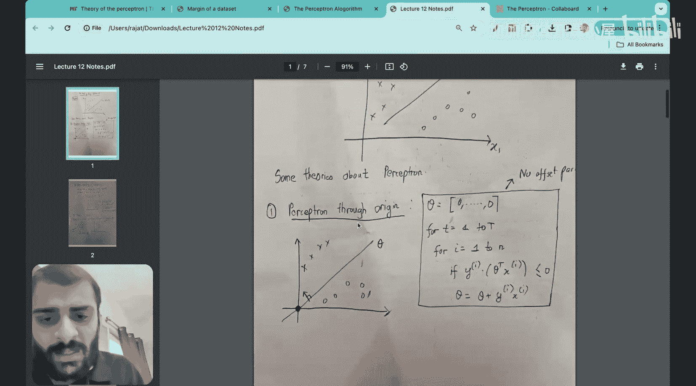

The first concept which we are going to introduce today is called as perceptron through origin。

 it means that up till now we have been talking about theta and theta not right。

And theta0 is kind of an offset， so if theta node is not0 or if theta node is set equal to0。

 it means that y equal to theta transpose x。

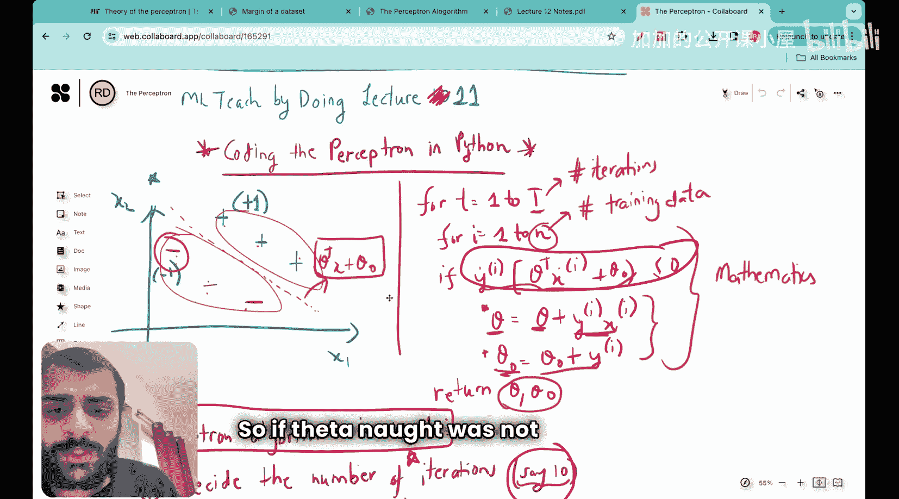

And that means that the line will just pass through the origin。

And perceptproron through origin is just a simplified origin of the perceptproron algorithm where ultimately we find that classifier which best separates the data。

 but it also passes through the origin。

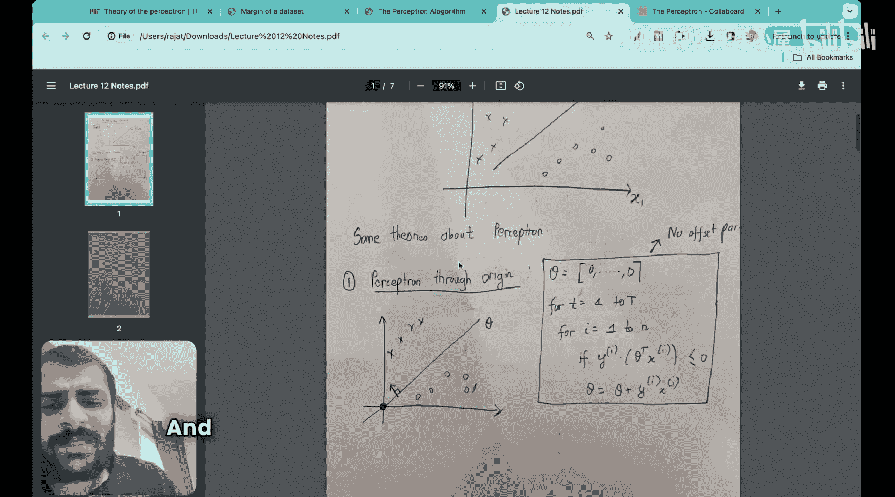

That actually means just setting theta not equal to 0 in the percept on algorithm。

So you take this algorithm and just put theta not equal to 0 everywhere in this algorithm。

 and that will give you the algorithm for a perceptron through origin。

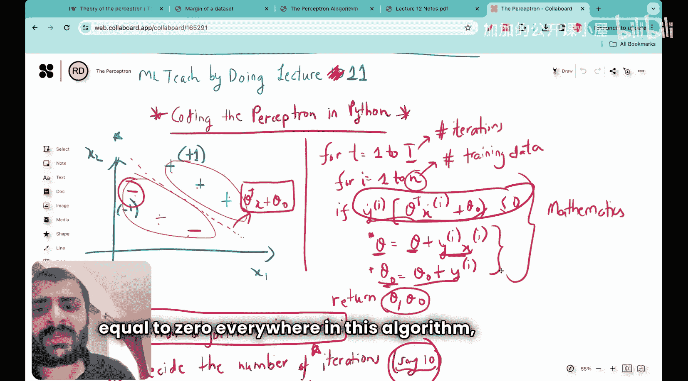

So， you can see this is the algorithm for perceptor through origin。

 it is quite simple again we check whether a mistake has been made or not and this is why I into theta transposexiile theta not won be there since it is equal to 0。

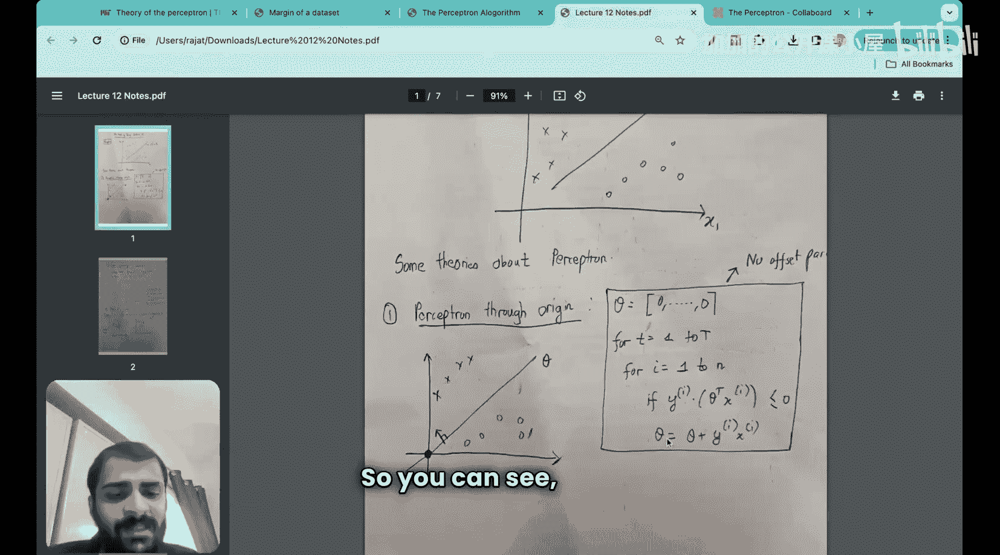

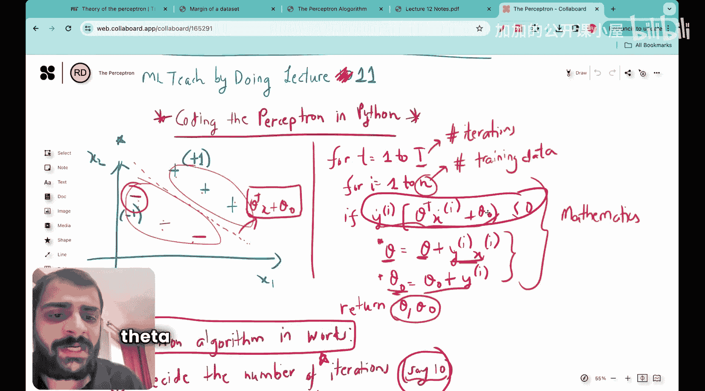

If the mistake has been made， we only update theta。

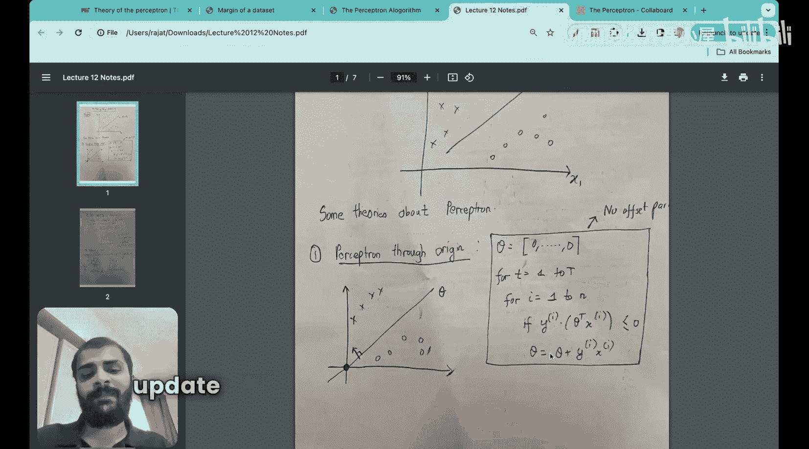

Since theta not is not there as the line passes through origin theta not is always zero。

 so we don't need to update it。So perceptron through origin is just a simplified origin of the perceptproron migo。

But many people use it to form theories about the perceptor because if something works for。

But a separate through origin。It most likely works for the general perceptionron as well where theta not is present。

Perceptron through origin just makes it easier to prove some things about the perceptron since we don't have to worry about it or not。

The second terminology， which I want to talk about in today's lecture is called as linear separability。

So， a data set D is called as linearly separable if there exists some hypothesis or if there exists some straight line such that y at times theta transposexi greater than 0。

Now， remember what I said about this quantity why I multiplied by theta transposexii。

 I said that if it is greater than 0， it means that the hypothesis makes no mistake。

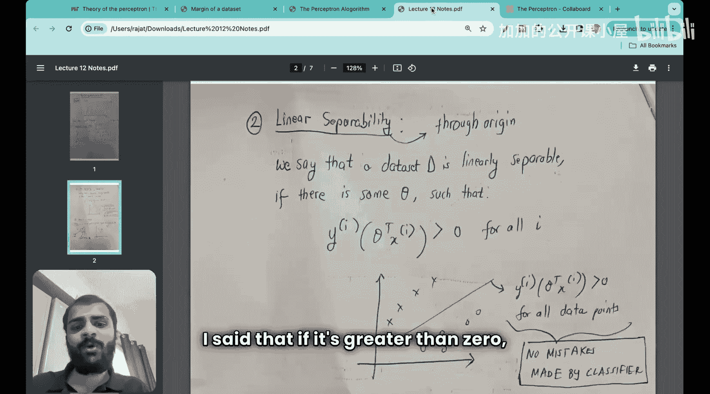

So basically this definition says that a data D is linearly separable if there exists a hypothesis which makes no mistakes on any of the data points。

For example， consider the data set given by this process and the circles。And let's say the。

 and if someone asks you， is this data set nearly separable？

You can even show them visually by drawing a straight line and you can tell them that for this particular hypothesis。

 if you calculate this value， y I multiplied by theta orthopo Xi。

 if you calculate this value for all possible Xi and Y I present in this dataset。

It will always be greater than zero。And hence， and why will it be greater than zero because no mistakes have been made by this classifier。

 the positive points are on this side which are all correct。

 the negative points are on this side which are all correct。

So no mistakes are made by this hypothesis and hence the data set D is purely linearly separ。

Very simple definitions， the first two definitions are perceptron through origin。

 which just means finding a straight line which passes through origin。

And the second definition is that of linear separability。

 which decides or which defines when is a data set linear and separable。

And the answer is if there is a hypothesis which exists and which makes no mistakes on all the data points in the data set。

That data set is considered to be linearly separate。

Now we come to probably the most important definition in this particular lecture and that is called as the margin of a data set。

Before coming to margin of a data set， let me first describe or define what is meant by margin of a single point。

So let's say this is the。X Y plane， and this is the straight line， which is denoted by theta。

And the normal lies in this direction， which I've specified。

And let's say we look at a point whose x coordinate is given by x and whose label is given by a y。

So first thing to note is that margin of a point always is defined or label the point。

So if you just have the coordinates of this point without a label， the margin cannot be calculated。

So you need two things to calculate the margin with respect to a point and a line。

 you need a line which is given by theta transpose x since it passes through origin and you need a point。

 you need the x and Oi coordinates of this point and you need the label whether it is plus 1 or minus-1。

Now， the margin of this particular point with respect to this particular light is defined by this formula。

Why？