# Vizuara【中英⚡机器学习：实践教学｜Machine Learning： Teach by Doing】 p16 P16 ML Teach by Doing Lecture 16： Cross Entropy Loss [BV1RusDz1EXd_p16]

Hello， everyone。Welcome to the day 16 of the machine learning teach you by Doing project。

This is the second part of logistic regression。In the first part of logistic regression。

 which was the lecture on day 15。We covered a new type of hypothesis。Which is also called as sigmoid。

We looked in detail about the sigmoid hypothesis。And we also saw about。

Why the sigmre hypothesis was constructed in the first place。

 how different it is from let's say the01 hypothesis function or the sine function which existed before。

We saw that the sigmoid gave us advantages with respect to a continuous smooth mathematical function plus it also provided us more information rather than just having the hypothesis say0 or 1。

 it provided us a continuous scale from 0 to 1。And it provided us more information about how right and how wrong we were about our hypothesis。

In today's lecture day 16， we will be looking at cross entropy laws。

So we have defined the hypothesis with respect to logistic regression right， that part is done。

In the previous lecture， the hypothesis is done that is the sigmoid function。

But now every hypothesis needs to be combined with a loss function。

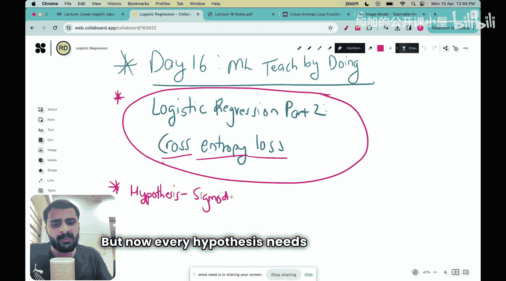

嗯。And we have not yet discussed the loss function for logistic regression。

This is the loss function which we will be discussing today， and in the next lecture。

 we will be discussing about optimizing the。Theta and theta node。Based on the loss function。

That is in the subsequent lecture。Today， let us cover this particular part。

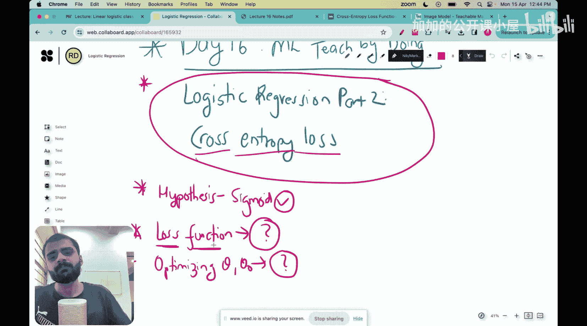

呃。At the end of today's lecture， you will also learn about why it is called as cross enpis。

So it turns out that cross entropy loss just measures the loss between two types of probability distributions or it measures the truth or it measures the difference between the truth and our predicted output for example。

 here is a cat and dog classification model which has been made using teachable machine。

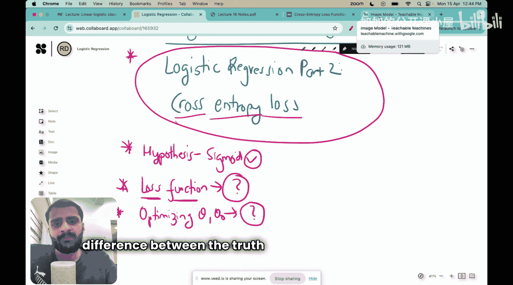

I have uploaded 10 images of cats and 10 images of dogs and let us do some testing right now after the model has been trained。

Whatever image I am obtaining， the model is able to correctly classify it as a dog。

 or if I update the image of a cat， the model correctly classifies the image as a cat。

In this particular example， the cross entropy loss will be just the difference between the output probability which my model assigns to whether it is a cat or a dog and the true answer。

 whether it was a cat or whether it is a dog， so you can think of it as just a difference between the true value and the predicted value or the true probability。

 output probability versus our predicted output probability。

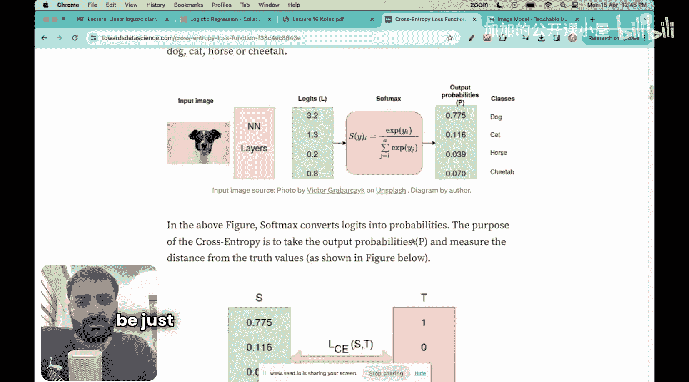

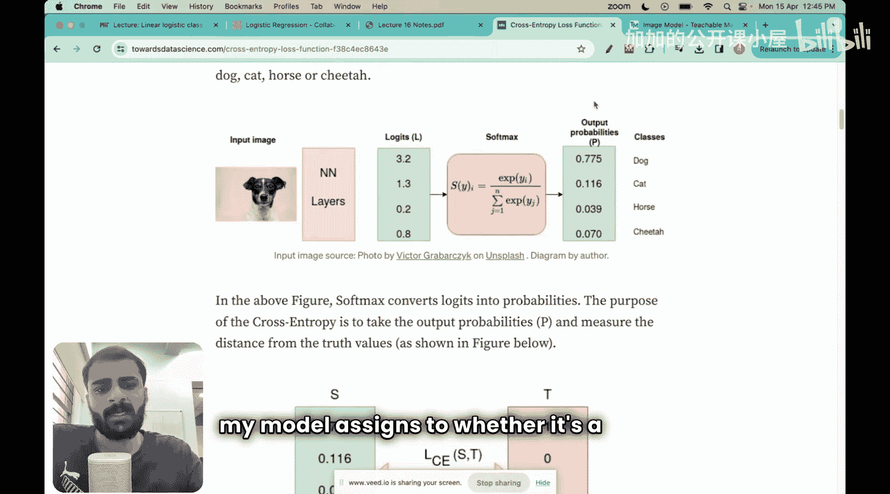

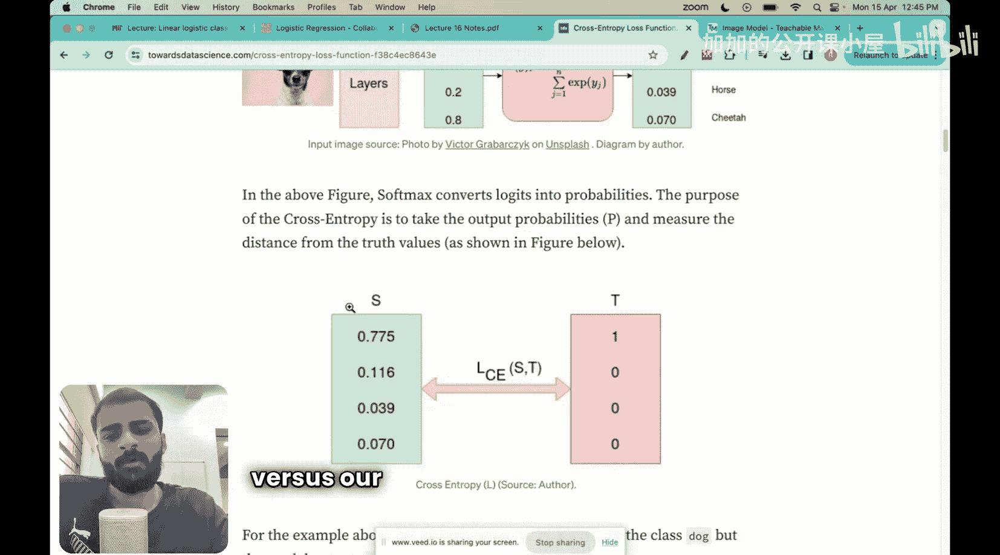

With that， let us get started with this lecture。

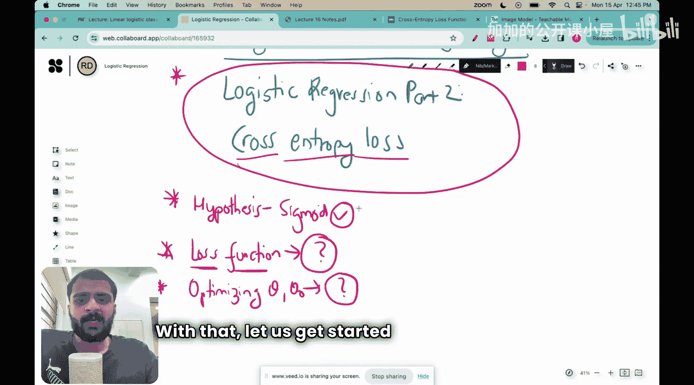

Okay， so the first thing which we will do is again have a brief introduction to a problem and what we are trying to do here in case someone is looking at this lecture for the first time so let's say we have four data points in one dimensional space right now。

Here is the。Wen。读。-1 and -2。So this point1 and point number two。

 these two points will be my positive class， which means that the true label is equal to 1。

True label is equal to1。And these two points will be my negative class。For this example。

 I am going to say that for the negative class， the true level is equal to 0。

It can also be equal to minus1 for the sake of simplicity。

 we are going to say that the true label is0 for the negative class。

So this is the example and our aim here。Aim here is to find a classifier for this one dimensional data set。

To find a classifier for this data set。Since this is one dimension。

 the classifier is just going to be a point。It can be a point over here， over here， over here。

 it can be anywhere on this straight line， but the ideas which we are going to discuss in this particular lecture hold true for even two dimensions。

 three dimensions or higher dimensions。

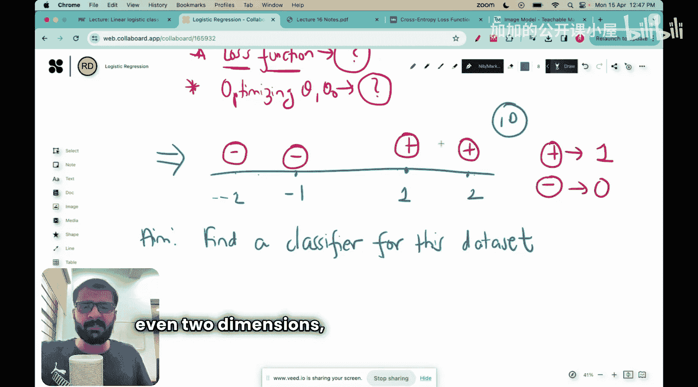

So the aim is to find a linear classifier which perfectly separates the positive points from the negative points。

The hypothesis which we are going to use is the one which we learned about the previous time when we started learning about linear classification we saw the sine hypothesis which is just either plus1 or0。

But we are going to use the sigmoid hypothesis here。

So this is the hypothesis which we are going to use， the sigmoid hypothesis。

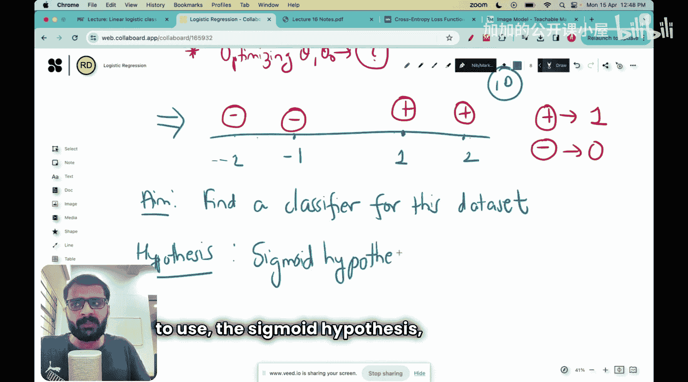

And it is also denoted mathematically by sigma of x is equal to1 upon1 plus e raised to minus x。

This is the mathematical representation of the sigmoid hypothesis。

What is meant by this hypothesis is that let's say I have a particular theta and theta node which describe the classifier。

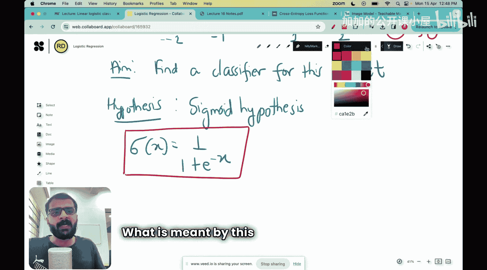

So in the case of one dimension， since it's one dimension， it will just be。

One value for theta and it will just be one value for theta node so let's say this is my classifier。

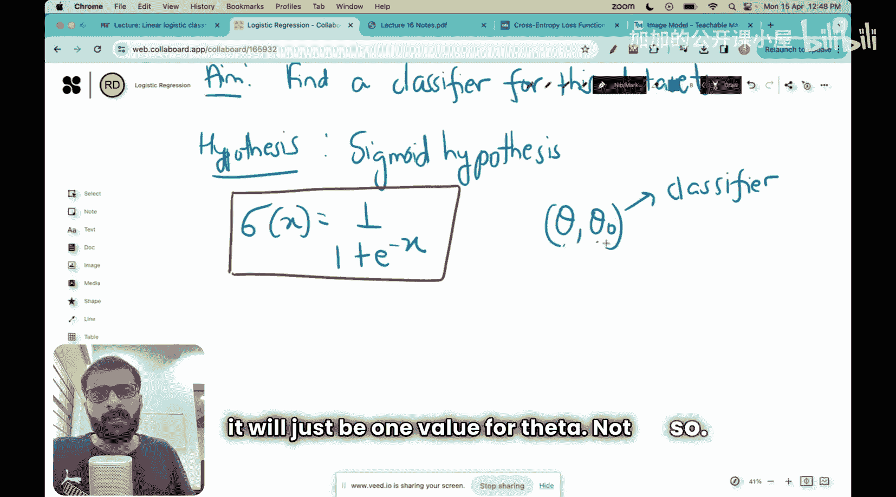

What my hypothesis will do is that。Sigma of theta and theta n and x。

Is that it will be1 upon1 plus e is 2 minus。Theta transpose x。Plus， the are not。

And then based on this particular value。We will assign a positive value or a negative value as our predictions。

 or rather in this particular example， we will either assign it a value of 1 or we will assign it a value of 0 based on this particular。

Calculation。

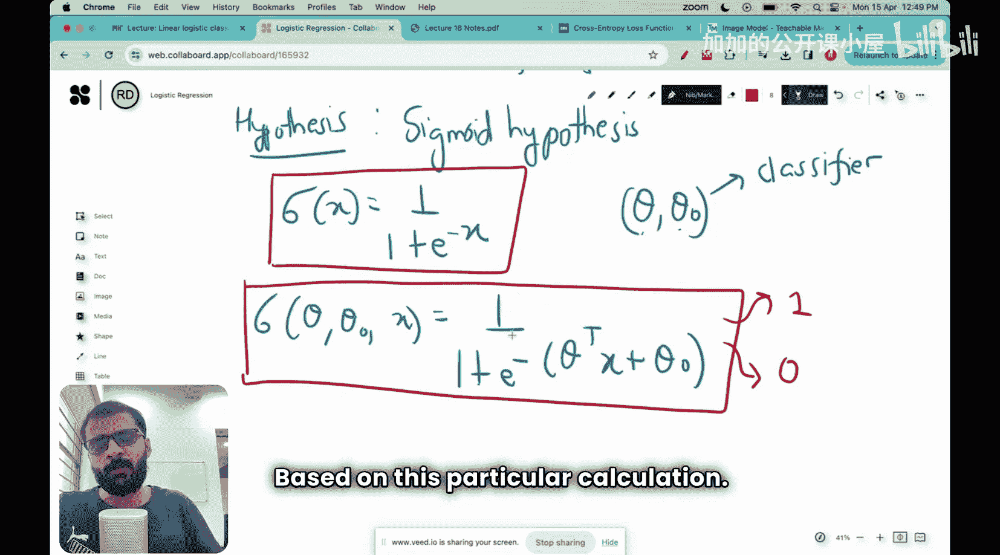

So let us see how we are going to do this hypothesis。

 the way the sigmoid function looks like is this。So on the x axis is theta transpose x plus theta0。

And on the y axis is sigma of theta transpose x plus theta node。

So the sigmoid function takes values from0 to 1， it never goes negative。

And it never goes beyond one either。So this is equal to plus1。This is equal to 0。5。

And this is equal to0 over here。Okay， so the way our hypothesis works is that we are going to say that if we are on the if you take any theta and theta on。

 that is our current hypothesis。Then if you take any x and if you calculate the value of theta transpose x plus theta node if that value is greater than 0。

 which means we lie somewhere here。Im going to say that the prediction is1。

And if I take theta transpose x plus theta not， and if that value is less than 0。

 which means I lie somewhere here。Then I am going to say that the prediction is 0。

 that is my hypothesis class。

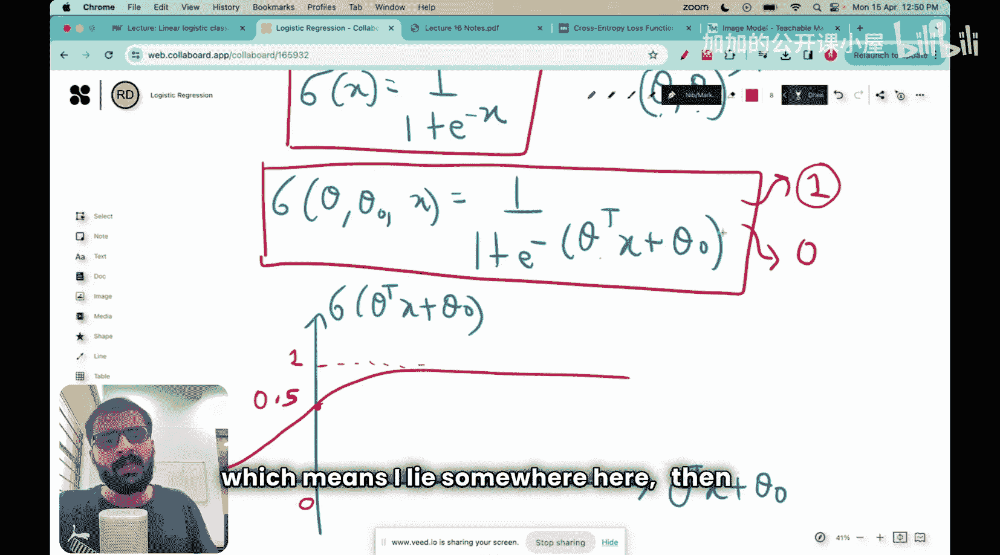

Now， one more thing which we looked at right in the previous lecture is that there is actually an intuition which is associated with the sigmoid function。

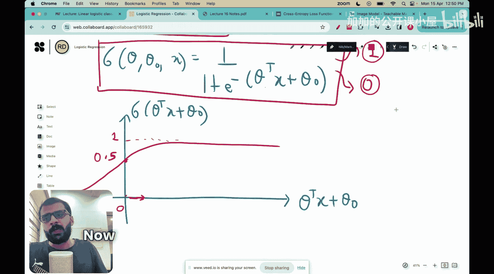

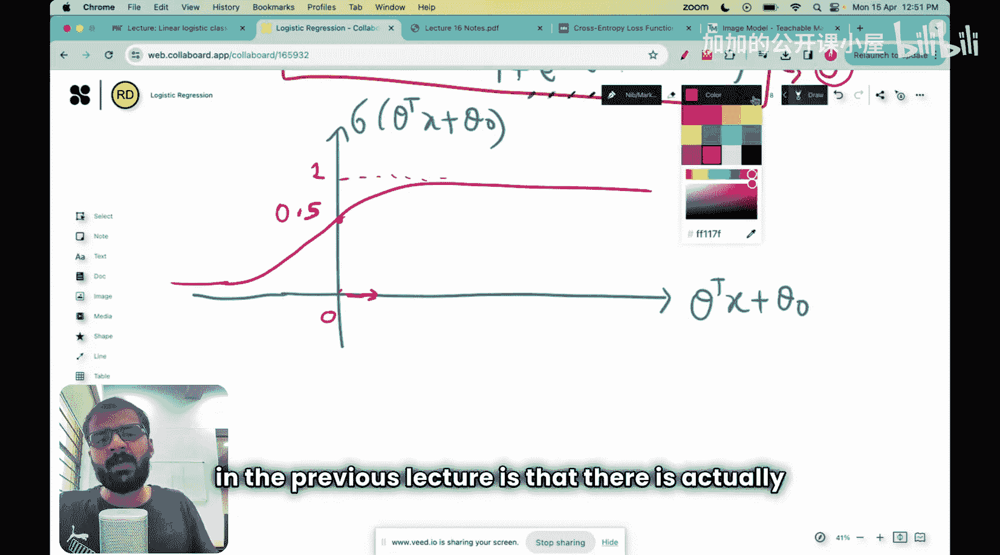

There is an intuition which means that the sigmoid function is actually very closely associated with probabilities。

Let me explain what this actually means。When if。Sigma of theta transpose x plus theta n。

Is close to one。

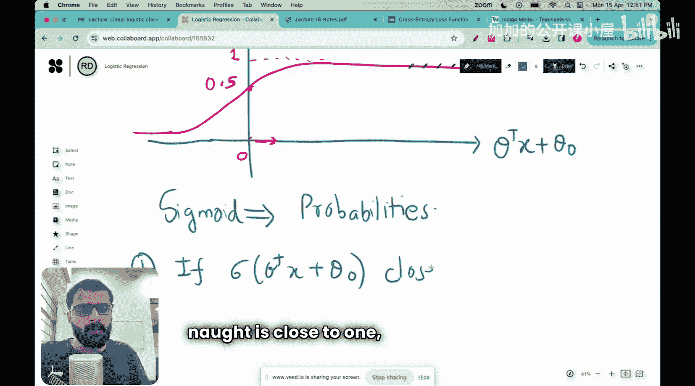

There is a high probability。That。Point will be classified as positive。

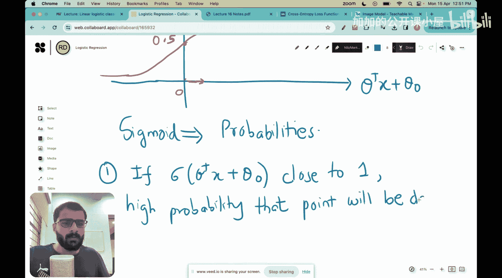

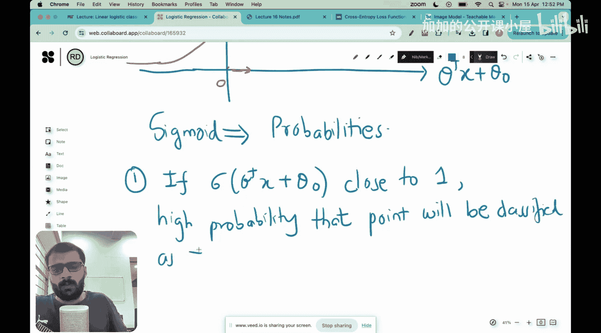

And this we can see from the graph also if we lie somewhere here。

 there is a very high probability that。The point will be classified as positive because anything which lies on this side。

Is anyway classified as a point whose true or whose prediction is equal to one？

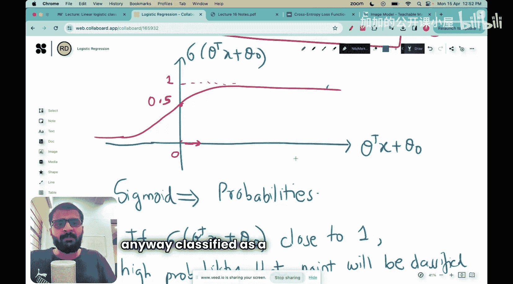

Secondly。If。Sigma of theta transpose x。

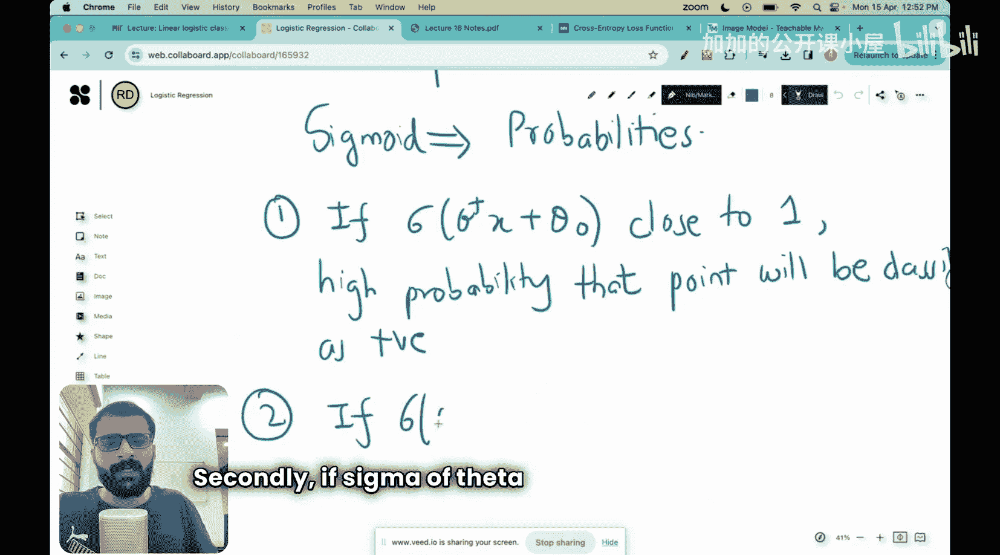

Pless data are not。Is。