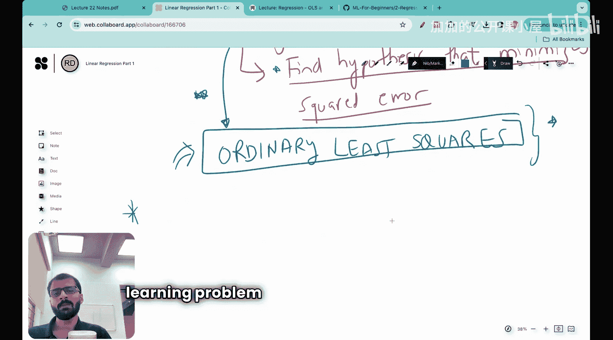
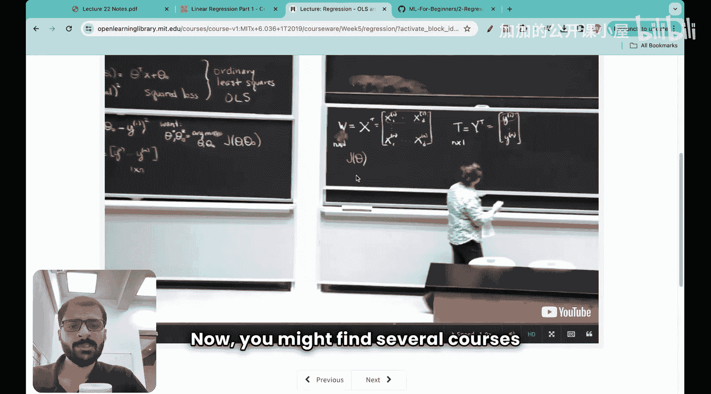
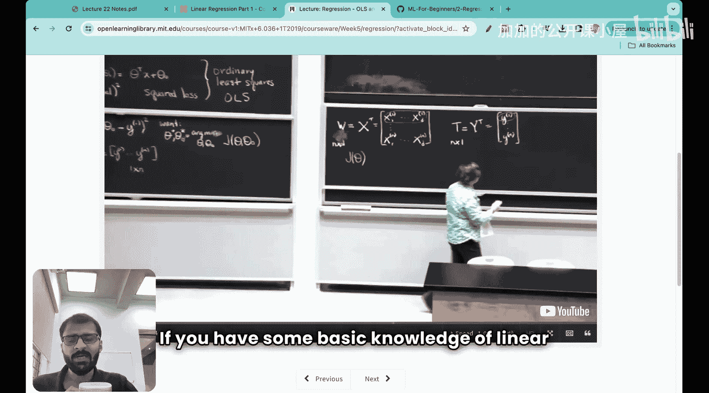
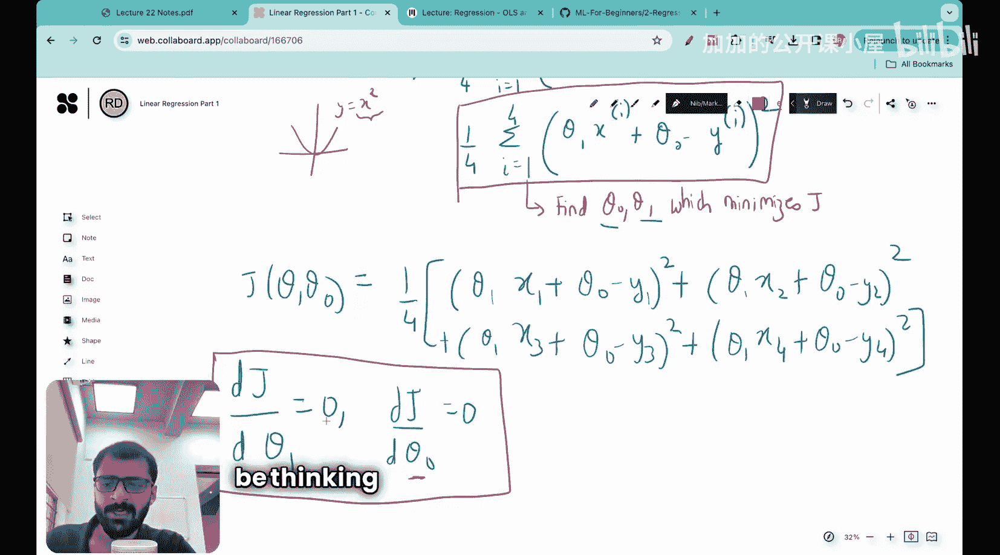

# Vizuara【中英⚡机器学习：实践教学｜Machine Learning： Teach by Doing】 p22 P22 Lecture 22： Ordinary Least Squares Method step by step implementation [BV1RusDz1EXd_p22]

Hello， everyone。Welcome to the day 22 or the lectureture 22 of the machine learning teach by doing project。

Today we are going to learn about a very important technique in the regression。

 which is called as ordinary least squares method。This technique will help us to find the hypothesis that minimizes the squared error。

Yesterday we started looking at linear regression and we learned about two things we learned about the hypothesis for linear regression。

 which is just straight line in 2 d planar surface in 3D etc。

And it is given by theta transpose x plus theta n， we also looked at the loss function which we are going to use。

 which is simply the square loss。Now we will look at the fourth step in the machine learning framework。

 we looked at the first three steps， which is data generating hypothesis and loss function。

Now the fourth step is formulaulate the ML problem as an optimization problem and find the best hypothesis through optimization procedures。

So that is exactly what we are going to do we are going to formulate this machine learning problem as an optimization problem。

Now you might find several courses offering lectures on orinarily squared。

The main issue with these courses is that they directly start from the matrix or the matrix form of the OLS。

 but they dont show you how exactly to go step by step to the solution by doing a hands on demonstration。

So very similar to everything which we do in this course。

 we will start with a very practical hands on demo and you yourself will read the solution。That way。

 ordinary square will be very intuitive to you。After you yourself find the solution for the hands on demo。

 then we will look at the matrix form and then we will see the similarities between the matrix form and what we have obtained。

If you have some basic knowledge of linear algebra， it will really help in this lecture。

 but if you do not have it's fine。

Portionions which you do not understand， you can go back after this lecture and learn that particular portion of linear algebra which will be very helpful to you so let's get started。

First of all， as I mentioned， we are going to immediately start off with a hands on demo。

Let me expand the screen a bit。Okay， so we are going to immediately start with the hands on demo here。

So here's the problem。I have four points in the x1 x2 plane。And these four points look like this。

The first point is1 comma 2。The second point is2 comma 3。The third point is 3 comma 5。

And the fourth point is4 comma 4。My aim is to find the best hypothesis。呃。Or the best straight line。

Y is equal to。嗯。The up。1 x plus theta not。Find the best Y which minimizes。

The squared loss for all these data points。Now， imagine you exist in a world where。

You do not know about orinarily square。 You just have knowledge of the fact that。

You want to convert this into an optimization problem， think about what you will do。Okay。

 first thing what you will probably do is think of the objective function which you need to minimize So the objective function J。

We will have two parameters， theta 1 and theta n， these are the two parameters。

 so okay this this should be theta not here。These are the two parameters for which you need to optimize for。

Because once these two parameters are fixed， the hypothesis is fixed。

So the hypothesis is given by the average。One by four inside four data points。

Summation of I goes from1 to4。Guess。Minus actual square， correct？It's as simple as that。

And what will my guess be， my guess will just be。The hypothesis。

Prediction and in yesterday's lecture， we already looked at the hypothesis。

 it looks something like this。Theta 1 x1 plus theta0。So then this value will be。

Guess minus actual square will be theta 1。Into X， I。Plus theta not。Minus Y， I squared。

I hope you understand what this means here we are just taking the guess minus actual whole square for all the points and we are adding it together。

Basically， what we are doing is let's say we have a hypothesis。

And the true value is known which is y I， so for the first point I find the guess subtract the true value and square it which is my lost function。

I do this for all these four points。So remember that let's say if I'm looking at this particular point。

The x value is2 correct， so let us look at the guess and the actual So where it hits this hypothesis。

That is my guess。And what the actual value， that is a。

So then the loss for this particular point will be g minus a whole square we are just summing up this particular difference or this loss for all the data points and then。

Dividing by4。Because we are taking the average。So now your task is。

This is the objective function and we don't have a regularizer term。

 so it is just the loss function here。We want to find theta。You want to find theta 0 and theta 1。

 which minimizes。G。So we want to find theta 0 and theta1 which minimize this objective function。Now。

 imagine if you have any function out there， let's say if you have a function， y equal to x squared。

And you want to find that x n which minimizes y， what do you do。

 you take the derivative and set it equal to 0， right？This is exactly what we are going to do now。

First， let me write the loss function in detail。It looks something like this。By detail。

 I mean I'm just going to sum up for all the four points。So， it's going to look like。

J of theta comma theta0。Will be equal to1 by4。Theta 1， x 1 plus。Thehita not minus y1 whole square。

Plus。Theta 1 x2。Plus， theta not minus y2 the whole square。Plus。Theta 3， x 3。

Sorry this should be theta 1 into x3。Theta1 into x3 plus。Theta not minus。Y 3 squared。

Plus theta 1 into x 4 plus theta not minus y4 whole square。

Now we want to find the optimal theta and theta 0 and theta 1 right so all we need to do is we need to take the derivative dJ dj of d theta 1 needs to be 0。

And DJ。喂。D， theta n should be equal to 0。idealally。

 we should be calling these as partial derivatives。

 but I am just using a simple framework here so that you understand what is going on。

So we need to optimize two parameters， correct， we need to optimize theta 1 and theta 0。

So similar to what we did for this function， y equal to x squared。Weve take took the derivative。

But now there are two parameters which need to be optimized。

 so we need to make sure that the derivative with respect to these two parameters will be equal to 0 and those will be our optimal theta 0 and theta1 which minimizes G。

There is one more consideration here that you might be thinking that what if this is a maximma。

 it could also be something like this， right？

