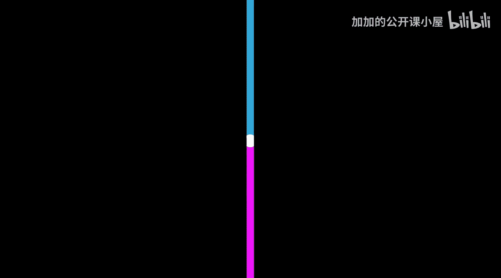
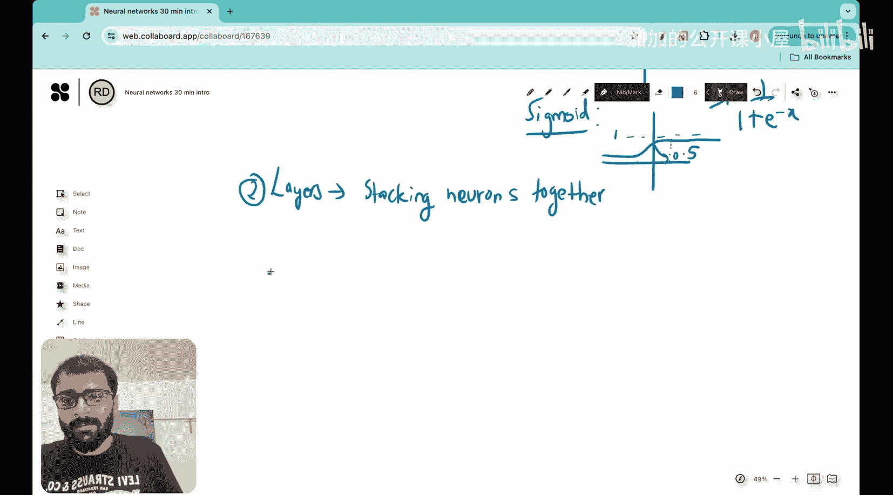

# Vizuara【中英⚡机器学习：实践教学｜Machine Learning： Teach by Doing】 p25 P25 Lecture 25： Neural network architecture in 30 mins [BV1RusDz1EXd_p25]

Hello everyone， welcome to the next lecture of the machinech learninging Tea by Doing project。

In this lecture， I have taken the ambitious task of trying to explain the neural network architecture。

In 30 minutes， the reason I'm trying to make these small videos is so that you can have a quick recap before going for interviews。

So that very quickly you will brush up all the concepts in a lot of detail。

 so let's get started on this journey。First I'll be explaining the building blocks of a neural network and second I'll put all of these blocks together there are no prerequisites required then I'll try to explain every single thing from scratch by writing it down here。

So first， let me start with the first building block， which is called as a neuron。

So just like when you are assembling Lego pieces， you build blocks together right。

 a neuron can be considered to be the smallest building block of the neural network architecture and at its simplest function the neuron does this it。

It is represented by a circle like this， it takes cell input。And then it gives out an output。

 that's it。The reason it's called as a neuron is because when people started thinking of these concepts。

 the idea was to model these according to the biological brain。

 and the neurons in our brain also work in a similar manner。 They take an input。

 and then they produce an output。 That's why it's also called as a neuron。

So the function of a neuron is that it takes an input and then it gives out an output that's it。

Now you must be thinking what these inputs are and what these outputs are and what really happens within the neuron itself。

So， inputs are the features which will be used to make a prediction。

 lets say we have major three properties the ear flapiness index。

 the pupil length so let me write the problem down let's say the inputs are X is the pupil diameter。

X2 is the ear flapappiness index。And x3 is the whisk length。

These are my measurements and the output is whether it's a cat or whether it's a dog。

So the whole aim of my neural network which I am trying to construct here is that it should take in these three features。

 it should take in the pupil diameter， it should take the year happinessiness index。

 it should take a vi length as three inputs and then it should output whether it is a cat or whether it is a dog。

For the purposes of this demonstration let us look at a neuron and its input its output and what happens within so as I mentioned the neuron let's say there are three inputs which are there x1。

X2 and x3， these will be the three inputs to the neuron。So this neuron has three inputs。

And every input will have a weight associated with it。 So this is called W1。 This is called as W 2。

 and this is called as W 3。 The reason these weights are there is because they。

They give an understanding of how important that particular feature is， so， for example。

 if w1 is way higher than W2 and W3， it kind of informs that this neuron places a lot of emphasis on the pupil diameter。

 for example。So these are the three inputs to the neuron， and then we have an output。

Let me call this output currently as F。Or rather let me call this output as why。Now。

 what happens within this neuron itself， this is where the magic happens。

So after we take the inputs and after we assign the weights lets see what happens within this magic itself。

 so let me zoom in further here， so the neuron essentially has three important features or three important functions which every neuron performs。

And let me represent these three here。The first function which a neuron does is the summation operation。

Which is the summation。The second function， which a neuron does is adding a biaster。

And the third function， which is probably the most important function which a neuron does。

And that's called as the activation function。So whenever you hear of the term neuron remember that it does three things summation bias and activation mathematically what this looks like is that it takes in this input input features it takes in the weights and it first of all does the summation so it does。

嗯。W 1 x1 plus W2 x 2 plus w 3 x 3。Then what it does is it adds the bias term。Bas。

And then what it does is it takes the activation function， so F of w1 x1。Plus， W 2 x2 plus W3。

 x 3 plus B。This is the function or this is the output which is given by this particular neuron。

 So you see how these three elements are coming together here， this is the sum。This is the bias。

And this entire thing is the activation or the activation function。

So every neuron in a neural network does these three functions it takes in an input features x1。

 x2 x3。It assigns weight to it W1， W2， W3。And then it produces an output y。

 which is equal to f of w1 x1 plus w2 x2 plus w 3 x3 plus b。

So there are three operations happening inside a neuron simultaneously。

 there is a summation operation， there is a bias operation and then there is the activation function。

Out of all these three things which are happening inside a neuron itself。

The summation and the biosterem are pretty straightforward because they showed up in regression and classification also the main thing which is the true power of a neuron comes from the activation function。

And there are several activation functions which are typically used in every neuron and I have a separate lecture on that。

 but just to give you an example of the overview of the。

Actation functions reallu is a very common activation function which looks something like this for negative values of inputs it0 and for positive values it just equal to x so its function is max of0 comma x another famous activation function is the sigmoid and remember the sigmoid assigns probabilities to events so it looks something like this。

And the mathematical form is 1 upon1 plus eras to minus6 Now consider our example where we have these inputs and we want to classify whether it is a cat or dog essentially we want to assign probabilitybaities right so sigmoid is an amazing activation function so what we can do is we can take the sigmoid and then if it is greater than 0。

5 we can say that it is a dog if it is less than 0。5 we can say that it is a cat y。

5 because the sigmoid crosses 0 at y equal to 0。5 over here。

So if we use the sigmoid activation function， let's say， then the output of this neuron will become。

Then the output of this neuron will become sigma of W1 x1 plus W 2 x2 plus w 3 x3 plus B。So。

 lets take some random values， let's say w1 is 1 w2 is 1 w 3 is 1 and lets say x1 x2 x3 r 1 and lets say b is equal to 0 so if we take this random values then for these values of weight the output of this neuron will be sigma of 3。

And if you look at this function。Sigma of three， which means it will be somewhere。

So it's on the positive side， so it's greater than 0。5。So since it' is greater than 0。5。

 then we will say that it's a cat。Because in our notation， we said that if it's greater than 0。

5 it's a cat， if it's less than 0。5 it's a dog。 So this is how neuron operates。

 remember that we do not know these weights currently。

 we do not know what is w and what is w to what is w3 and that is the main purpose of training or optimizing this neuron letters We need to find these weights so that。

The answer matches well with our training data and also the testing data。

 but right now I showed you the main function of the neuron。

So this is the first building block of a neural network。

 which is the neuron now let us look at the second building block。So you might be thinking that。

 okay， what is so special in this because if you look at。This thing sigma of w transpose x plus b。

 this actually looks just like a logistic regression rate where also we had a sigmoid activation function and there also we are classifying whether if it is greater than 0。

5 it is in one class and if it is less than 0。5 its another class。

So what's so powerful about neural networks， the real power of the neural networks comes from the second building block and that is the layers。

So layers is just stacking。This bunch of neurons， together。

And that is where the true expressivity of neural network comes into the picture。

So when we think of layers， we stack a bunch of neurons together。

 so let us see how this stacking actually looks like。So let's say these are my inputs again， x1。

This is x2 and x3 and now。