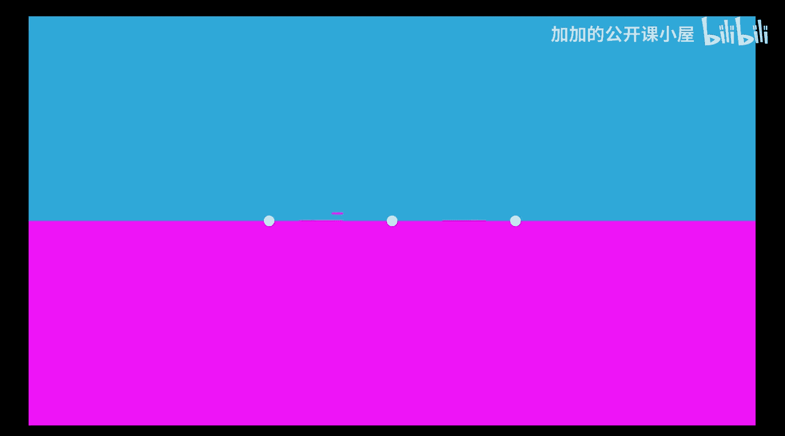
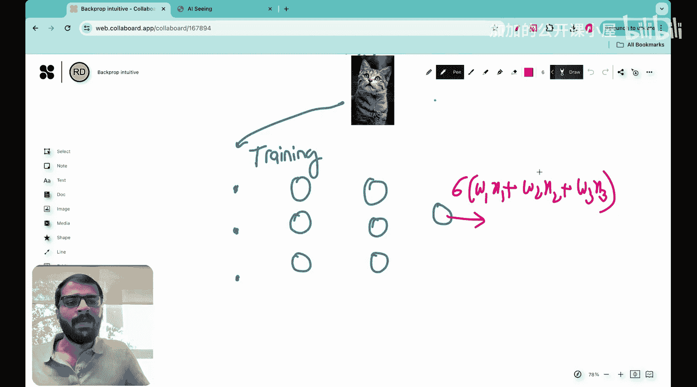

# Vizuara【中英⚡机器学习：实践教学｜Machine Learning： Teach by Doing】 p26 P26 Lecture 26： Backpropagation intuition [BV1RusDz1EXd_p26]

Hello， everyone。Welcome to this lecture。In which we will learn about back propagation。

 but in a very imputive manner。I deliberately wanted to have a separate lecture so that。

We don't get caught up too much in mathematics， but really understand the intuition behind this algorithm。

You might forget maths， you might forget matise such as taking the derivative of one matrix with respect to another。

 but once you have an intuitive understanding of back progression， you will never forget it。In fact。

 you will appreciate it much more。This lecture is heavily inspired from the channel 3 blue 1 brown。

And the tutorials which are present on that channel， so let's get started。

The problem which we have is the same what we have been seeing in the neural networks。

we have data collected from cats and dogs and we are measuring three things， vi length。

 pupil diameter and the ear Lainess index。Now the question is that if we have been given a new data。

 such as if have given if we are given a new set of these three measurements。

Can we predict whether it's a cat or a dog based on these major myths？

And the task is to construct a neural network to make this prediction， okay。

So this is the way our neural network looks like we have the input layer which has3 inputs x1 x2 and x3 there this is the first hidden layer。

 this is the second hidden layer and this is the output。In the output。

 the final classification is whether it's a cat or whether it's a dog。Now。

 every particular layer will have weights associated with it。 So this layer if you see。In this。

 if you look at this layer， every neuron， this neuron。

 this neuron and this neuron will have three weights。So there will be nine weights here， similarly。

 there will be nine weights here and there will be nine weights and there will be three weights here。

Apart from these weights， every neuron here， this one， this one， this one， this one， this one。

 this one and this one will have a bioter associated with it。

 so these will be the weights which are typically associated with this neuron。

As we have seen already every neuron does three basic things。

 the first thing is the summation operation， so let's say the inputs are x1 x to x3 and the weights are w1 w to w3。

 so it does this summation operation。Then it adds a bias term to it。

And then it appliess an activation function， so in this case we are looking at the sigmoid activation function。

Now， if you look at this output neuron here， the way this output neuron works is that we will find this quantity and if it is greater than 0。

5。Then we will say that it's a cat。If it's less than 0。5。Then we will say that it's a dog。ok。

When we say we want to design design a neural network to be able to make this prediction。

 ultimately what we mean is that so let me write down the weight matrix matrixice here so here it is w1 w01。

Here is W2， W 02， and here is W 3 and W0，3。So what I want to do is I want to find。Find the optimal。

W 1， W 2， W 3。W 0 and W 02 and W 0，3， I want to find the best values of these。

And these would involve a number of weights， so we have already seen that W1 will be a 3 by 3 matrix because every neuron here will have three weights so there will be nine weights total so this will be a 3 by3 matrix W2 will be a 3 by3 matrix because every neuron here will have three weights and w3 will be a 3 by1 matrix similarly w01 w02 and w03 are just the bias termss so we need to find the best values of every single weights in these matize。

And we have already seen that the best way to do this is to use gradient descent。

So let me write this in a different color， so in gradient descent the main aim which we have。

So let's say I look at a particular weight W I。Let's say the new value is W I。

 the old value minus the step size， the gradient of loss with respect to W。

This is what I need so the main term which we really need in all of these to optimize the weights is the gradient of the loss function with respect to the weights and this is where back prop really comes in。

Back propagation helps us to find。Gradient of the loss。With respect to weight。So there。

We can update these weights。Today， we are going to look at a very simple intuition as to。

We will look at the gradient of the loss function and we will look at how different neurons contribute。

Or how the weights of neurons contribute to this gradient through which we will also understand the basic intuition behind the back propagal algorithm itself。

Now if you look at the let us look at this gradient of the loss function with respect to weights further this let me call the gradient of loss with respect to weights this will actually be a matrix and this matrix will have gradient with respect to the weights coming to each particular neuron so lets say so every particular line here if you look at the pink lines and the orange lines and the green lines that is one weight correct and so if you look at this gradient with respect to loss it will have nine pink lines。

It will have nine pink lines because we need the gradient with respect to all the weights in this layer。

Then it will have nine orange lines。It will have nine orange lines because we need the gradient with respect to weights all in the second layer as well。

 and it will have three green lines。Im neglecting the bias term for now just for the sake of simplicity。

 it will have three green lines over here。And what this represents is that every single termure will represent。

That how a small change in the weight of that particular line will affect the loss。

So if I look at this pink line here。If I look at the first pink line。

 which let's say is this particular is this line， this line。And if this gradient value is， let's say。

For the sake of simplicity， let's say this is 0。1。And let's say if I look at a green green line。

 so let let's say I look at this green line over here and this gradient value so lets say this is equal to 0。

1 and this is equal to 3。2。So let's say if this is 0。1 and this is equal to 3。2。So。

 this matrix is also an indication of how sensitive the loss is with respect to changes in this weight。

 so this means that even if I change this weight by a small amount the loss will change by a pretty big amount whereas the loss is not quite sensitive to this particular weight over here。

This also implies that this green line is 32 times more important to the loss than this pink client over here。

And changing this particular green line will help me in changing or updating my loss function。

Remember what is happening in backproagal gradient descent is we are continuously updating these weights and for that it is very important for us to know which weights contribute a lot to the loss and which weights do not contribute so much to the loss so that we can know which weights to update more so here we can so this matrix gives us that idea gradient of loss with respect to W。

It gives us an idea of sensitive the loss is with how sensitive the loss is with respect to every single weight。

Okay， now what I want to show you is that I want to take a very simple example。

 so let me actually upload an image here。I am going to upload the image of a cat。Okay。

 and this image has been uploaded here， and this is my training example here， okay。

This is my training example。This is my training example。Okay， so there will be three inputs。

 there will be three inputs。The first input is the pupil diameter。

 the second input is the yearF flapiness index and the third input is the whisker length。Correct。

 these three inputs I have also shown over here。Then， it will feed in。To the first layer。

So there will be three neurons here。Then there will be three neurons here。

And then there will be the output neuron。This is what is happening here and what I want to do is this output neuron will give me an answer。

 so it will have sigma of w1 x1 plus w2 x2 plus w3 x3。And if it's later than 0。5。

Then what are we going to say then？