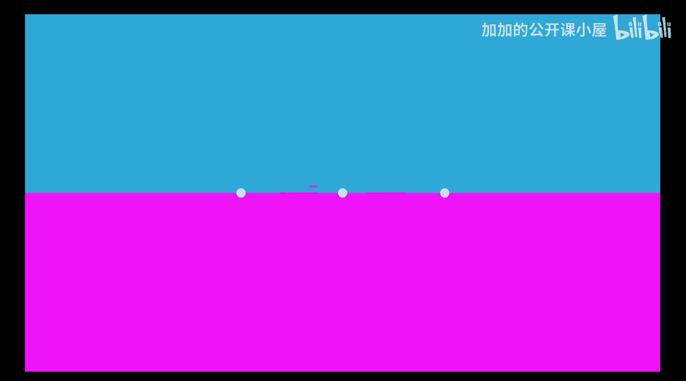
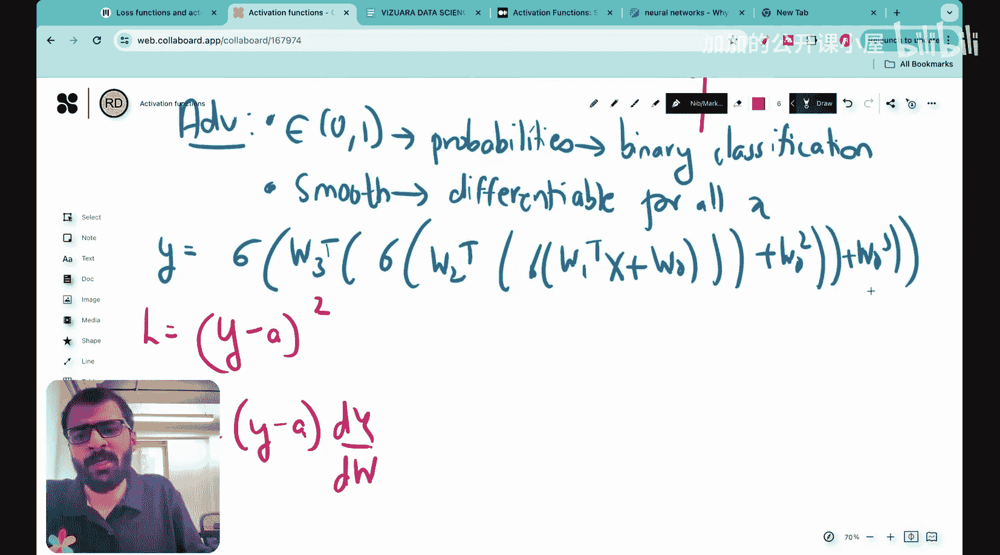

# Vizuara【中英⚡机器学习：实践教学｜Machine Learning： Teach by Doing】 p27 P27 Lecture 27： Neural Network Activation Functions [BV1RusDz1EXd_p27]

🎼Yeah。Hello， everyone。In today's lecture， we are going to learn all about activation functions。

The reason neural networks become so expressive and powerful。

Is that they have these things called activation functions。

Which convert linearities into nonlinearities。And which basically allow us to capture a lot of。

Interactions between the input features and to discover relationships between them。

Actation functions are one of the fundamental building blocks of neural networks。

Which help us to uncover complex relationships between the input and the output data。

Today's entire lecture is devoted to understanding the different activation functions。How they work？

What are the advantages， these advantages， and which activation function should you use for a given machine learning problem？

Interviewers tend to ask a lot of questions related to activation functions in interviews。

 so it is very important to have your concepts clear regarding the same。So let's get started。

Before we start， I just want to give a quick recap of the neural network structure and where out activation functions actually fit in。

So here I have shown。Two hidden layers in this neural network。

 there is an input layer with three different inputs and there is an output layer。

In the output layer， we have one output okay。So in each of these layers in the first layer there will be the weight matrix W1 in the second layer。

 there will be the weight matrix W2 in the third layer， there will be the weight matrix W3。

And you can see all of these different neurons which have been arranged here in the different layers。

 so this same neural letter can also be written in a block representation as I've written below so first you get the input x it goes through the first set of weights and biases then we get z1 which is just the linear summation so w1 transpose x plus w01 then z goes through an activation function。

So basically every single neuron here will have an activation function and then when the activation function applies on Z1。

 it leads to the output of that layer， which is called as A1。So in the first layer， for example。

 every single neuron will have an activation function and an output corresponding to it and all these outputs of different neurons will feed in as inputs to the next layer。

So here you can see the input to the next layer is called as A1。

 then it will go through a set of weights W2 andw02。

 it will go through the activation function of the neurons in the second layer。

Then you will produce an output a2。And then it will go through W3， W0，3。

We will go through the activation function of the last neuron and then finally we'll get the output a3 okay。

So this is the building block representation of the neural network here。

And if you were to represent the output in terms of just the functions。

 this is what the output would look like。Here I've used the sigmoid activation function， W3。

 W2 and W1 are the weights and W0， W02 and W03 are the biases。

So essentially this is similar to y equal to f of x。

Where F is this huge function which you have sigma of sigma of Sigma。

It will be useful to keep this functional representation in mind as we understand the properties of different activation functions。

Sometimes it's a bit harder for us to think in terms of building blocks but its easier to think in terms of functions so keep this formulation in mind。

 remember that a neural network is just a big function at the end of it。

A function which looks like this， which is a bit more complex。

 So this is way complex than a sigmma signal sigmoid， right， it's sigmoid of sigmoid of sigmoid。

All neural networks can essentially be represented in huge functional forms like this。

Now that we have this in mind let us look at the level of a single neuron every single neuron has three functions。

 it does the summation operation on the weights， it adds the bias term and then it applies an activation function。

 so this is the activation function F which is applied on w1 x1 plus w to x2 plus w3 x3 plus B。

Ws are the weights which are feeding into these neurons based on the input， So this is x1， x2 x3。

 and then every input will have a weight W1 W to W3， and then there will also be a biaser。

So every single neuron which has been shown here， these neurons in the first hidden layer。

 these neurons in the second hidden layer and this neuron in the output layer。

 all of these neurons do these three functions， they do a summation operation， they add a bias term。

 and then they apply the activation function to the resulting output。

So activation functions show up wherever neurons show up and they play a fundamental role in not only the forward pass but also in the backward pass when we do the gradient with respect to the weights since we want to optimize the weights so let us see the different activation functions and how they compare and contrast with each other and let's see their advantages as well as disadvantages。

是的。Al right， so let's start looking at the types of activation functions which are commonly used in machine learning。

The first activation function， which we are going to look at is the sigmoid。

We have covered this a lot in previous lectures。So the sigmoid activation function looks like this y is equal to1 upon1 plus era to minus x。

 and if you plot this activation function， it will look something like this。

So this activation function always returns a positive value。It is keptped。At one。

 so it never becomes higher than one， it always lies between 0 and 1 and its value 0 is 05。X and y。

 so this is the sigmoid activation function， and its typically routinely used in binary classification。

So remember that since the sigmoid always takes values between 0 and1。

 the output of the sigmoid function is very commonly treated as probability。

 so if you want to distinguish between two categories like whether it's a cat or whether its a dog you can treat the output you can treat the output of the sigmoid as that probability and then you can say that if it is greater than 0。

5 its a cat if it is less than 0。5 it's a dog。So sigmoid activation function is typically used in such kind of binary classification problems where we have to assign probabilities to the two classes。

 we have to assign probability to let's say what's the probability that the neural network is classifying this as a cap。

 what's the probability that the neural network is classifying this as a。

So now let us look at the advantages and the disadvantages of this particular sigmoid。

So the first advantage is that so let me write this down so first advantage is that it always belongs between0 and 1 so the output belongs between0 and1 and it is linked to probabilities。

So it's a very good function to be used for binary classification。

So very good activation function to be typically used for binary classification that is the first advantage of the sigmoid activation function the second advantage is that this function is smooth。

Which means that it is differentiable at all the points at。

It is differentiable for all the inputs or for all x。

This will be very useful for us because remember when we do the backward pass we have to take the derivatives right so we need to make sure that the activation functions are also differentiable。

So one advantage of sigmoid is that it's pretty smooth as you can see from the graph here so it's continuous and differentiable at all the points Okay now let us come to the biggest disadvantage of the sigmoid activation function and to really understand the disadvantage I want to use this this functional form So remember if a sigmoid activation function is used let's say in a neural neural network the final y will look like something like this sigma of。

W 3 transpose， then sigma of W 2 transpose。 Then sigma of W1 transpose x plus w 0，1。Plus， W 0，2。

Plus w03， it will look like this， remember。And now what we want to do is we want to find the derivatives。

 okay， so the loss will look something like y minus the actual whole square。

So now if you want to take the derivative of the loss with respect to it。

 it will look something like2 into y minus a multiplied by the derivative of this whole thing dy by Dw。

So ultimately we will need to take the derivative of this entire quantity with respect to w correct now let's see what that would look like if you。

