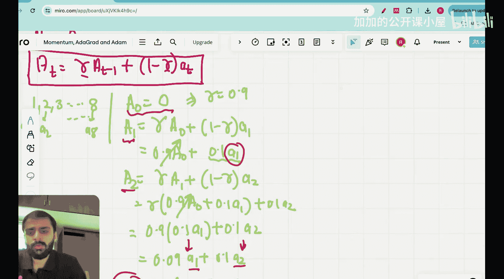

# Vizuara【中英⚡机器学习：实践教学｜Machine Learning： Teach by Doing】 p28 P28 Lecture 28： Momentum in Gradient Descent [BV1RusDz1EXd_p28]

Hello， everyone。Welcome to this Vira AI Labs lecture。Today。😊。

Is a very interesting lecture because today we are going to learn all about adaptive step sizes。

In particular， we are going to look at three different methods， the first is momentum。

 the second is add delta， and the third is Adamom。Adam is right now the default optimizer。

 which is used in all in training most of the machine learning algorithms。But to understand Adam。

 we need to go through a sequence。And the one concept which is underlying all of these three methods。

 momentum， add Dlta and atom is the concept of running averages。

So before coming to running average and understanding it。

 let me first motivate why we need adaptive step sizes in the first place。

If we have a fixed step size， then it turns out that the gradient descent proceeds in a very slow manner and its not the most ideal thing to do。

The reason is because in back propagation。At each layer and for every different weight metrics when we are taking derivatives with respect to the loss。

Different mets accumulate together。And the accumulation might be different for different layers。

So the step size which works for one layer might not work for another layer。

 similarly the step size which works in one iteration might not work for another iteration。

That's why we need to look at step sizes with change with respect to。Ittereration。

 so these are not fixed step sizes and that's why they are called as adaptive step sizes。

So before we look at how can we change the step size with respect to every iteration？First。

 we need to understand the concept of running averages。

And I have seen that so many students find it difficult to understand the concept of Adam because they don't understand running averages。

It's a very simple concept if you actually understand it。

So let me first try to explain it the concept of running averages。

So we start out with a sequence of numbers such as A a2 dot dot dot A。And up。

The normal average for these numbers is just so if you look at normal。Average。

Is just one by N A1 plus A2 plus dot dot dot A， right？

A moving average is an average which changes based on the particular element which we are looking at。

So when we look at moving average or running average， it is denoted by even。A2， dot， dot， dot in。

So at every sequence。At every step of this sequence。

 we will essentially have a running average or a moving average。

So let us start with a simple example。Let's say I have or before that。

 let me start out with the formula for moving average in the first place。

 So the formula for the moving average is this a0。Which is the moving average at the first element is equal to 0。

And then， a。8 is equal to gamma of A minus1 plus1 minus gamma。

8 so this is a small a which is the element of that particular sequence A1 a2 dot dot dot A and capital a represents the moving average at a particular time。

So you might be noticing that I'm using the term running average and moving average interchangeably so moving average is a subcase of running average。

 if this gamma also is a function of time then it is called a running average but if gamma is fixed which we are going to assume for the rest of this lecture then it is called as a moving average。

So let us try to understand what this actually means because this will show up。

Let me draw it in a better manner。This thing which we have written here right now will show up in all of these methods it will show up in momentum。

 it will show up in Adam as well， so we need to understand what is this moving average and where does this formula really come from。

So let us take numbers。 So let us take numbers as。1，2，3， dot dot， dot up to 8。

 So let's say this is my A1， this is my a2 dot dot dot， this is my a 8。

So let us start calculating these moving averages， a0 is equal to 0。So that is already mentioned。

 let us calculate capital a1， so capital A1 is gamma times a。

Gmma times a0 plus 1 minus gamma times a1。And for now here， I'm going to say。

 let's say gamma equal to 0。9。So， so capital A is 0。9 a0 plus 0。1 a。

Then capital a2 is gamma times a plus 1 minus gamma times small a2。

 which is equal to gamma times 09 a0。Plus 018 plus0182。

Which is equal to so here we are looking at gamma equal to 0。9， right？

So let me actually compute this so this is point。9 into a。And okay， so now a 0 is equal to0 anyway。

 So this term will go out， this term will go out。 So a1 is 0。1 into a1。 So then。This will be 0。

9 into20。11。Plus，0182。Which is equal to 0。0911 plus 0182。And then， a 3。

A3 will be equal to gamma times a2。Plus 1 minus gamma small a3 is equal to 09 into 0。0911 plus 01。

Into a2 plus01 into a3。It is equal to。0。9 into 0。091。Plus 0。9 into 0。182 plus 0。1 into a3。

So now I want you to take a look at these running or moving averages， of course， a0 is equal to 0。

a 0 is equal to 0 which we have already seen before look at a1 a1 so capital a1 just depends on small a1 that is nice now capital a2 has contributions of small a1 as well as small a2。

 so it has contribution of the current element which is a2 but also of the past element。

And what is the contribution of the past element since the value of gamma is around 0。9。

 the contribution of the past element is very small。

The contribution of the past element is much less。Then the contribution of the current element。

Let's look at A3。So a3 again has contribution from all three elements。

 small A1 small a2 and small a3， but as we saw with capital a2。

 the contribution of a1 and the contribution of small A1 and small a2 is small compared to。

Cap it compared to small a3。So the first understanding which we have is that moving average。

It captures。The effect。O。The past。As well as the present。Okay， that is the first。

Intuition behind moving average and the second intuition is that if the value of gamma is very close to one。

 if the value of gamma is close to one， then the present。Domins the past。So。

 you can think of it as retaining memory， so you have some memory of the past and the current moving average has the memory of the past elements here you see capital a3 is the current moving average it has memory of small a1 small a2 as well as small a3。

 but if gamma is very close to1 then the past values are given much less preference than the present value。

Now， let us look if gamma is actually equal to small value。

So now the second。