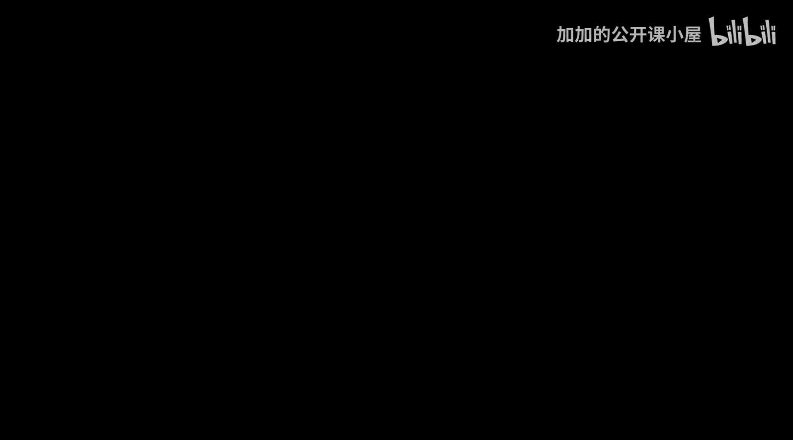
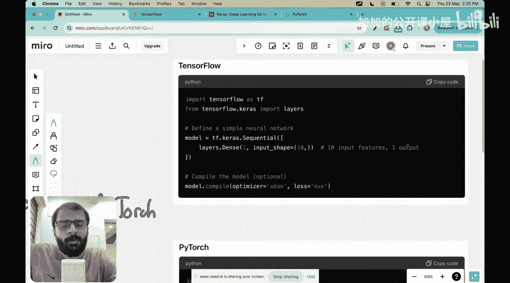
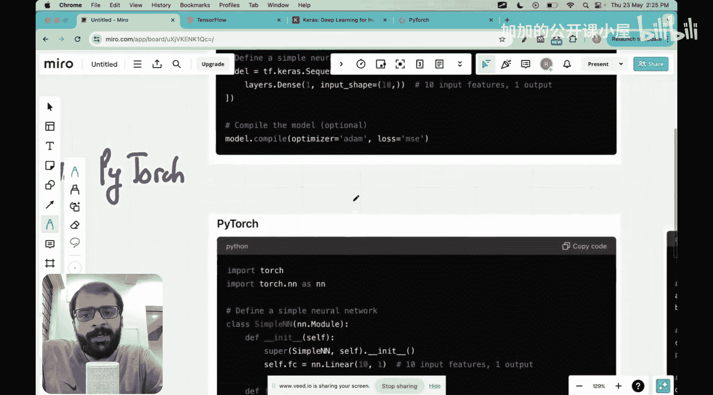
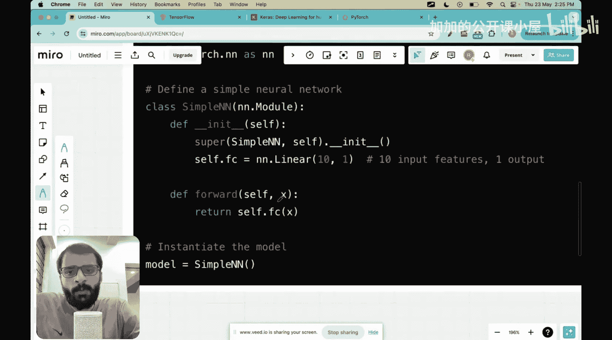
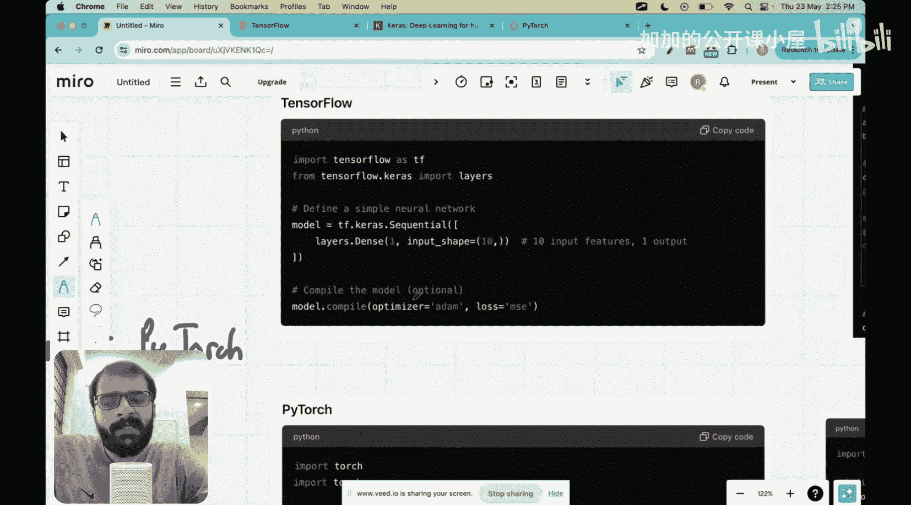
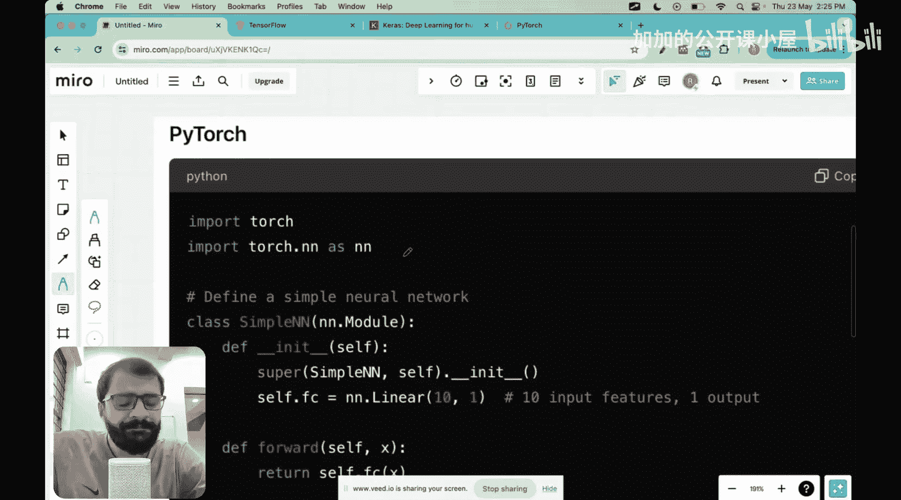
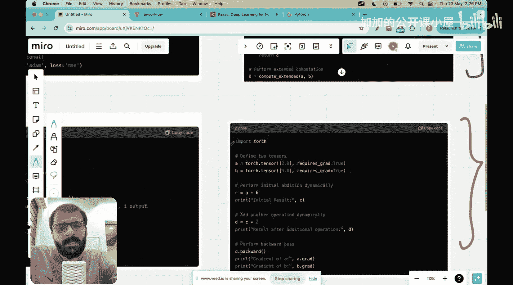
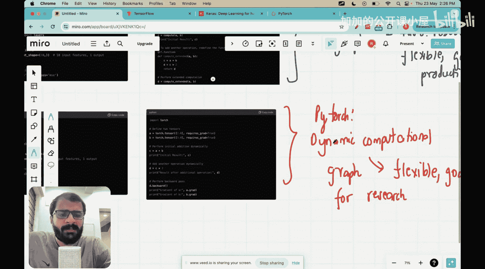
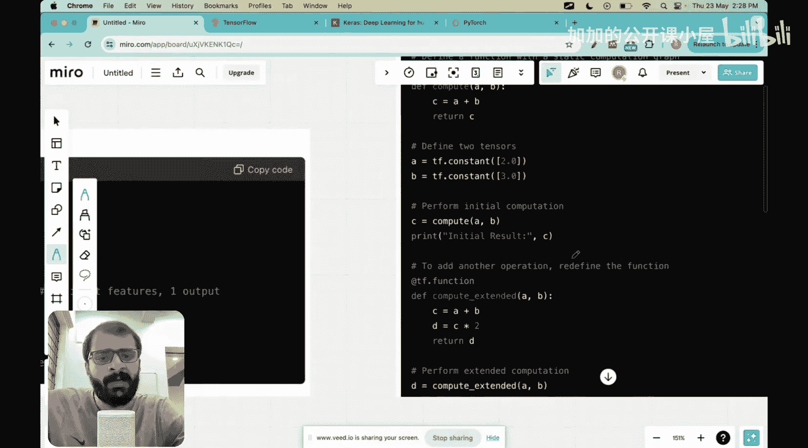
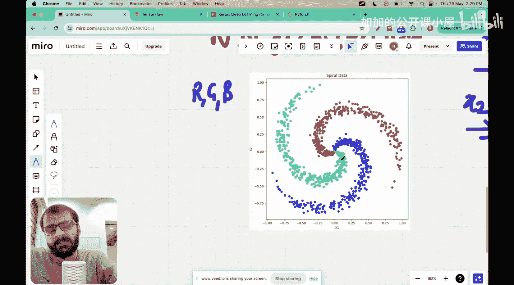

# Vizuara【中英⚡机器学习：实践教学｜Machine Learning： Teach by Doing】 p29 P29 Lecture 29： Hands on neural network training in Python [BV1RusDz1EXd_p29]

Hello everyone， welcome to this machine learning teach by doinging lecture in this lecture we are going to be looking at a hands on implementation。

Of neural networks in Python。Will be taking a problem and then we will construct the neural network architecture。

 We will train the neural network， and then we will obtain the results。

 and then Ill also show you testing。Well be using some standard libraries in Python。

 which are routinely used by engineers in practice。

If you want to see a much more detailed version of how to create a neural network from scratch。

I have started another series called neuralural Network from scratcht and that has three to four videos so far in which we will be breaking down the commands which these libraries such as TensorFlow and Ks use。

But in this lecture I am going to use the command straight from these libraries because the main name of this lecture is to show you how neural networks are used in practice today if you want to get a much more theoretical understanding。

Please take a look at the neural network from scratch series and Im attaching the link to it in this video for your references。

So let's get started with today's lecture before we move to the problem and before we actually start coding in Python。

 I want to first describe about three framework works which typically。You must have heard about。

 or you will hear about when you think of coding neural networks in Python。

And those three frameworks are as follows， the first is something called Tensorflow。

 the second is something called ks and the third is something called pieattorch。

Now most of the students either use one of these or many students actually don't know the difference between these three。

 so let me explain to you each of them first is Tensorflowlow and if you go to the Tensorflowlows website you will see that Tensorflowlow is basically a platform for running machine learning models or machine learning frameworks it is developed by Google。

And many Python codes which are used today。Use tensorflow。That's number one。

 the second thing or the second term which you will hear about a lot is something called kas。Now。

 K is a bit different than Tensorflow because Kas is like an API。

So basically you can think of it as basically functions which you can inke so for example。

 if you want to chain different layers together to create a neural network architecture。

 you can use the sequential API call from Ks。Similarly。

 CAs just makes it easier to write down functions if you want to implement a dropout layer instead of coding the dropout layer from scratch。

 you just have one command for it。Instead of specifying the loss function， and instead of。

Explicitly writing down the gradient decent rules you can do it very simply using the KRS interface。

 which is also called as an API。So Ks is a neural letter API and Tensorflowlow is a platform for ML。

 so what people did was that。They integrated ks with tensor flow。

So Tensorflow and ks are now integrated with each other。嗯。

And the code which we are going to use today will actually use kas within Tensorflow so you can think of as Tensorflow as the bigger machine learning library。

Kas as the neural network API， so basically making it easier to call neural network functions。

And then ks was merged through a tensor flow so that we can call the kas functions by using Tensor flow itself。

Then there is one more library， which is called as Pitorch。

Now Pitorch is also a machine learning framework and you can define and run neural networks using Python using Pitorch also it was developed by meta which was earlier called Facebook。

Now， there is a big difference between pitorch and tensor flow and I will try to simplify that difference for you as much as possible。

So first， let's look at simple codes。In tensor flow and pietorch。

 which you will write to create a neural network。 So， for example。Here we are using tensorflow。

 you import tensor flow SF and then remember I told you Kas is。Integrated with Tensorflow。

 So if you want to use the layers API within CAs， all you need to do is from Tensorflow dot ks import layers。

And then you can define the layers of the neural network。You can even import sequential。

So here we have defined a neural network which just 10 input features and one output。

On the other hand， if we wanted to do the same thing with Pytor the implementation kind of looks like this。

So Pyettorarch follows a more object oriented approach where we define a class。

Then we define two methods within the class， so underscore underscore in it underscore underscore is a special method which is called automatically when an instance of this class is created。

Then we define the weights of this neural network 10 input features of output。

The second method is forward， so this implements a forward pass and then returns the output from the neural network。

So there are two different ways of writing the same neural network Tensorflow uses more like an API based approach or chain functions together。

And Pytorch uses。

An object oriented programming approach。But there is a subtler and a bigger difference between these two Tensorflow uses something which is called as a static computational graph and Pytor uses something which is called as a dynamic computational graph。

So let me try to actually explain to you what these mean。Okay。

 so lets say we want to compute the summation of two functions。

 so remember Tensorflow uses static computation graph。

 so we define the compute function and then we say that c equal to a plus b。Now。

 if you want to modify something in this function。You need to write a different function。

 so compute extended c equal to a plus B， and then lets say I want to define another variable called D which is c multiplied by 2。

 so that is another variable。So， you cannot just extend this function very easily you have to write another function。

 The reason is because once this function is defined a static computation graph is created by a tensorflow and it becomes very hard to be flexible with this function now that is the simplest way to describe it whereas if you use。

By torch you can change things on the fly so initial addition can be performed dynamically where c equal to a plus b。

 then you can also add another operation dynamically d equal to c into22 you don't have to define a separate function for it。

Essentially what I am trying to say is that Pytorch is a bit flexible with the code because it creates computational graph between variables on the fly or on the go as the code is being run。

Whereas tensor flow creates the graph dynamic creates the graph in a static manner。

 so if you want to change something， then we need to redefine the function。Itself。

 and so it's a bit less flexible。

In summary， both tensor floor and pyettorch can be used by beginners。

But remember that tensorflow is fast robust， but it is not very flexible。

So if you want to tie around with stuff， if you want to use this for research。

 Tensorflowlow is not very recommended， but it' is actually quite good for production level or industrial level machine learning frameworks。

Pye torch on the other end generates these graphs in a dynamic manner so it is very flexible so if you want to change stuff on your own be use these frameworks to do research then Piy torch is very good。

As a beginner you can use both pytorch and tensorflow and in fact I encourage you to use both to see the similarities and the differences between the two。

In this particular video， we are going to be using Tensor flow。

So I hope you have understood the differences between these three frameworks now tensor flow cares and pytor basically you can think of tensor blue cares in one bucket and pytor in another bucket。

So let's get started with today's example。Today， what we are going to do is we are going to perform a simple classification task。

First， let me introduce you to the input data。Our input data or training data looks something like this。

Every input has two attributes x1 and x2。 So if you plot them it will look like this and every input also has a color coding associated with it。

 So essentially there are three color codes are。G or B。So any point x1 comma x to which you take。

 lets say we take this point， this is coded as red。

 if we take this point it is coded as blue if we take this point it is coded as green。

This is also called as the spiral data。Our goal in this lecture。

