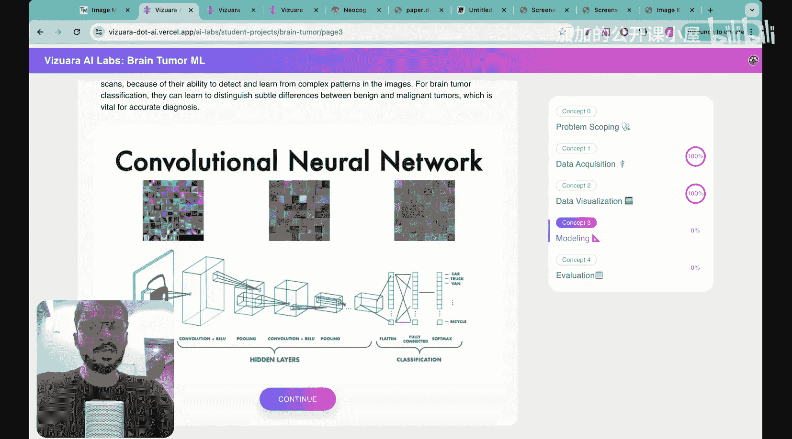
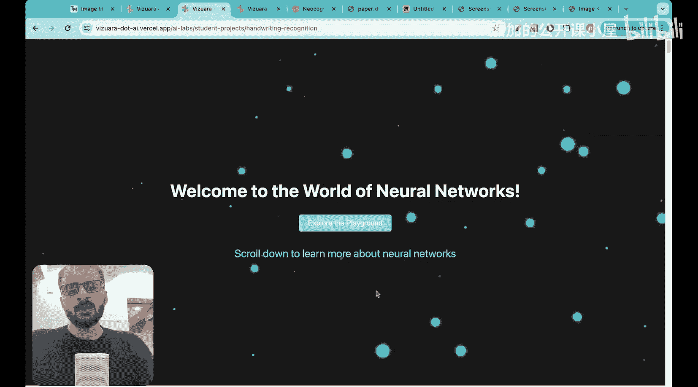
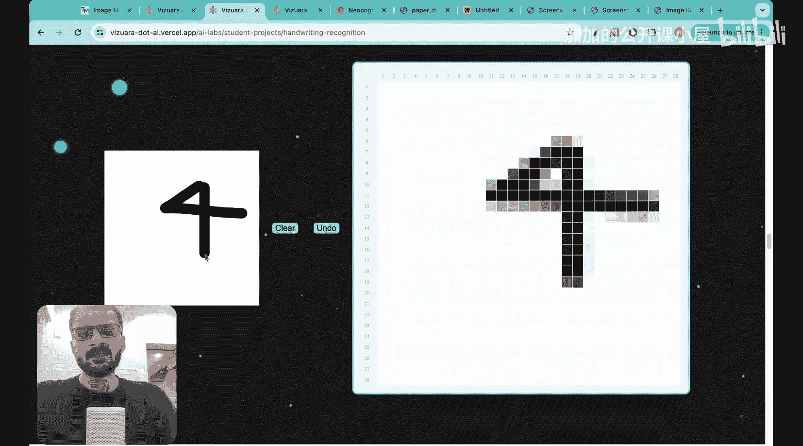
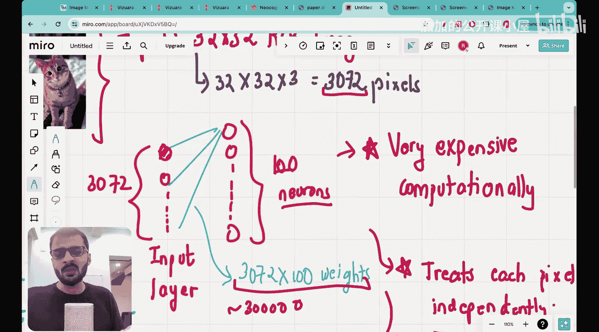

# Vizuara【中英⚡机器学习：实践教学｜Machine Learning： Teach by Doing】 p30 P30 Lecture 30： Introduction to Convolutional Neural Networks (CNNs) [BV1RusDz1EXd_p30]

Hello， everyone。Welcome to this lecture on machine learning， teach by Doing。In this lecture。

 we will be learning about convolutional neural networks and their introduction。In particular。

 we have three agenda points in today's lecture first we will start out with the applications of convolutional neural networks。

Second， we will look at the intuition behind why do we even study about convolutional neurallets？

And I had not used just feed for neural networks， which we have looked at before。And thirdly。

 we will look at the history of development of convolutional neural nets。

So although this term has become really popular for the last decade。

 people have been working on this subject for the past 40 to 45 years and it is very important to acknowledge their contributions。

Convolutional neural networks are also referred to as CNNNs。So in this lecture。

 whenever I use the word CNN， Im in convolutional neural network。So let's get started with the first。

Section of today's lecture， which is the applications of CNNs。

The first application which I want to show you is a simple cats and dogs image classification。

So the interface which I am showing you right now is called as teachable machine what I have done here is I have uploaded 10 samples of cat images and I have uploaded 10 samples of dog images。

And Ive trained the model。And the final task of this train model is that whatever image I upload as a test image。

 it should correctly classify whether it's a cat or whether it's a dog。It seems simple。

 but actually it's incredibly complicated to train an AI system or a computer。

To recognize images and what they represent， for example， look at this test image。

The training image of all dogs are just from the front of you and they are in different positions essentially we are telling the computer that I have given you 10 images of dogs try to identify patterns or features from these images which let you know that it is a dog and based on these features I am going to give you some difficult test image and you have to do a good job on it。

And。The trained neural network here is doing an amazing job you see with 100% accuracy saying a dog。

And I think this is a difficult test image because it' is shown from the side view and not front view。

 as are all the images in the training data。If I upload any other image， let's see how it performs。

So now I am going to upload the test image of a CA and here also I am going to upload a difficult image which was not part of the training data。

With 100% accuracy。The trained neural network has predicted that it is a cat。In fact。

This system or this model is so robust that any new image which you upload a cat or dog。

 it will correctly classify whether it's a cat or whether it's a dog。

If you look at the second section here the training。

 what is going underneath the hood is a convolutional neural network is trained。

So the model which is making these predictions is not a simple feed forward neural network which we have seen before。

 it is a different type of a neural net which is called as a CNNN or convolutional neural net。

The second example， which I want to show you is in the healthcare space。

And it in the it's called brain tumor detection。So imagine you have an MR scan and。

There can be two possible options based on the scan， a tumor is present。

 which means it's malignant or a tumor is absent， which means it is benign。Of course。

 a doctor can take a look and manually say whether a tumor is present or not。But the question is。

 can we train an AI system to effectively look at an image and classify it as a benign or malignant。

 which means tumor is not present or tumor is present？

So let' us look at the data for this we have data for malignant and Im going to show five images here you can see malignant images have bright white spots when tumor is present and I am going to also load the data for a benign so here is one image to。

Here are five images of benign。Which means that a tumor is not present， and they look。

Sooer compared to malignant。 So they don't have sportss。 So humans can see this， but。

It's actually a very hard problem to train computers to look at millions of these images and。

The task is that if I give you any new image， you should be able to correctly predict whether a brain tumor is present or not。

This involves pattern detection。The computer or the AI should automatically detect。

regionsions where a tumor is present and classify that as malignant。Now。

 if you look at the evaluation lets do the model evaluation now let's click on the second image and click on test the model。

Here we can see that the model predicted benign and the actual value is benign。It's amazing right。

 the train neural network was able to correctly predict。

Whether it's a benign tumor or malignant tumor just based on the training data set。

Again the underlying neural network architecture is not a feed forward neural network but it is something called a convolutional neural network just take a look at this schematic no need to worry about how it is working right now I am going to explain all those details。

In some of them in this video， some of them in subsequent videos。

But remember the power of convolution neural letters and what all it can achieve。

The third example I want to show is a very interesting example called handwritten digit classification。

So let's say if you have written a handwritten digit， something like。

 let's say I'm drawing a five year。

The computer converts it into a bunch of pixels， so it does not know its5。

The task is to train the neural network so that any handwritten digit can be correctly classified。

 so lets say I type 8 here。The neural network should be able to correctly predict based on the pixels that is indeed an it。

If I type three here。The neural network should be able to predict that it is a three and it should do these predictions。

Because some people type digits differently， right， I may type of four like this。

I may even type a four like this。

For both of these， the neural network should correctly predict it as four。

Similar to these applications， which we just saw convolutional neural networks have a wide range of applications。

So for example， if you take the example of self driving cars。How do these cars。

Detect between objects， humans and how do they make that distinction。

 there is a convolutional neural network which is trained underneath。Essentially。

 whenever you are dealing with images of some sort。A CNN or a convolutional neural network。呃。

Operates underneath the hood。So I hope Ive motivated you enough regarding the applications of CNN。

 but now let us try to look at a more deeper level regarding why CNNs are needed in the first place。

So， now we have come to the。Second example here， why convolutional neural networks are needed。

So let's take a simple example of this cat， okay。And I have just drawn a schematic here and have roughly marked the position of this cat。

 let's say that this is a RGB image red green and blue and its 32 by 32 pixels in one channel so the total number of pixels is 32 by 32。

Multipliied by3， these are the total number of pixels in the input image and that is 3072，30。

72 pixels those are present in the input image。Y 30 has 72 because 32 into 32 for one channel and we have three channels like these。

 so a total of 30，72 pixels。Now let's say that I don't want to use a convolutional neural network and I say that Ill just train a normal neural network based on this input。

 I'll just use a feed for neural network。Lets see how that will proceed。

 So in a feed for neural network， you will need an input layer。That will be these30，72 pixels。

 so each input will have one unit here， so there will be 30，72 units in the input layer。

And let's say that in the first hidden layer， we have 100 neurons。Now。

 every neuron here will have 3072 weights， so the total number of weights in the first layer itself is 3072 multiplied by1000。

 which is around 300，000 weights。That is just in one layer if we have four or five layers like this。

 it will lead to1 million weights。This is not computationally efficient at all， in fact。

 it is extremely expensive computationally。And that is the first reason why feed forward neural networks are not used for image classification tasks。

But this is a minor reason there are two。아들。