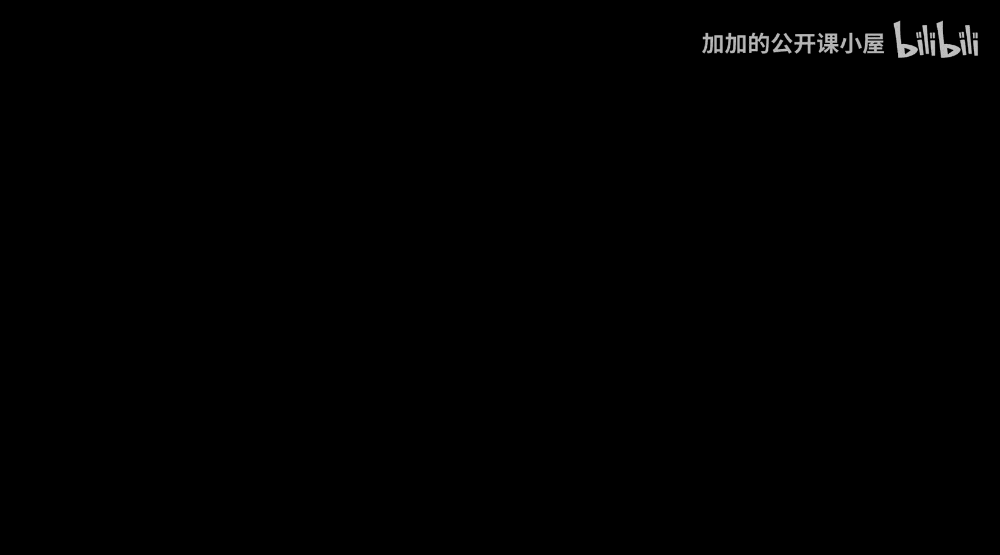
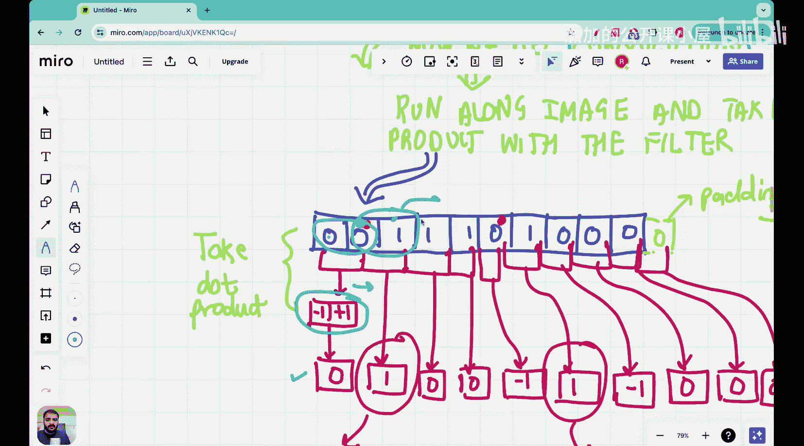

# Vizuara【中英⚡机器学习：实践教学｜Machine Learning： Teach by Doing】 p31 P31 Lecture 31： Filters in 1D and the Convolution Operation [BV1RusDz1EXd_p31]

Hello， everyone。Welcome to this lecture on Convolutional neural networks。Today。

 we are going to learn about a very important concept in convolutional neural network。

 which is called as filters and why we really care about them。In the previous lectures。

 lecture on convolutional neural network， we have looked at。

Why normal neural networks are not very good for classifying images。 So for example。

The goal of convolutional neural networks is to look at this image， for example。

 and conclude that it is an image of a cat。The question is why don't we use normal feed forward neural networks for this task。

 it turns out that normal neural networks don't exploit or don't use。

Two very key features of using images as data。The first key feature is spatial locality this means that all the features or the pixels which correspond to a cat will be close together。

For example， the pixel which corresponds to this eye will be close to the pixel which corresponds to this eye。

 the pixel which corresponds to this year will be close to the pixel which correspond to this year。

Traditional neural networks don't take advantage of this feature or this property of images。

 the property of spatial locality。The second feature of images as data is that of translational invariance。

 which means that in this image， whether the cat is slightly shifted to the right left top or bottom。

 it will remain a cat。These features of images look simple。

 spatial locality and translational nu variants， but they are hugely beneficial。

And we need some architecture， which takes advantage of these features， Trad neural network with。

Neurons and layers don't take advantage of these features at all。

 and that's why they were not very useful in tasks such as classification of this image。

And that is the reason people turned to convolutional neural networks。

One of the key concepts in convolutional neural networks is that of filters。In fact。

 the whole of CNNs or convolutional neural networks will be much easier to understand if we understand what are filters。

Filters are the true building blocks of convolutional neural networks。

And if you have used tools like Instagram or Snapchat before。

 you might be knowing of filters or if you have used your phone camera and if you have changed the filter to bright or dark or to some any other filter。

 that's exactly the kind of filters which we are talking about here。

But we will talk about them in a bit more mathematical sense。

 We will also introduce the term convolution and why are these neural networks called convolutional neural networks。

I'll try to explain everything from scratch so that you will understand from the very basics。

Today we are going to learn about filters on one dimensional images and the convolution operation on one dimensional images。

We have another lecture after this in which we' will start looking at two dimensional images such as the cat over here and the conevalation operation on the two dimension image。

Let's get started with today's lecture。We will first start with our one dimensional image which looks something like this。

So here you can see the image starts with a dark color here。

 then it transitions to a lighter color which is white， then it becomes dark。

 then it becomes light and then it becomes dark again。

This is the one dimensional image which we have in pixel representation。

 this looks something like this， all the dark spots will be represented by zero。

And all the white spots will be represented by ones。So the pixel representation is 0，0 for the black。

region here， 1，1，1 for the white region here， then0 for the black region， one for the white region。

 and then 0，0，0 towards the end for the black region at the end。That is the input data which we have。

This is a one dimensional image remember when we look at an image we will see it as a series of dark and white bands right but when a computer looks at this image it just sees a bunch of pixels so this is the data which is available to us so I am just writing it over here as data。

Now the goal here is that we want to detect left edges in this image what do I mean by left edges left edges means that whenever there is a transition from black to white so lets see where there are left edges here there is a left edge right because there is a transition from black to white here and here there is a left edge because there is a transition from black to white。

I want to detect left edges just from this pixel representation here。

 so somehow the answer should be that there is a left edge over here and there is a left edge over here。

Remember that we can see the left edges clearly， but that is not the main goal；

 the main goal is for us to help the computer understand where the left edges are based on this pixel representation。

And to achieve this goal， we need to look at transitions from zero to one pixels because。

As I mentioned to you， we are looking to capture the black to white transition right in pixel that means we are looking to capture transitions from 0 to 1 that is the goal represented in terms of mathematics。

How can we do this？This is where filters actually come into the picture。

 it turns out that filters are a great way to detect features like these such as left edges in the image。

So to achieve this goal， we are going to start with。Filter。

 which is called as the left edge detection filter， okay。

And I am going to intuitively assume this filter。 not all filters are this intuitive to assume。

 So since we are looking at a left edge detector， we think that there has to be a transition from something low to something high right。

 So I am going to use this filter， which has。Essentially two values it has the first value as minus1 and it has the second value as plus 1 and I am going to call this as a left edge filter for a right edge filter I would have used plus1 and minus1 but I want to detect transitions from a darker region to a lighter region。

 so I am going to be using this filter which has two values minus1 and plus1。

And then what I will be doing is that then I will be doing something which is called as the convolution operation。

What this convolution operation means is that Ill take this filter。

 Ill take this image representation， and then I'll run this filter across the image and take dot products at every single time。

If you are not familiar with dot product， let me first introduce that concept to you if there is one vector。

 if there is one vector v1， which has essentially。2 values A1 and v1， and if there is a vector v2。

 which has two values a2 and V2， then the dot product of v1 and v2。

 which is also represented as v1 dot v2 is the product of the first terms。Even need2。

Plus the product of the second terms， which is B1 B2。

So that is exactly what we will be doing here we'll be taking this left edge filter。

 which which you can think of as a vector with two values minus1 and plus 1。

We will be first starting from the left hand side， so well put this left edge filter over here。

 take the dot product with the first two entries and then keep on sliding the left edge filter across the image。

Let me show you how this looks like in practice， so this is my image right this is the pixel representation 00。

11101000。So this is my filter。So， as I told you the first step in convolution is to take the filter and align it to the left side of the image so first I' am going to take this filter and align it to the left side of the image then I am going to start taking dot products so initially I am going to look at these two values over here。

And then I'm going to take a dot product between this vector 0，0 and minus 1 and plus 1。

And remember in dot product the way we do the dot product is we multiply the first entries and then add the multiplication of second entries。

 so it will be0 into minus1 plus0 into plus 1 so the resulting answer will be0 over here。

Then what we do is that we will take this filter and slide it to the right。

Then we will be taking the dot product between the second value and the third value。

 which are these two。So then we will take the dot product of0 and1 with minus1 and plus 1。

 so the answer of that will be plus 1。Then I will slide it further。

I'll slide the filter further to the right and then I'll take the dot product of the filter with these two。

