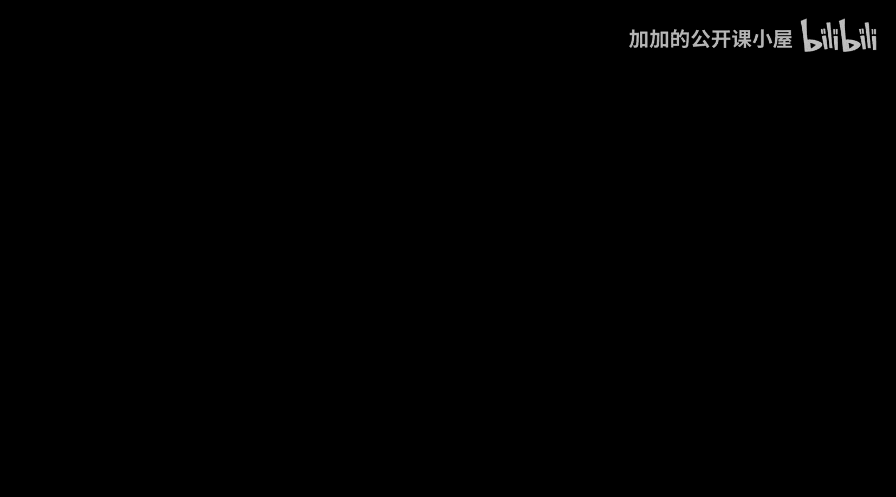
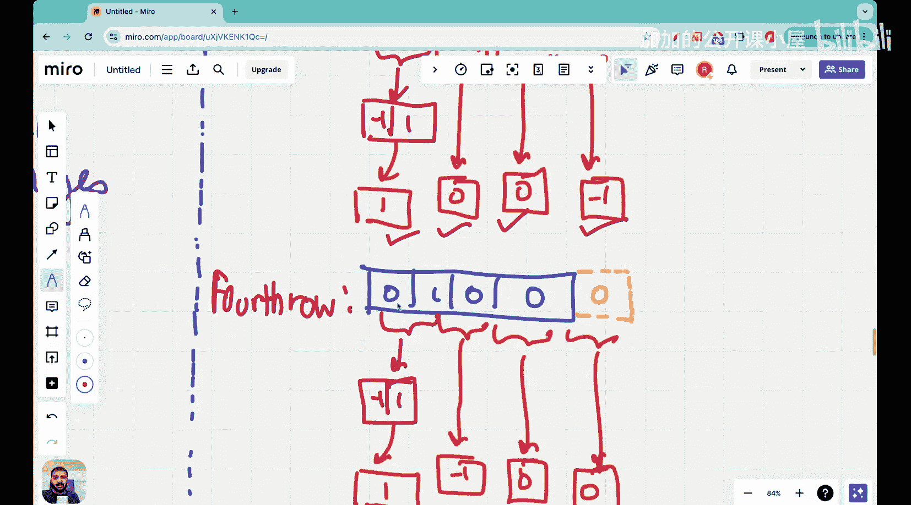

# Vizuara【中英⚡机器学习：实践教学｜Machine Learning： Teach by Doing】 p32 P32 Filters in 2D, Channels and Feature Identification [BV1RusDz1EXd_p32]

Hello， everyone。Welcome to this lecture on convolutional neural networks in the previous lecture we have looked at one dimensional filters。

And we have seen how filters can help us detect features in images。

 we have also seen the convolution operation。Now in today's lecture we are going to move to two dimensions。

All the images which usually we have on the internet are two dimensional images such as cats， dogs。

 even the photos on our phone are two dimensions。So we now move to two dimensions so that it is more related to real life。

The main goal again， is to identify features in images and to quantify images such as the image of a cat。

 dog， etc。Very similar to what filters did for one dimension。

 you will see that filters have the same role or filters have the same function when we move to two dimensions as well。

It's just that the number of filters goes on increasing a bit and that's why some care needs to be taken with respect to dimensions。

Okay。So， the problem as I said is similar to one dimensions。

 we have a two dimensional image here like this where you can see that there are areas of bright which are represented by white regions here and there are areas of darkness。

Now， let's say you have certain tasks which you need to do such as for example。

 the task which I'm considering here is that given this image。

I want to detect an isolated pixel in the image。What I mean by isolated pixel is that there is a dark region。

Such as a dark region like this and everywhere else it is surrounded by a white region。

 this kind of pixel I am referring to as an isolated pixel lets say I want to detect such a pixel in the image。

When we look at this image， our eyes can see that there is one such pixel in this image which has been marked by the pink arrow over here。

So our eyes can see that there is one pixel here， which is this which is this pixel。

 which is that isolated pixel。So our eyes have got us to the correct answer。

 that is because of the evolutionary mechanism of our eye and its ability to detect patterns。

But the real challenge is to get computers to identify this to prescribe a set of mathematical rules such as the convolution and the filter。

So that the computer can take in this image， and the computer can。

Say that this is the isolated pixel。So first I want to demonstrate the filtering or the convolution operation on two dimensional images very similar to what we saw for one dimensional image。

When a computer looks at this data， it does not see what humans do when we look at this image we see bright regions and dark regions right。

 but when a computer when a computer looks at this image。

 all the computer sees is a bunch of numbers。So wherever there is white region here。

 the computer sees it as one and whenever there is a black region， the computer sees it as zero。

So now I'm going to switch to this part of the screen。Okay。

 so this is the data set which we have it is a data set which has four and4 four rows and four columns when I say data set Im in data which is the image data which we have so the computer has taken that image and converted it into a bunch of pixels。

Now I'm going to show you how to perform a convolution operation。

Let's take the problem which is similar to what was there for the one dimensional case。

 let's say we want to detect left edges。Which is basically just detecting where there is a transition from white to black。

I could have taken the isolated pixel problem here。

 but it would just lead to linearier calculations I'll come back to this problem later for now I'll just take the problem of identifying left edges which is essentially wherever there is a transition from。

Wherever there is a transition from the white region to the black region。

Or let me flip it around this time I think I will take all the points where there is a transition from the black region to white region in the previous example I think we took the other case white to black。

Let me look at the previous left edge filter so now in the previous example in the one dimension or also we had the transition from black to white so let's stick with that we will be detecting the left edge here which is wherever in this image there is a transition from black to white and we can see that there are three places in this image where there is a transition from black to white and our goal is to detect those three places in a mathematical way。

So the first step is converting the。First step is converting the image into a set of pixels as we have done over here and then choosing the filter so since we are going to be detecting left edges which is transition from black region to white region we will choose a filter which has two values the first value is minus1 and the second value is plus 1。

The reason we have chosen this filter intuitively is because we want to capture a transition from black to white or a darker region to a lighter region。

 so we hope that minus1 will correspond to darker region and plus1 will correspond to lighter region。

What I'll be doing is very similar to what I showed you for the one dimensional convolution。

 we will take this filter and then slide it across the rows so first we look at the first row。

 slide it across the rows， go to the second row third row fourth row。

Before we do that I want to introduce padding here so when we take this filter and lets say slide it across the first row initially we will start here right and take the dot product of these two with the filter then we will come here take the dot product of these two then we will come here take the dot product of these two with the filter but when we come to the last。

Number here， there is nothing to the right side of it。

So then it will be a very difficult thing and also since we want to maintain the output size as the input image size。

 we will do a padding。Pdding means that we will add a hypothetical value or a value which is not real after this after every row。

So after the first row， we will add this value of0 over here after the second row。

 we will add this value of0 over here。After the third row， we will add this value of 0 over here。

 and after the fourth row， we will add this value of 0 over here。 Remember。

 padding is just to make sure that when we do the convolution operation。

 the output dimension is the same as the input input dimension。

 which is 4 by 4 if we do didn't do this padding we just have three convolutions in the first row。

But we need four convolutions to maintain this size of four。Okay。

 so the way we will do this convolution operation of the filter with this matrix is that we look at each row first we'll look at the first row。

 then we will go to the second row， third row and fourth row。When we look at the first row。

 that is 1，1，1，1 and then padding of 0， and then we will slide this filter from left to right and take the dot product。

Between those two entries。In the row so we will first align it to the left and take the dot product between 11 and minus-11 which is the filter so the result here would be 0 then we will slide it to the right so then my input vector or the data vector is 1 and 1 so they will take the dot product between this data vector and the filter which is minus1 and1 that will lead to 0。

Then I will slide again to the right so then the vector which I have the input vector is 11 and I will take the dot product between this vector and the filter and the answer will be0 and then finally due to the padding I'll use 1 and0 as my last input vector and I will take the dot product with minus1 and1 which and the result will be minus-1。

Remember that if we have1 vector A 1， A2 and the second vector B1 B2。

 when we take the dot product of these two， the result will be A1 B1 plus A2 B2。

So when we do the convolution operation of the filter with the first row， the result will be 0，0，0。

 and minus1。Then we go to the second row and we do a very similar thing。

 we write down the second row， we pad it with0， we take the filter。

 start from the left hand side and then take dot products as we move to the right so when we do this the dot products from the second row would be0 minus11 and minus1。

Then we go to the third row。Again， we do the same thing， we pad it with0 on the right hand side。

 align the filter first on the leftmost and then take the dot product and then slide it gradually to the right。

So then the result of the convolution operation from the third row would be 1，0，0 and minus1。

And then we will do a similar procedure for the4 row， the4 row input data or the image data is 0100。

 we will pad it with 0， then we will align the filter on the leftmost side well take the dot product and slide it to the right。

 so the result will be 1 minus 10 and 0。

Now， what we will do is that we will accumulate results from all of these rows and print this file。

