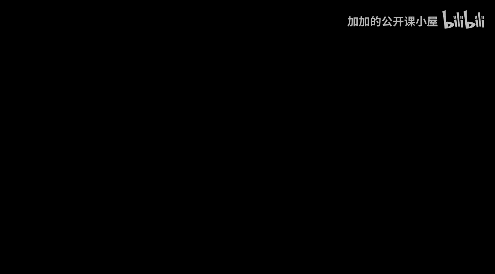
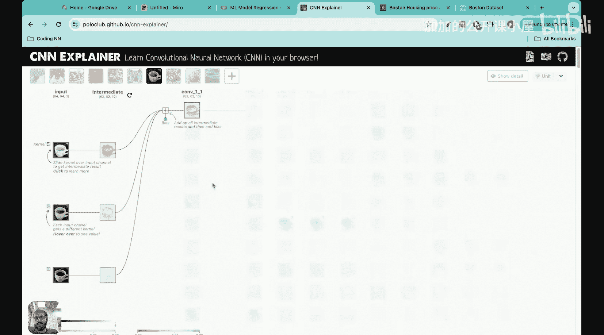

# Vizuara【中英⚡机器学习：实践教学｜Machine Learning： Teach by Doing】 p33 P33 Filtering Layers in Convolutional Neural Networks [BV1RusDz1EXd_p33]

Hello， everyone。Welcome to this lecture in the neuralural Network from Scratch series。

In the previous lectures on convolutional neural networks。

 we have looked at filters in two dimensions。And in the lecture before that。

 we looked in detail at filters in one dimensions。Today we are going to look at how to represent filtering layer in convolutional neural networks。

 so just like there are hidden layers in a feed forward neural network。

In convolutional neural network， there are different types of layers。

And one such layer is called as the filtering layer。Naturally。

 the filtering layer consists of filters。And we will look at the nomenature of how these filters are represented。

In neural networks， the neurons are there in each layer。And we stack them。Below。

Each other individual representation in convolutional neural networks， it's a bit different。First。

 let us revise the concept of filters which we saw in the previous class。

Imagine there is an image which is a 4 by4 image like this。

 there are some white pixels in this image and there are some dark pixels in this image。

What happens in the filtering layer is that we first choose the number of filters which we want in this layer。

So let's say I make the choice that I want four filters in this particular layer。

What is done is that these four pill filters are then applied。To the image。

So let's say that every filter which I have is2 by2 filter。

 this2 by2 filter then starts on this image and then it performs the convolution operation as it slides through this entire image。

And then when one filter operates， the size is a 4 by4 image。

But when four such filters operate on this base image。Then there are four four by four images。

So now we actually have a tensor whose dimension is 4 by4， multiplied by 4。And this depth。

Is called as the channel depth。If you want more details about essentially。

How the convolution operation is performed on every single section of the image。

 please look at the lectures， the previous two lectures in the convolutional neural networks part。

I just want to show you。Viual animation regarding how this convolution operation is performed。

 So let's say if you look at one particular filter。

 I told you that this filter star at a particular location and then slides through right and then it performs the convolution operation everywhere it goes which results in a4 by4 image and there are four such filters Let us look at the visual representation of this So here you can see that I have a coffee cup。

 So first what is done is that the coffee cup is divided into three channels， the red channel。

 the green channel and the blue channel。 So now I want you to focus on the red channel and I will show you how a particular filter is applied。

 What is done here is that on this red channel there are 10 filters which are applied1，2，3，4，56，7，8。

9 and 10 So let us see the result of applying each filter。So when I click on this。

 you will see what the filter it does。So here you can see the the filter slides over every pixel of the image and then it performs or then it outputs a resultant。

 which is a different。Ir， which is still it is still maintaining the size as the original image。

 but this is how the filtering operation is performed。

If you want to see it in more detail this is exactly how the filtering operation is performed so Ill move my cursor here it it's at the top left right now if you can see on the on this coffee cup image and and then I'll slowly move it to the right and I'll move it down and I'll slowly again move it to the left。

Whenever I' am posing it at every single moment， you can see the convolution operation which is being performed。

So what happens is that the filter drags through the entire image like this and then it produces a resultant image。

This is exactly what I have shown here every filter when it drags through the image and performs a convolution operation it produces a resultant image of the same size since there are four such filters will obtain a tensor which is 4 by4 by 4 right？

Now let's look at another filtering layer which operates on this Spsor。

So now this is my first filtering layer which I showed you now let me move to the second filtering layer。

Look at the second filtering layer and look at the input to the second filtering layer。

 the input is a4 by4 by4 tensor， right？So again I have to decide two things。

 I have to decide the number of filters I want in this layer and I also have to decide the dimension of each filter。

So lets say that I decide that the size of the filter which I want in the next layer is a 4 by 4 filter is a 2 by 2 filter。

So in the next filter。The size is 2 by 2， but remember that it cannot just be 2 by 2。

 I need to add the the channel depth also， so the filter。

 which Ill construct in this next layer will be 2 by 2 by 4 and why do I need to add the channel depth because now there is a tensor So here each the filter which went through this image or 2 d because this image or 2 d but now this is a tensor。

 So when I look at a filter it will be。Let me erase。Is4 by4 and mark it in orange color。

 So if I look at the filter in the second layer。Its a 2 by2 filter for sure。

 but it also has a depth dimension because it will go through all of the four images which are stacked in the tensor。

So then the dimension of the next layer filter will not just be2 by two， it will be 2 by two by 4。

So then this2 by2 by 4 will convve over this entire tensor right it will first start over here and then it will have this depth also so it will produce one output to value then it will go here and then it will go here and then it will go here so one such filter which is 2 by2 by 4 will produce an output which is 4 by 4。

So now you can see when one filter operates on this tensor since the filter also has the same depth。

As the tensor depth， the output， which is produced is 4 by 4。

But in this layer the second choice which we have to make is the number of filters which we want to use and if we decide to use 10 filters then each of those filters will create a 4 by 4 representation and so the output of this layer will be 4 by 4 by 10 there will be 10 channels if we decide to use 10 filters。

Let me go over this part again。Whenever we look at a filtering layer we have to decide two things we have to decide the number of filters and we have to decide the size of the filter so first the size of the filter will be 2 by 2 and remember that the depth is already fixed。

The depth of the filter has to be equal to the channel dimension of the previous layer output。So。

 the previous layer output has a channel dimension or channel depth of4。

 so the depth of the filters in this layer has to be4， so the size of the filter will be 2 by2 by 4。

This 2 by2 by 4 filter it will convulve through this entire tensor and when it convuls it will generated output which is 4 by 4。

The second choice which we have to make is the number of filters and if we decide to use 10 filters each filter will produce a 4 by 4 output so if we use 10 filters then the output will be 4 by 4 by 10。

So then this will be the output dimension of this filtering layer。

 and then we will do the same process again。So remember。

 if we were to do the same process in the next filtering layer。

 first we have to decide the size of the filter。And the size， let's say I use a three by three。

But again， remember that the depth of this will be fixed since the previous layer output has 10 channel depth。

 so the size of the filter has to be 3 by 3 by 10 and lets say if I use the number of filters as 20。

Then the output of this layer will be。4 by，4 by 20。是。

This is how filtering layer actually works in practice。

Please keep in mind this operation because the filtering layer is one of the most fundamental operations in。

The convolutional neural networks。Again， I would like to show you this animation and let me zoom out a bit over here。

 so lets say I have a coffee cup it is divided into three dimensions red， green and blue initially。

In each dimension，10 filters are applied， so let's look at again this let me。

