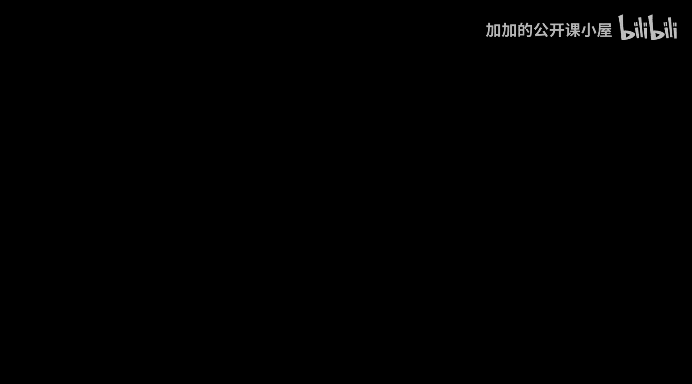
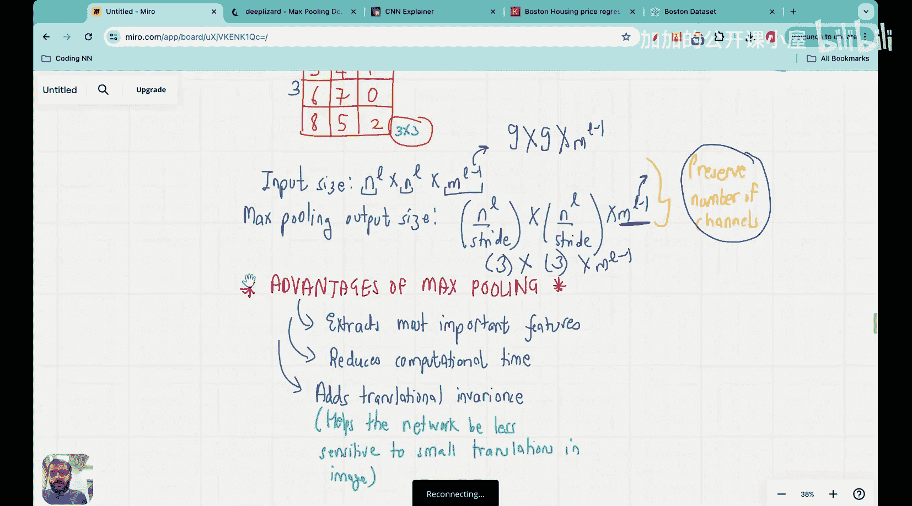

# Vizuara【中英⚡机器学习：实践教学｜Machine Learning： Teach by Doing】 p34 P34 What is Max Pooling in Convolutional Neural Networks？ [BV1RusDz1EXd_p34]

Hello， everyone。Welcome to this video in the Mach learninging Tea by Doing series。

Today we are going to learn about an important aspect in convolutional neural networks。

 and that is the max cooling layer。In the previous lecture， we have looked at another layer。

 which is called as the filtering layer。Which is one of the most important players in the CNN。

or convolutional neural network， however there is another layer which you will see when convolutional neural networks are implemented。

 let us try to understand everything about the max pooling layer。

 what it is and why is it used in the first place。So first let me start with the what is a aspect and then I'll tell you why max pooling layers are used in convolutional neural networks。

So the first thing to understand is that the filtering layer has some values right。

 which are the weights which need to be optimized。The max pooling layer does not have any weights。

There are just two parameters which are needed when we describe this layer first is something called as the stride。

And second is something called as the size。So lets say if this is the input image which I have。

 which is a 9 by 9 image and I have represented some pixel values which are randomly taken in each of the pixels。

 so there are 81 total pixels here。Let's say we want to pass this image through max pullinging layer。

 First question， which you should ask yourself， is what's the size。 If I say the size is 3 by 3。

Which means that I'll have this max pooling layer of three by three size。

 which I've shown here three rows and three columns。

The second thing which you should ask is the pride， the pride means。

How many steps we should leave before we move to the next max pooling layer。 So， for example。

 if the stride is equal to。If the stride is equal to0。

 it means that the max pullinging layer will slide without leaving any gap。

 so this is this will be my first max pullinging layer then。Let me show you where the second will be。

 this will be my second max pulling layer， then this will be my third max pulling layer， etc。

I'll slide similarly for the entire image， this is very similar to the convolutional operations trade which we use。

So sp equal to3 means that we will leave a gap of three， so if this is the first max pool layer。

 the second will be here。And the third will be over here。The fourth will be over here。

 the fifth will be over here，6 will be over here。 The 7 will be over here，8 will be over here。

 and 9 will be over here。So basically what this is doing is that it is leaving a gap so usually in max pooling layers the stride is the same as the size so the size is 3 by3 right so the stride will be typically be three which means that this will be the first max pooling layer then right next to it will be the second etc if the stride was zero then as I mentioned the second max pooling layer will be over here the third max pooling layer will be over here etc so it will just not leave any gap before moving ahead。

Okay， so once the stride and the size are specified。

 let me tell you what a max pooling layer does and it's very simple Basically we have these nine blocks right。

 this is the first max pooling block， this is the second max pooling block this the third max pooling block etc So we have these nine blocks what the max pooling layer does is that it looks at each block and takes the maximum value out of that block So for example you first look at the first block the maximum value is5。

And then year comes five。Then you look at the second block， the maximum value is4， so here comes4。

Then you look at the third block， the maximum value is1， so here comes one。Similarly。

 you look for all the blocks and you write down their maximum values so after you apply the max pooling layer to this input image the output image will be a much scaled down image。

 so this will be a 3 by3 image which is scaled down now right。

And then the output in this or every pixel in this output image will contain the maximum value in that corresponding block。

That's it。 The max pooling layer is as simple as that。

But you should understand that the stride and the size are very important if for example I use a max pooling layer of size equal to 2 and stride equal to2 it will be like this this will be my first block then this will be my second block then this will be my third block。

 this will be my fourth block etc。So then the output dimensions will defer that way。

If the input size is NL by NL by m minus1， then the max pool output layer size will be NL by stride multiplied by NL by stride multiplied by m minus1。

It's very important to keep in mind that the max pooling layer actually preserves the number of channels。

 So the number of channels was M L -1 in the input layer and in the output or in the input image in the output。

 the number of channels remains the same。 The only thing which max pooling changes is the。

leength and the width so in this case nL is equal to 3 right so in in in the case which I showed here I did not show the channel depth but basically it was 3 by 3 by ml minus1 sorry nl was equal to9 because in the original image we had a 9 by 9 image。

So NL is equal to 9 and the input size was 9 by 9 by m minus1， right？

Now the stride is equal to 3 and NL is equal to 9， so N L by sp will be 3 by9， 9 by 3。

 so it will be3 by 3 by ml minus1。And this is exactly what we see here these three rows and three columns。

 so the output size will be 3 by3 and the number of channel dimensions will actually stay the same。

This is what max cooling does to an image， it downscales the image。

 which means that it reduces the size of the image。And it just the operation， which max pooling。

Os on or the operation which max cooling applies on the input image is just that it takes the maximum value in every block which it sees。

 thats it。So， for example， if you have an image like this and if you have a max pooling which has which is2 by2 in size and with a sp of two。

 so typically it is assumed as I said that the sp is same as the dimensions or the size so then the first max pooling will be over this block the second will be over this。

The third will be over this。And the fourth will be over this。

And then we take the maximum in each block so in the first block the maximum value is 20 which is shown over here in the second block。

 the maximum is 30， which is shown over here in the third block the maximum is 112 which is shown over here and in the fourth block the maximum is 37 which is shown over here。

So this is the output value， which we have。Now let me show you an interactive animation of how max pullinging actually works。

 so Im going to go full screen in this animation and I'm going to hit play right now So what you should keep your attention on this green box over here that is the max pullinging block and it will slide across the image and wherever it it is that it will take the maximum so right now it at these four pixels which are all zero right so the output will be0 which is shown on the screen right now when I when I click on step you will see that it moves to the right。

And then the output is again0， then I click on step。

 then the max pullinging takes the maximum of these four values。

 so then I keep on a clicking step here you see now let me come to a place where the output will not be0。

Let me come over here here the four values are up 00。2。2 and 09， so the answer is 0。9 over here。

So if I continue clicking on step for this entire image。

 you will see that the resulting image first of all is a much lower origin because now we are dividing by4 remember the output dimensions are the input dimensions divided by the max pulling。

Size， which is 2。 So the output image here will be exactly half。呃。Of the input image。Yeah。

 so here is the output image， which has been shown。

If I click on play here you will see that it happens in a much faster manner overall here and if you calculate the length and the width of the output image you will see that it's half so the area of the output will be one fourth of the area of the input because the length of the output is half and the width of the output is equal This is how the max cooling layer actually operates Now let us look at the advantages of max cooling Why do people use the max cooling layer in the first place。

So the first advantage of maxpoing is that it extracts the most important features。So here you see。

 we take the maximum pixel value， right？