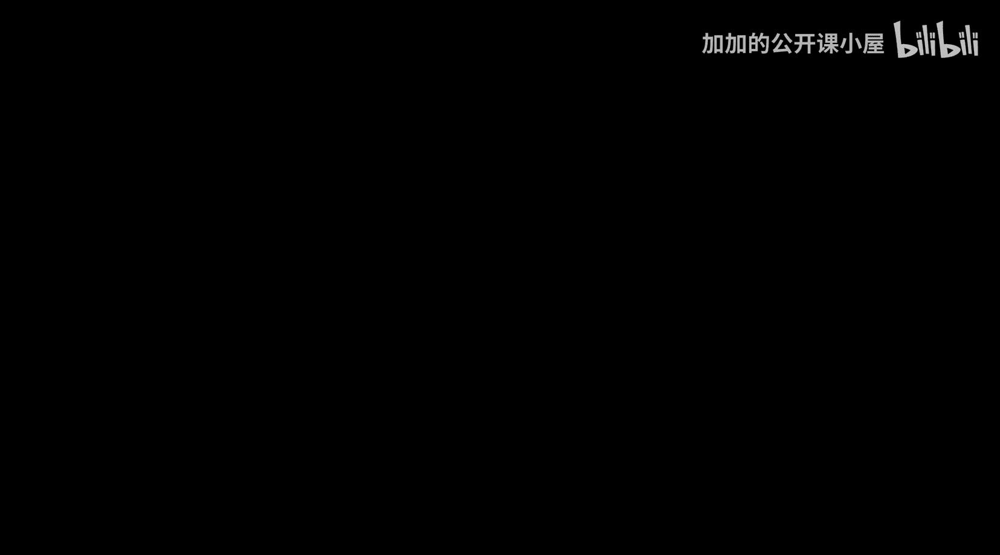
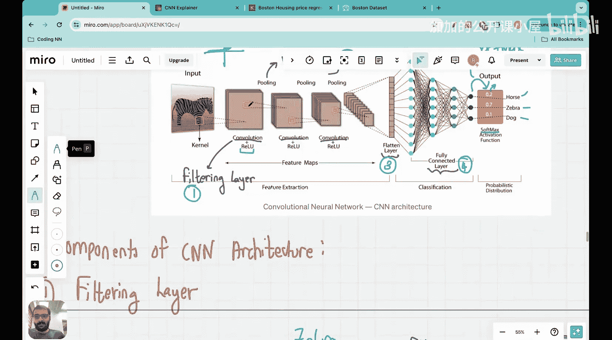

# Vizuara【中英⚡机器学习：实践教学｜Machine Learning： Teach by Doing】 p35 P35 CNN Architecture explained [BV1RusDz1EXd_p35]

Hello， everyone。Welcome to this lecture。In the machine learning each by doing series。Today。

 we are going to learn everything about the convolutional neural network architecture。

We have been preparing for this for the past two lectures in the previous lecture we looked at max pooling layer and in the lecture before that we looked at the filtering layer。

Now， we are ready to understand the entire。Convolutionional neural network architecture and all the components which it contains。

When you learn about CNNNs or when you take any CNN course。

 you will typically see that this is the figure which they start with and it's very difficult for students to understand because there are so many things going on here and it's difficult to understand what really to。

Or what exactly should I pay attention to over here in the first place？

So let's see what all the different components are here。

Here is the image the image is that of a zebra and then there are different things which are going on here。

 the first thing I want you to notice is that there is something which is written as convolution here。

 so convolution and convolution this is nothing but the filtering layer。

And we are going to revise what it means。人。There is a filtering layer and then there is something called as a pooling。

 this is nothing but the max pooling layer。So first the filtering layer is applied。

 then the max pooling layer is applied， then again the filtering layer is applied。

 then again the max pooling layer is applied。Towards the end。

 there is something called as the flatten layer and finally there is the fully connected layer。

So in terms of the components， if you look at the components there is first is the filtering layer number one second is the max pooling layer which is number two third is the flatten layer which is number three and fourth is the fully connected layer which is number four there are some other things which are going on here which are related to the activation functions。

 but those cannot be really called as components because they have been borrowed from neural networks and。

I'll tell them what they mean so there is this relu activation function over here and there is a softmax activation function over here So these are just nonlinear transformations。

 for example what the relu does is that it has so relu of x is this for x is less than0 it is 0 and for x greater than0 equal to x so after we take the convolution operation if some negative filter values are there they are put to0 and the positive filter values stay as it is or the positive output values stay as it is and the negative output values are put to 0 So Somax is needed because this is a classification problem so if there are classes such as horse zebra and dog and we want to class among these three things among these three animals which one of these three animals does this image is closest2 so here if we see that horse is 0。

2 zebra is 0。7 and dog is 0。1 which means that there is 0。P probability that that it's a horse。

 70% probability that it's a zebra and 10% probability that it's a dog。

So between this output layer and these probabilistic values。

 there is something called as the softm layer。The main purpose of this lecture is to。

Give a broad overview of these four building blocks， the filtering layer， the max pooling layer。

 the flatten layer， and the fully connected layer。Let's start understanding what each of these layers actually mean。

This will be a revision based on the previous lecture so it will be good to revise all of these concepts also so whenever you see a filtering layer like this like this。

 remember what is happening is that we have an image over here。呃。

And let's say that image typically has number of channels， right？So let me start out like this。

 so let's say this is a zebra image。This is a4 by4 image。

 let's say and first what is done is that the filters are applied。

 the number of filters are decided and so each filter each filter so lets save the filter size is 2 by 2。

This2 by 2 filter is applied over this image and then it convals over this entire image and it produces a 4 by 4 output。

There are four filters over here so it will produce a tensor which is4 by 4 by 4 that's what a filter operation essentially does so whenever you look at a filtering layer ask yourself two questions first what is the size of the filter in this case it's 4 by four second how many filters I want to use and here in this case we are using four filters。

Visually， let's see what this means so。Let's say I have a coffee cup here and I told you the filtering operation right So in this layer I said the first question I ask is I want how many filters do I want so I say that I want 10 filters 1。

2，3，4，5，6，78，9 and 10 great second what is the size of the filter let's say I want2 by two filter now let's see what the first filter does When I go over to the first filter you will see that it slides over this image and produces the output image if I click over here we can actually observe this operation in a lot more detail so let me click let me click on this image and。

Here you can see this operation so let's say I have 10 filters and let's say the size of the filter is3 by 3 and then you can see I'm sliding over here right now with my cursor and you can see that a corresponding output is being generated here。

So you can see that every filter， so this is one filter。

 one filter convves over this entire image and generates an output which is the same size of the image。

 so let me play this animation here so here you can see now the animation。

The animation is playing try looking at the filter as it is moving from left to right on the spleen and the output where it is moving。

So this is what every filter does every filter does the convolution operation and produces the output as the same size of the image what is really important is the number of filters because the number of filters are going to determine the depth。

 for example。Here I'm using 10 filters， right？Here I am using 10 filters and let's say if the input is 64 by 64 if I use 10 filters。

 it means the output is a tensor which is 64 by 64 by 10。That is the output of the filtering layer。

 so first always decide the number of filters and second always decide the size of the filter。

This is what is happening in a filtering layer let me try to explain this in the form of tensors so let's say the output of one layer is 4 by 4 by4 since there are four filters。

And now you want to apply one more filtering layer。 So first， you decide the size of the filter。

 and this will be a 2 by 2 by 4 filter because remember， the input size is 4 by 4 by 4。

 So the filter also has to be a tensor。 So the filter will be。Let me use orange color。And。

I'll erase this。So in this layer， let's say。Yeah in this layer let's say I am going to use a filter which is2 by 2 but I also need to conval will the depth so the filter also has to have the depth of4 so the filter which I am choosing here is2 by2 by4 this filter will conv over all of all of this tensor and produce an output which is 4 by 4。

I also have to decide the number of filters so if in this layer I am willing to use 10 filters。

 the output of each filter is 4 by 4 and I am using 10 filters so the resant output will be 4 by 4 by 10。

This is what is happening when you consider a filtering layer。

 when you consider a filtering layer the number of filters are chosen。

 the size of each filter is chosen and the output is determined。So。

 whenever you look at a filtering layer like this， whenever you look at a filtering layer like this。

 I want you to imagine this visual layer。So specifically I want you to think of this this visual over here on the right hand side of the screen。

 the animation which is playing the filter is hovering and then it is performing the convolution operation and the output is being generated This is exactly what is happening and what is this filter doing every filter here is detecting some specific feature so there are 10 filters here right maybe this filter maybe this filter is determining the。

Edges of this coffee， maybe this filter is determining the curve shape of the handle。

 maybe this filter is determining the liquid texture which is present in the coffee So every filter here has a specific purpose and when it's trained it will do the task of identifying the particular feature。

That is the advantage of the filtering layer， the filtering layer extracts features from the image which is fed to the filtering layer。

Now along with the understanding of the filtering layer the nomenicclature is also very important。

 there are three things actually which you need to fix the number of filters we discussed about this。

 the size of the filters we discussed about this， but there is one more parameter which need to be fixed and there is the stride。

So when a filter operates on an image， always the output image won't be the same size as the input if the stride is equal to 2。

 for example， when the。