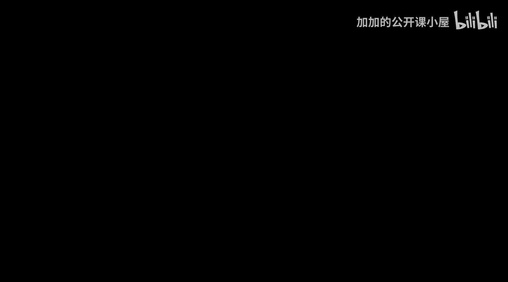

# Vizuara【中英⚡机器学习：实践教学｜Machine Learning： Teach by Doing】 p36 P36 Backpropagation in Convolutional Neural Networks [BV1RusDz1EXd_p36]

Hello， everyone。Welcome to this video in the Ma learning， teach by Doing series。

In the previous videos we have looked at the convolutional neural network architecture in a lot of detail。

 we looked at the four building blocks filtering layer， max pooling layer。

 flatten layer and fully connected layer。And we saw how these building blocks are arranged。

To make a convolutional neural network diagram or schematic， which looks like this。

Usually an input image is pass through a number of layers， such as a filtering layer。

 then a pooling layer。So this is the filtering layer。Let me mark it with a different color。

Yeah so this is the filtering layer then we have a pooling layer then another filtering layer。

 then another pooling layer， the filtering layer is also referred to as convolution with a re activation function then we do this filtering pooling filtering pooling multiple times until we have the flatten layer and then a fully connected layer towards the end。

Thats the convolution neural network architecture， and we discussed that there are two building blocks whose parameters we need to optimize。

First is that when we look at every filtering layer or a convolution。

 there are filters and the shape of the filters might be a tensor shape like this。So this。

 for example， might be a three by three by four filter。And when we look at filter， they carry well。

Pot1，2， etc cetera。So these are the values which need to be optimized。

 so every filtering or convolution layer will have filter values which need to be optimized。

The pooling layer does not have any values， because we just take the。

The pooling layer does not have any parameters， I should say。

 because we just take the maximum value of the input so there is nothing to optimize in the pooling layer。

 the flatten layer also there is nothing to optimize。

The fully connected layer has weight and biases similar to how traditional neural network has。

 so there are two main layers whose parameters need to be optimized the filtering layer which is also called convolution over here and the fully connected layer。

For the purposes of this lecture， I am going to denote these combined parameters by a variable which is called S W。

So well need to optimize all the parameters W so that。

The output here shows that it's a maximum probability of what's actually present in the input。

 so for example， if the input is that of a zebra and then the output has three classes horse。

 a zebra and dog， these parameters W should be such that the maximum probability is for a zebra and lower probabilities will be for the horse and for the dog。

Today we are going to see how we optimize the weights of a convolutional neural network。

This is not going to be a very deep theoretical lecture and I'm not going to show mathematical calculations。

 this will be more of an overview lecture so that you get an understanding of how back propag and gradient descent is implemented as always in this series will take a practical example for me to demonstrate that to you。

Later I'll be making a more deep dive into the mathematics of CNNs。

 but if you're preparing for interviews and if you want to master CNN。

 this much part of the lecture should be enough。So to understand how the weights of a convolutional neural network are actually optimized。

 one thing which you need to understand is that ultimately the CNN is just a mathematical function which looks like this。

It takes the image as the input。And the weights are the values in the filtering layer and the fully connected layer。

 so we need to optimize these weights。So the strategy which will be following is very similar to what we did for a traditional neural networks we first found the loss。

The loss value between the predicted what is the prediction of the c and what is the actual output so we first find the loss。

Let me write this year we first find the loss and the loss depends on two factors。

The loss depends on the prediction。And the true value。

And then what we will be doing is that we will find the partial derivative or the gradient of the loss with respect to all the parameters。

And then using gradient decentrups will be updating each parameter So， for example。

 there is a parameter called W1 what we will be doing is that we will be updating it in every iteration we update it。

Like this， so this is vanilla gradient descent。And there are of course。

 advanced optimizers build on top of this， which add momentum。

 then there is AdamM and there is RMS Pro also。So using one of these optimizers。

 which are all variations of the simple gradient descent。We will iterate all the parameter values。

And eventually we will optimize these parameters so that the loss is reduced。

To do these optimizations， one very important thing which we need is to find the partial derivative of the loss with respect to all the parameters or the gradient of the loss with respect to the parameters。

So， the strategy which we will be implementing is actually exactly similar to that of neural networks we will find the partial derivative of loss with respect to the parameters that step number one and step number two is that will update the weights through gradient and descent methods。

Now， one thing to note is that let's look at this diagram again and let me actually erase。

Some of these。Marks， which have been made here that so that I can explain。

This next step in a clear manner。O。So。Let me again switch back to the pen。Okay great。

 so now let us look at finding the partial derivative of the loss with respect to the weights。

 so lets say if I want to find the partial derivative of the loss with respect to the weights in this filtering layer。

So for that we need to do back propagation， so Ill need to find the partialian derivative of the loss with respect to the inputs to the flatten layer。

 then Ill need to find the partialian derivative of the pooling layer output with the pooling layer input then Ill have to find the partialian derivative of the filtering layer output with the input and so on and so forth until I reach the final layer。

So you will notice that there are two partial derivatives which we need if there is the if there is a pooling layer。

And there is an input to the polling layer， which is x。

And then there is an output to the pullinging layer which is let's say Z will need the partial derivative of Z with respect to x。

And if there is a。Filtering layer。And if the input to the filtering layer is x and the output is z。

 then we will need the partial derivative of Z with respect to x。

So in pooling what we actually do is take the maximum of all the pixels and it turns out that it is actually quite easy to find the partialian derivative of the maximum operator I am not going to go through the details of that right now but keep in mind that it's possible the second thing which happens in the filtering is that if you look at filter it just a dot product right if I have this as my input。

And。If I have a filter， the filter will slide through this input and it will perform the conation operation。

 which is at the heart of it just a dot product。So finding the partial derivative of the filtering output with the input actually boils down to finding the derivatives through this dot product and that is completely possible。

So at the end the only difficult things which are new here are the partial derivatives through the max operation and the partial derivatives through the dot product both of which are completely possible to do everything else which we see here we have already encountered in neural networks and we have already found partial derivatives for example we know how to handle relu we know how to handle soft Mac and we know how to handle fully connected layers。

So with this。We can actually handle the entire convolutional neural network architecture and find gradient。

As I mentioned earlier， I'll be making separate lecture on the mathematics of finding gradient through the max pooling layer。

 through the flattening layer， through the filtering layer， etc。But for now。

 just keep in mind that we just have dot products。For the filtering layer and max。

Or the max operation or the max cooling layer， and we can easily differentiate both of them。

So that's why back prop progression is completely possible and as a result。

 step one is completely possible to execute for the convolutional neural network。

So this is the intuition behind how we optimize the weights。In a CNN。

 So next time let's say if you look at an interface like teachable machine。

 Google's teachable machine allows you to distinguish between any two types of varieties。

 For example， you can distinguish between let's say the first category。

